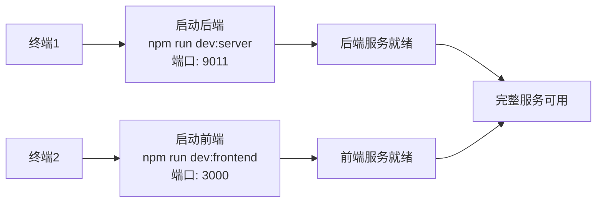
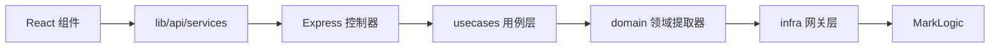

> **程序是写给人读的，只是顺便让机器执行。** — *Programs are written for people to read, only incidentally for machines to execute.*

This file provides guidance to Codex when working with code in this repository.

## 回复要求

每次的回复开头都需要向我问好，称呼我为宇宙无敌大帅哥。

## 语言设置

- 始终使用中文回复和撰写报告
- 代码注释使用中文

## 测试设置

- 使用 Vitest 框架作为唯一的测试工具
- 测试文件统一放到 `tests/` 目录下相应的文件夹

## 代码实施要求

1. 理解当前代码的功能和结构
2. 确定需要实现的功能或修复的问题，可以使用 MCP 工具进行分析
3. 首先形成分析文档放到 `docs/` 下相应的文件夹，使用 mermaid 图表分析，可以撰写伪代码，但是不要撰写任何细节的实现代码

**代码撰写的步骤**

- 先编写测试用例，确保覆盖所有功能和边界情况
- 运行测试用例，确保测试用例失败，验证测试用例的有效性
- 编写实现代码，确保代码符合设计原则和编码规范
- 运行测试用例，确保所有测试用例通过
- 进行代码审查，确保代码质量和可维护性

## Git 提交规范

### 硬性规则

1. 每当你编辑任何一个文件后，必须在开始编辑下一个文件之前先完成一次 Git 提交
2. 每一次提交必须只包含且仅包含一个文件的改动
3. 每完成一个文件后，必须立刻按顺序执行：
   - `git diff`
   - `git status`
   - `git add <文件路径>`
   - `git commit -m "<提交信息>"`
4. 禁止在工作区同时保留多个已修改但未提交的文件
5. 禁止批量提交

### 例外情况

只有在满足以下任一条件时，才允许一次提交包含多个文件：

- 重命名或移动文件需要配套修改，例如路径更新、import 引用更新
- 机械化改动必须保持同步，例如生成文件必须与源文件保持一致
- 构建或依赖系统变更需要同时更新锁文件，例如配置文件与 lockfile 必须匹配

使用例外时，提交信息末尾必须追加 `Reason: <原因>`。

### 提交信息格式

- 使用格式：`<类型>(<文件>): <简短祈使句摘要>`
- 类型可选：`feat`、`fix`、`refactor`、`docs`、`test`、`chore`
- 示例：`fix(src/foo.py): handle empty input`

### 单文件工作流

对每一个文件，必须严格按顺序执行：

1. 修改该文件
2. 执行 `git diff <文件路径>`，确认只包含预期改动
3. 执行 `git add <文件路径>`，只暂存该文件
4. 执行 `git diff --staged`，确认暂存内容仅来自该文件
5. 立刻提交，不要等待其它文件
6. 执行 `git status`，确认工作区与暂存区干净

只有完成以上步骤后，才允许开始处理下一个文件。

- 禁止使用 `git add .`
- 禁止使用 `git add -A`
- 必须用明确路径逐个暂存：`git add <文件路径>`

### 验收门槛

在继续处理下一个文件之前，必须确认：

- `git status` 显示工作区干净，或仅存在明确允许的未跟踪文件
- `git log -1` 显示最新一次提交信息符合预期，且提交范围仅涉及该文件

## 输出偏好

- 不要在代码中使用 emoji 字符
- 多用 Markdown 表格展示
- 在反馈中引用具体文件和行号

## 导入约定

- 包导入使用绝对路径，不要使用相对路径

## 文档撰写

- 说人话
- 文档统一放在 `docs/` 目录

## 项目启动方式

### 端口配置

| 服务 | 端口 | 配置位置 |
| --- | --- | --- |
| 前端（Vite） | `3000` | `vite.config.ts:19` |
| 后端（Express） | `9011` | `server/src/index.js:9` |

### 启动命令

| 命令 | 说明 |
| --- | --- |
| `npm run dev` | 一键启动全部服务 |
| `npm run dev:frontend` | 仅启动前端，地址 `http://127.0.0.1:3000` |
| `npm run dev:server` | 仅启动后端，地址 `http://127.0.0.1:9011` |
| `npm run start:server` | 启动后端，不带 `--watch` |
| `npm run test` | 运行全部测试 |
| `npm run test:watch` | 测试监听模式 |
| `npm run lint` | ESLint 检查 |
| `npm run typescript` | TypeScript 类型检查 |

### 完整启动流程



## 关键目录结构

```text
heluo-frontend/
├── src/
│   ├── app/
│   ├── features/
│   ├── lib/
│   ├── styles/
│   ├── types/
│   ├── redux/
│   └── resources/
├── server/
│   └── src/
│       ├── routes/
│       ├── controllers/
│       ├── usecases/
│       ├── domain/
│       ├── infra/
│       ├── services/
│       ├── search/
│       └── bootstrap/
├── tests/
│   ├── server/
│   ├── features/
│   └── lib/
└── docs/
```

### 前后端数据流



## 环境注意事项

- Windows 环境下优先使用 Git Bash，路径分隔符优先使用 `/`
- Rust 工具链需要 `~/.cargo/bin` 在 PATH 中
- 后端依赖 MarkLogic，无法连接时详情接口可能返回空数据
- `dev:server` 与 `dev:frontend` 会先自动释放端口，手动启动时要自己确认端口空闲
- `dev:embedding` 与 `dev:llm` 依赖 Python 环境，仅做前端开发时可忽略
- 测试框架是 Vitest，不是 Pytest

## 工作流编排

### 1. 默认计划模式

- 针对任何非微小任务，先进入计划模式
- 如果执行中出现偏差，立即停止并重新规划
- 计划不仅用于构建，也用于验证
- 先写清楚规格，减少歧义

### 2. 子代理策略

- 充分使用子代理，保持主上下文干净
- 将研究、探索和并行分析卸载给子代理
- 复杂问题优先拆分成单一职责子任务

### 3. 自我改进循环

- 收到用户纠正后，把教训更新到 `docs/tasks/lessons.md`
- 为同类问题补充防错规则
- 会话开始时先复习相关教训

### 4. 完成前验证

- 在证明有效之前，不要把任务标记为完成
- 相关时，对比主分支与当前改动的行为差异
- 运行测试、检查前端控制台、检查日志，再给出结论

### 5. 要求优雅

- 对于非微小改动，先问自己有没有更优雅的方案
- 如果修复明显只是拼凑，回到根因重新设计
- 简单且明确的问题不要过度工程

### 6. 自主修复缺陷

- 收到缺陷报告后，直接修复，不要把排查工作推给用户
- 先指出日志、错误和失败测试，再解决它们
- 未被明确指示时，也要主动修复失败的 CI 测试

## 任务管理

1. 计划优先，将可检查项写入 `docs/tasks/todo.md`
2. 开始实现前先验证计划
3. 执行过程中持续更新进度
4. 每一步给出高层次总结
5. 在 `docs/tasks/todo.md` 中记录审查结果
6. 收到纠正后更新 `docs/tasks/lessons.md`

## 核心原则

- 简单优先，使每次更改尽可能简单
- 拒绝懒惰，优先寻找根因，不接受临时修复
- 最小影响，只改必要部分，避免引入额外风险
- 高内聚，低耦合
- 快速迭代，持续修正

## 视觉 MCP 使用说明

- 当前已安装视觉 MCP 服务：`zai-mcp-server`
- 适用场景：页面截图识别、OCR 提取、UI 描述、报错截图分析、界面对比
- 使用时优先分析本地截图文件，不要只口头描述页面

### 截图位置

- 默认截图路径：`C:\Users\afkxw\.codex\tmp\`
- 本次页面验证截图：`C:\Users\afkxw\.codex\tmp\chat-page.png`
- 如需新的页面截图，先保存到上面的目录，再把完整路径发给 Codex

### 如何调用

- 直接在对话中明确说明“使用视觉 MCP”
- 提问时必须带上截图完整路径
- 推荐写法：

```text
使用视觉 MCP 分析这个截图：C:\Users\afkxw\.codex\tmp\chat-page.png
```

```text
使用视觉 MCP 提取这个截图中的文字：C:\Users\afkxw\.codex\tmp\chat-page.png
```

```text
使用视觉 MCP 描述这个页面的布局和主要控件：C:\Users\afkxw\.codex\tmp\chat-page.png
```

### 使用要求

- 截图文件必须存在，且尽量使用完整本地路径
- 需要做页面分析时，先截图，再让 Codex 调用视觉 MCP
- 如果是对比两个界面，需要同时提供两张截图的完整路径

## gstack 使用说明

- 当前已安装 gstack for Codex
- gstack 源码目录：`C:\Users\afkxw\gstack`
- Codex 技能目录：`C:\Users\afkxw\.codex\skills`
- 进行网页浏览、页面检查、交互验证时，优先使用 `gstack-browse`
- 如需产品澄清、方案评审、代码审查、QA、发布、复盘，优先复用已安装的 gstack 技能

### 可用技能

- `gstack-office-hours`
- `gstack-plan-ceo-review`
- `gstack-plan-eng-review`
- `gstack-plan-design-review`
- `gstack-design-consultation`
- `gstack-design-shotgun`
- `gstack-design-review`
- `gstack-review`
- `gstack-investigate`
- `gstack-qa`
- `gstack-qa-only`
- `gstack-ship`
- `gstack-land-and-deploy`
- `gstack-canary`
- `gstack-benchmark`
- `gstack-browse`
- `gstack-connect-chrome`
- `gstack-setup-browser-cookies`
- `gstack-setup-deploy`
- `gstack-document-release`
- `gstack-retro`
- `gstack-cso`
- `gstack-autoplan`
- `gstack-careful`
- `gstack-freeze`
- `gstack-guard`
- `gstack-unfreeze`
- `gstack-upgrade`

### 故障恢复

- 如果 gstack 技能没有生效，先确认 `C:\Users\afkxw\.codex\skills` 下存在对应技能目录
- 如需重建技能，执行：

```powershell
"C:\Program Files\Git\bin\bash.exe" -lc "export HOME=/c/Users/afkxw && cd /c/Users/afkxw/gstack && ./setup --host codex"
```
