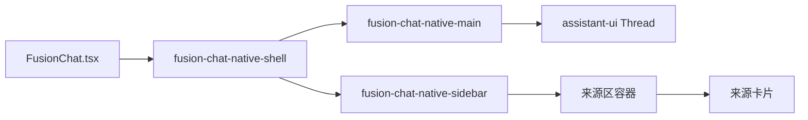
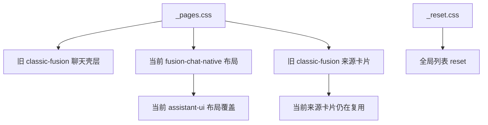
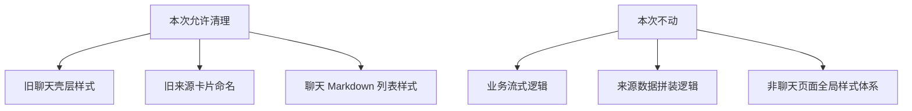

# AI 聊天界面样式遗留与潜在冲突检查

## 背景

当前融合问答页面已经切换为 `assistant-ui` 原生线程布局，但样式层仍保留部分历史命名和全局覆盖规则。

本次目标：

1. 找出已经脱离当前 DOM 的聊天壳层样式。
2. 找出仍在运行路径上但命名已不一致的样式。
3. 找出可能影响 `assistant-ui` Markdown 或后续升级的潜在冲突。

## 当前结构

## 遗留样式分层

## 发现

### 1. 旧聊天壳层样式已脱离当前页面

`classic-fusion-wrapper`、`classic-fusion-layout`、`classic-fusion-chat`、`classic-fusion-messages` 等选择器仍然保留在 `_pages.css` 中，但当前页面已不再渲染这些类名。

影响：

- 增加样式文件理解成本。
- 容易误导后续维护者，以为当前页面仍依赖旧壳层。
- 一旦旧类名被误复用，旧布局会被整段重新激活。

### 2. 来源卡片仍沿用旧命名

右侧来源栏已经切到 `fusion-chat-native-*`，但来源卡片节点仍使用 `classic-fusion-evidence-*`。

影响：

- 布局层和组件层命名不一致。
- 后续清理旧样式时容易误删仍在使用的卡片样式。
- 样式职责边界不清晰。

### 3. 全局列表 reset 可能影响 Markdown

`_reset.css` 里对 `ul, ol` 统一设置了 `list-style: none`。

影响：

- 如果 Markdown 渲染层没有重新定义列表样式，聊天正文中的项目符号和编号可能消失。
- 这是全局规则，影响面不只聊天页面。

### 4. assistant-ui 内部类名覆盖存在升级脆弱性

当前页面直接覆盖 `.aui-thread-root`、`.aui-thread-viewport`、`.aui-user-message-root`、`.aui-assistant-message-root` 等内部类名。

影响：

- 现版本可用，但未来升级 `assistant-ui` 时，类名或结构调整会导致布局静默失效。

## 建议处理顺序

1. 删除未使用的旧聊天壳层样式，只保留当前来源卡片仍实际依赖的样式。
2. 将来源卡片样式迁移到 `fusion-chat-native-*` 命名，消除混用。
3. 为聊天 Markdown 明确补齐列表样式，避免被全局 reset 吃掉。
4. 将 `assistant-ui` 的覆盖收敛到最少必要集合，减少对内部结构的绑定。

## 本次清理边界

