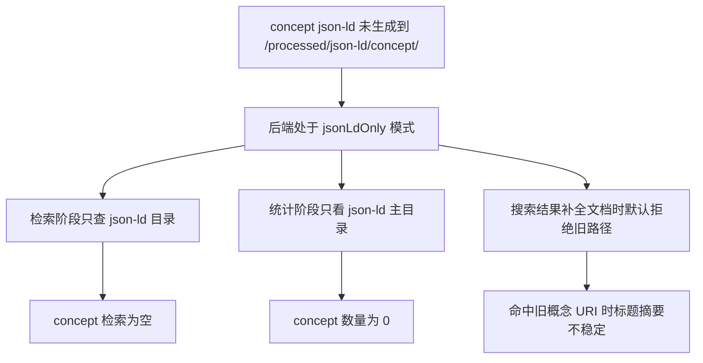

# 古籍编目 concept 缺失时的后端回退方案

## 问题概述

当前后端默认开启 `HELUO_JSONLD_ONLY=1`，概念资源主目录固定为 `/processed/json-ld/concept/`。

当古籍编目相关 concept 文档尚未生成到该目录时，会出现以下连锁问题：

- `concept` 检索直接返回空
- 首页 `concept` 统计可能为 `0`
- 搜索结果即使从旧集合命中，也可能在详情补全阶段读不到文档

## 根因分析

## 修复目标

- 在 `concept` 维度保留 `json-ld` 优先策略
- 当 `json-ld` 目录无数据时，允许回退到旧概念集合
- 搜索结果补全文档时，允许读取旧概念 URI
- 统计接口在 `concept` 目录为空时，允许回退到旧概念集合口径

## 约束

- 不放宽 `person`、`poem`、`book`、`place`、`ancient_book` 的 `jsonLdOnly` 行为
- 不修改前端展示协议
- 仅修复 `concept` 缺失时的兼容链路

## 实施步骤

| 步骤 | 说明 | 预期结果 |
| --- | --- | --- |
| 1 | 先补集成测试，复现 `concept json-ld` 缺失场景 | 测试先失败 |
| 2 | 调整 `concept` 检索回退逻辑 | `/api/v1/search` 可返回旧概念结果 |
| 3 | 调整搜索结果补全文档逻辑 | 搜索项标题、摘要稳定 |
| 4 | 调整统计接口回退逻辑 | `/stats/entity-counts` 不再把 concept 统计为 0 |
| 5 | 运行相关 Vitest 用例 | 回归通过 |
