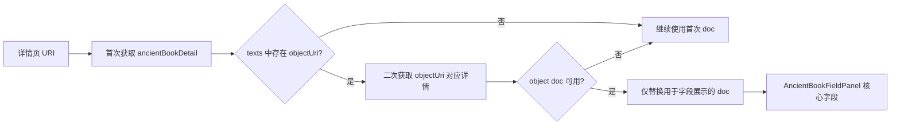

# 古籍详情核心字段改为 Object 数据优先方案

## 背景
当前古籍详情页的“古籍核心字段”由 `entity=detail.doc` 驱动。  
当详情入口 URI 来自 `book_entry/txt` 时，`doc` 往往不是 `ancient_book_object` 文档，导致核心字段展示与预期不一致。

## 目标
- 古籍详情“核心字段”优先使用 `ancient_book_object` 的 `doc` 数据。
- 保持现有详情页主链路稳定：卷文本、层级、IIIF manifests、卷列表等能力不回归。
- 无可用 object 文档时，自动回退到当前文档，避免页面空白。

## 现状链路
```mermaid
flowchart LR
  A[详情页 URI] --> B[fetchDetailByResource ancient_book]
  B --> C[/api/v1/ancient-books/:id?uri=sourceUri]
  C --> D[返回 ancientBookDetail.doc]
  D --> E[useDetailData.entity]
  E --> F[AncientBookFieldPanel]
  F --> G[古籍核心字段]
```

## 调整后链路（Object 优先）


## 方案说明
1. 在详情服务层新增“从卷列表提取 objectUri”与“从 objectUri 提取 id”的轻量解析能力。
2. 古籍详情首次返回后，若存在 `objectUri`，尝试二次请求对应 object 详情。
3. 仅在二次请求成功且拿到有效 `doc` 时，替换最终返回模型中的 `doc` 字段。
4. 其他字段沿用首次结果，确保页面整体语义稳定。

## 边界情况
- `texts` 为空或全部无 `objectUri`：不触发二次请求。
- `objectUri` 存在但二次请求失败：静默回退，不影响详情页加载成功。
- `objectUri` 非标准路径，无法提取 id：不触发二次请求。
- 二次返回 `doc` 为空对象：不替换。

## 测试计划（先测后改）
1. 新增单测：首次返回 set/txt doc，且存在 `objectUri`，应触发二次请求并以 object doc 作为最终 `doc`。
2. 新增单测：无 objectUri 时不触发二次请求。
3. 新增单测：二次请求失败时应回退首次 `doc`。

## TODO LIST
- [ ] 增加 detailService 古籍 object 优先单测（先失败）。
- [ ] 实现 detailService object 优先逻辑。
- [ ] 运行相关 Vitest，确认新增与回归用例全部通过。
- [ ] 复核古籍详情页核心字段与 IIIF 区块显示是否一致。
