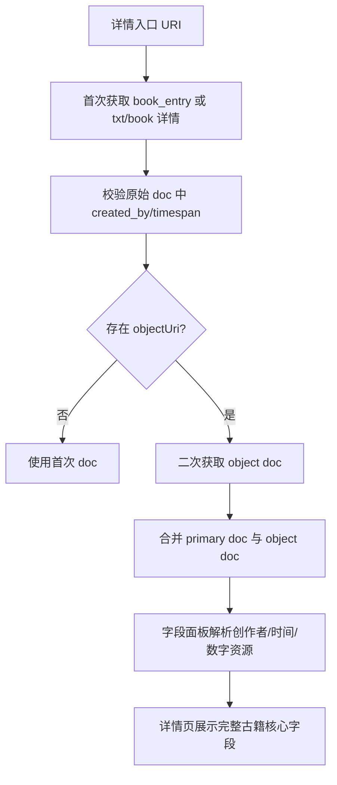

# 古籍详情创作者与时间缺失排查及修复方案

## 背景
当前古籍详情页没有稳定展示创作者与相应时间。  
已知古籍详情存在多层数据来源，至少包括：
- `book_entry` 书目层
- `ancient_book_txt` 文本层
- `ancient_book_object` 载体层

现有前端链路会在拿到古籍详情后，优先切换到某个 `object` 文档作为字段展示数据源；但字段面板本身又没有解析创作者与时间，导致即使原始数据里存在相关信息，页面也无法展示。

## 问题假设
1. 创作者与时间可能位于 `book_entry.created_by`。
2. 某些卷级或载体级补充信息可能位于 `object.created_by` 或 `object.timespan`。
3. 当前“只保留 object doc”的策略会覆盖掉书目层已存在的创作者与时间。

## 现状链路
```mermaid
flowchart TD
  A[详情入口 URI] --> B[/api/v1/ancient-books/:id]
  B --> C[返回 ancientBook.doc]
  C --> D[detailService 二次拉取 object doc]
  D --> E[直接替换最终 doc]
  E --> F[AncientBookFieldPanel]
  F --> G[仅渲染 名称/实体类型/数字资源]
```

## 目标链路


## 原始数据校验重点
- 检查 `book_entry` 原始文档是否含 `created_by.carried_out_by`
- 检查 `book_entry.created_by.timespan` 是否存在
- 检查 `ancient_book_object` 原始文档是否补充了 `created_by`、`timespan`、`identified_by`
- 明确两层数据的职责：
  - 书目层更可能承载作品层创作者与年代
  - 载体层更可能承载卷级标题、影像资源、对象元数据

## 修复策略
1. 不再把 `object doc` 当作唯一真源，而是作为补充来源。
2. 前端详情服务对古籍采用“主文档优先、object 文档补充”的合并策略。
3. 古籍字段面板新增创作者与时间解析：
   - 优先读取 `created_by.carried_out_by`
   - 时间优先读取 `created_by.timespan`
   - 如无，再回退 `timespan`
4. 保持现有 IIIF、卷文本、卷列表与层级逻辑不变。

## 边界情况
- `objectUri` 不存在：仅使用首次文档。
- `object` 请求失败：静默回退首次文档。
- `object` 文档只有标题、无创作者/时间：不得覆盖首次文档的有效字段。
- `created_by` 为数组或对象两种形态：解析逻辑都要兼容。
- `timespan` 可能只有 `_label`，也可能只有首尾边界：字段展示要兼容两种形态。

## 测试计划
1. 先补 `detailService` 单测，覆盖“主文档与 object 文档合并后保留创作者/时间”。
2. 补字段解析单测，验证古籍字段面板能显示创作者与时间。
3. 运行古籍详情相关测试，确保 IIIF 与卷文本逻辑无回归。

## TODO LIST
- [ ] 校验本地后端原始古籍文档中 `book_entry` 与 `object` 的字段分布
- [ ] 新增 detailService 合并策略测试
- [ ] 新增古籍字段解析测试
- [ ] 实现古籍 doc 合并与字段展示
- [ ] 运行相关测试并复核详情页展示结果
