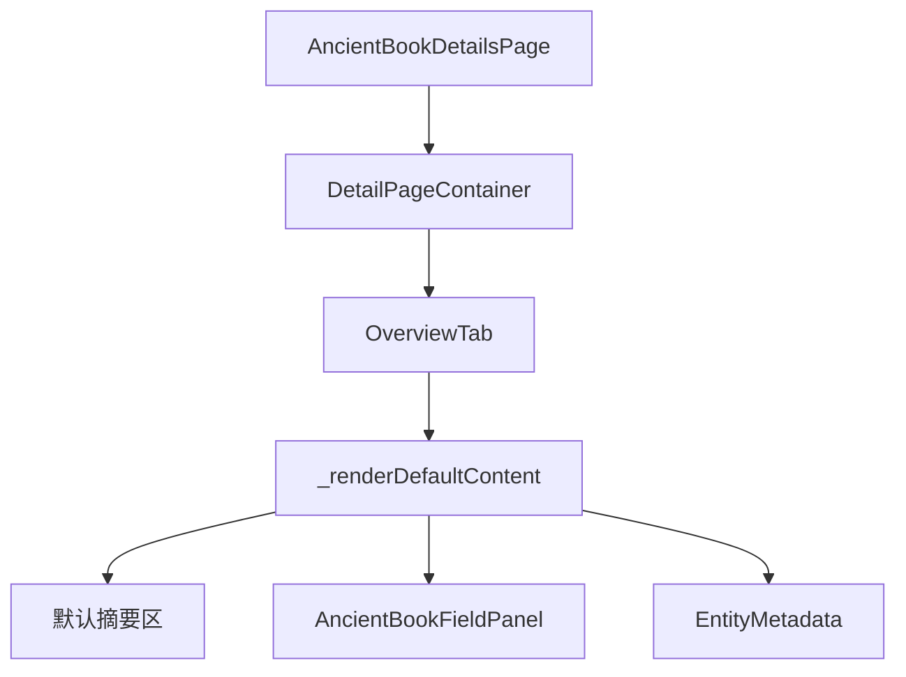
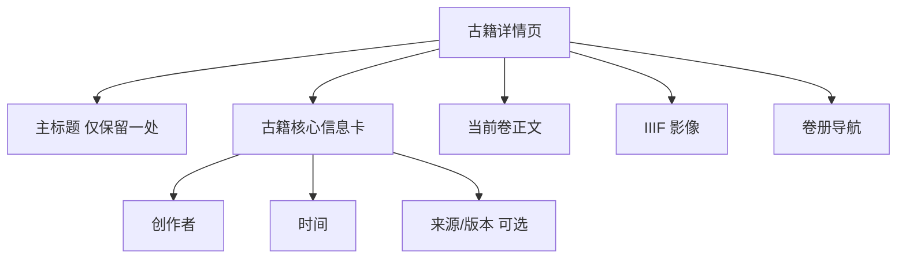

# 古籍详情页内容收敛与核心信息突出方案

## 背景
当前古籍详情页已经补齐了创作者与时间解析，但页面仍存在以下问题：
- 默认摘要区仍会展示
- 古籍标题会在多个区域重复出现
- “实体类型”等技术性字段可读性弱
- 古籍详情仍沿用默认详情布局，页面重点不够集中

用户当前诉求是：
1. 在古籍详情界面明确展示创作者及其直接相关信息
2. 删除“类型/集合”这类无效字段与区域
3. 删除摘要区域
4. 减少重复标题展示，例如“杜诗捃”“卷一”等不应多处重复出现

## 当前链路

## 问题拆解
- 默认摘要区来自 `OverviewTab._renderDefaultContent`
- 古籍字段区来自 `AncientBookFieldPanel -> parseAncientBookFieldGroups`
- 元数据区来自 `EntityMetadata`
- 古籍页面顶部还额外展示了层级、正文、IIIF、卷册

这导致古籍详情页同时出现：
- 标题
- 摘要
- 字段卡
- 元数据卡
- 正文
- IIIF
- 卷册

对古籍场景来说，信息密度过高且重复。

## 目标结构

## 实施策略
1. 古籍详情不再使用默认摘要块。
2. 古籍详情不再展示通用 `EntityMetadata` 卡片，避免重复类型与集合信息。
3. 古籍字段卡只保留高价值字段：
   - 名称
   - 创作者
   - 时间
   - 来源/版本（如有）
4. 删除“实体类型”“数字资源”等非核心字段。
5. 如顶部标题已经存在，则字段卡中的“名称”是否保留需要谨慎：
   - 若页面已有明确主标题，字段卡可不再重复展示名称
   - 若字段卡必须保留名称，则页面内其他次级标题应简化

## 优先决策
- 摘要：直接删除，不留空白区域
- 类型：直接删除
- 集合相关信息：不单独展示
- 标题重复：只保留最主要的一处标题，其他区块避免再次重复

## 测试计划
1. 古籍详情 UI 测试：
   - 不应渲染摘要文案
   - 不应渲染“实体类型”
   - 应渲染“创作者”“时间”
2. 字段解析单测：
   - 古籍字段不再包含“实体类型”“数字资源”
   - 保留“创作者”“时间”

## TODO LIST
- [ ] 新增古籍详情 UI 回归测试
- [ ] 新增古籍字段解析测试调整
- [ ] 修改古籍字段解析，删除类型等字段
- [ ] 修改 OverviewTab，对 ancient_book 跳过默认摘要与通用元数据区
- [ ] 运行相关测试并复核古籍详情展示
