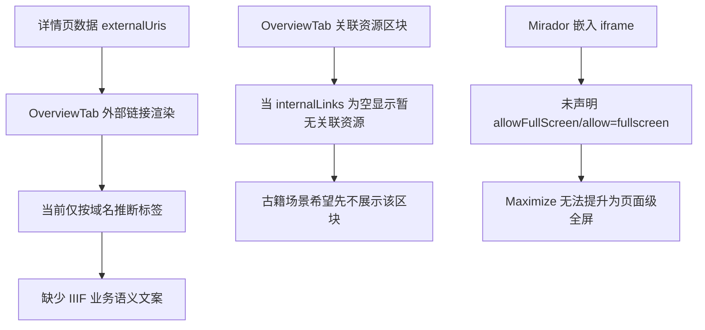

# 古籍详情外链标注与 Mirador 全屏需求梳理

## 目标范围
本次仅处理以下三项：
1. 古籍详情页外部链接中，IIIF manifest 链接增加业务语义标注。
2. 古籍详情页右栏“关联资源”区块暂不展示。
3. 点击 Mirador 的 Maximize Windows 后，启用页面级全屏体验。

## 现状分析

## 需求定义
- 外链标注：若 externalUri 判定为 IIIF manifest，则展示文案 `IIIF Manifest（古籍影像）`。
- 关联资源：`resourceType=ancient_book` 时不渲染“关联资源”卡片及其空态提示。
- 全屏策略：为 Mirador 承载 iframe 增加全屏权限，使 Mirador 内部最大化按钮可触发页面全屏。

## 设计决策
- IIIF 判定策略：URL 包含 `/iiif/manifests/` 或以 `/manifest.json` 结尾，视为 IIIF manifest。
- 影响面：
  - `OverviewTab` 文案函数与右栏渲染条件。
  - `IIIFSection` 与 `IiifPage` 的 iframe 属性。

## 边界与风险
- 非古籍页面继续保持“关联资源”展示逻辑。
- 外链标签优先级：IIIF 识别优先于既有域名识别规则。
- 全屏行为受浏览器策略约束，但 iframe 权限是必要前提。

## TODO
1. 新增测试：覆盖外链 IIIF 标注与古籍关联资源隐藏行为。
2. 新增测试：覆盖 IIIFSection iframe 全屏权限属性。
3. 修改 OverviewTab 实现。
4. 修改 IIIFSection 与 IiifPage 的 iframe 全屏权限实现。
5. 回归测试并确认变更效果。
