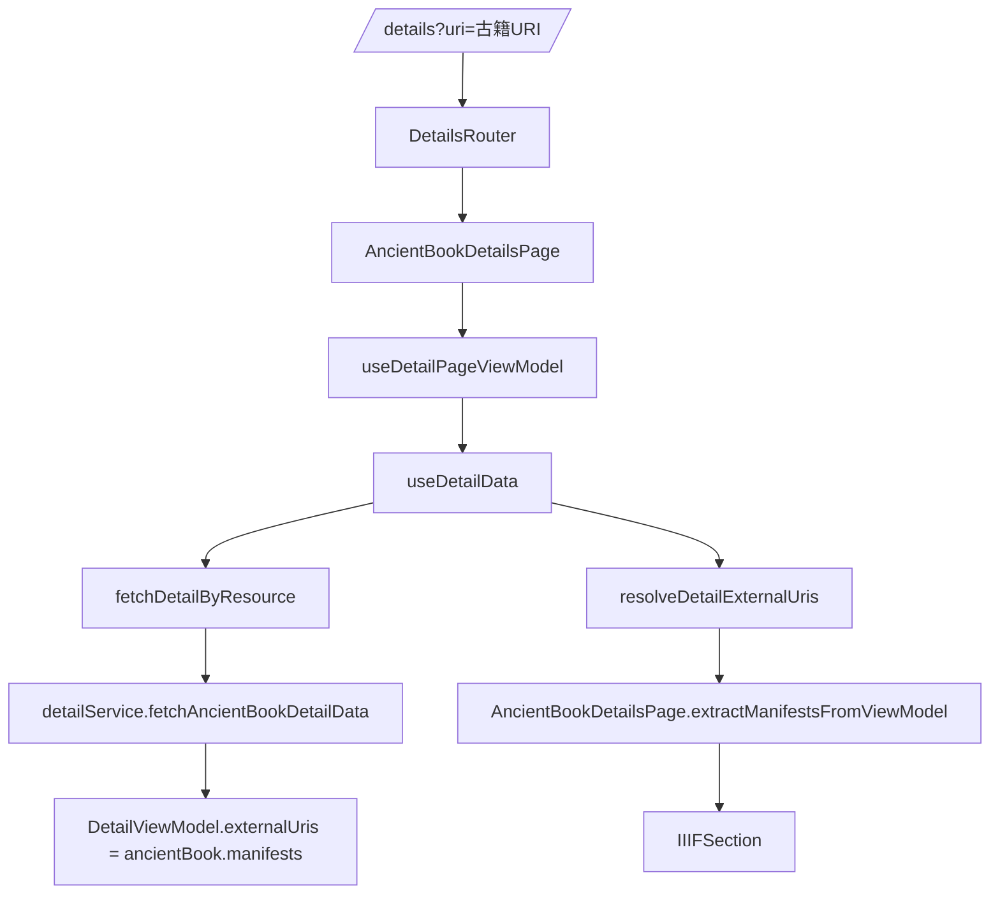

# 古籍详情 IIIF 回归问题分析

## 问题现象

当前古籍详情页出现两个直接症状：

1. 没有内嵌 IIIF Mirador 浏览器
2. 没有按卷定位与卷次相关入口

用户体感上像是古籍专用页面失效，退化成了普通详情页。

## 历史回溯

通过 `git log` 检查古籍详情相关文件，确认这条能力链曾完整存在：

- `a62b482`：古籍详情页集成 IIIF 查看器
- `8f014ce`：`IIIFSection` 支持嵌入模式
- `dfa0cec`：支持自动加载嵌入式 IIIF
- `01781f8`：古籍页自动加载嵌入预览
- `ceeae80`：`IIIFSection` 增加卷首导航
- `3be4eb3`：古籍页启用卷首导航

说明：

- 古籍页组件没有整体被删除
- Mirador 和卷次导航的 UI 能力仍然在代码中
- 当前故障更可能发生在数据进入页面之前

## 当前链路

## 根因

问题出在 `useDetailData` 的外部链接解析逻辑。

当前 `detailService.fetchAncientBookDetailData()` 已经把古籍 manifests 映射到了：

- `DetailViewModel.externalUris`

但是 `useDetailData.resolveDetailExternalUris()` 的现状是：

- `book` 返回空数组
- 其它类型只返回 `doc.equivalent` 中提取出来的 HTTP 链接
- 完全忽略 `detail.externalUris`

这会导致：

1. 古籍详情接口返回的 `manifests` 被丢失
2. `AncientBookDetailsPage` 优先读取 `viewModel.externalUris` 时拿到空数组
3. 若 object 文档本身不带 IIIF manifest，则 `EntityParser.getIIIFManifests()` 也拿不到结果
4. 页面最终不渲染 `IIIFSection`
5. 因为 `IIIFSection` 没有渲染，所以嵌入 Mirador 和卷首导航也一起消失

## 修复策略

最小修复：

- 保留 `book` 类型外链为空的现有规则
- 对 `ancient_book` 以及其他非 `book` 类型，统一使用：
  `mergeDetailExternalUris(detailExternalUris, docData)`

这样可以同时满足：

1. 古籍接口返回的 manifests 不丢
2. `doc.equivalent` 中的外链仍可继续合并
3. 不改变图书详情“隐藏外链”的现有行为

## 测试策略

先补测试，再修实现：

1. 在 `tests/features/details/useDetailDataExternalUris.test.ts`
   增加古籍场景，断言 `resolveDetailExternalUris('ancient_book', manifests, {})`
   应保留 manifests
2. 运行该测试，确认当前实现失败
3. 修复 `useDetailData.ts`
4. 运行古籍详情相关回归：
   - `tests/features/details/useDetailDataExternalUris.test.ts`
   - `tests/features/details/ancientBookDetailUiRegression.test.tsx`

## 预期结果

修复后，古籍详情页应恢复：

- IIIF Mirador 嵌入预览
- 按卷定位按钮
- 卷信息表

且不影响图书详情页隐藏外链的既有行为。
