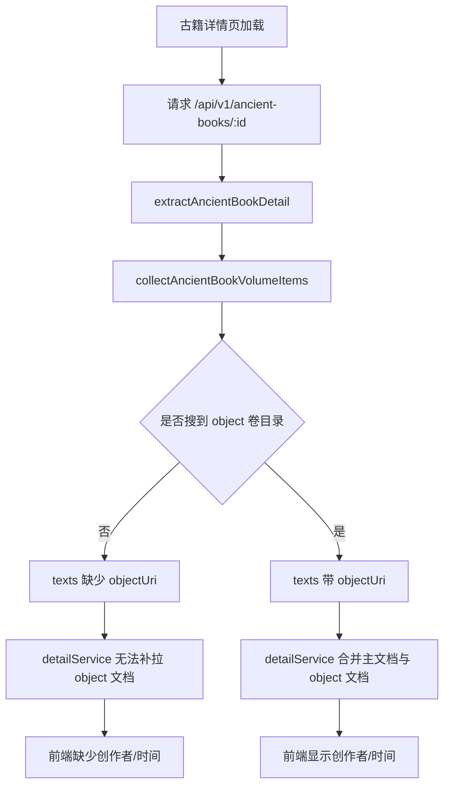

# 古籍详情前端无变化问题分析

## 问题概述

古籍详情页前端已经具备展示“创作者 / 时间 / 版本来源”的能力，但部分页面仍然没有展示这些信息。

排查结果表明，问题不在前端渲染层，而在古籍详情接口返回的数据缺失：

- 前端需要依赖 `texts[].objectUri` 二次拉取 `object` 文档
- 当前主工作区后端仅搜索旧目录 `/processed/entities/...`
- 实际数据已经存在于 `json-ld` 目录 `/processed/json-ld/ancient_book/ancient_book_object/volume/`
- 因此部分古籍卷册无法拿到 `objectUri`
- 前端虽然已改造，但拿不到补充字段，所以界面看起来“没变化”

## 现状链路

## 根因

`collectAncientBookVolumeItems` 只搜索旧目录：

- `/processed/entities/ancient_book/ancient_book_txt/volume/`
- `/processed/entities/ancient_book/ancient_book_object/volume/`

但线上/本地真实古籍数据存在于新目录：

- `/processed/json-ld/ancient_book/ancient_book_txt/volume/`
- `/processed/json-ld/ancient_book/ancient_book_object/volume/`

因此需要兼容两套目录并统一去重。

## 修复策略

### P0 最小修复

1. 为卷目录搜索增加“多目录合并”能力
2. 同时搜索 `json-ld` 与 `entities`
3. 按 `uri` 去重
4. 保持现有字段结构不变，仅补齐 `objectUri`

### 测试策略

1. 新增古籍详情集成测试
2. 构造仅在 `json-ld object` 目录命中的卷数据
3. 断言接口返回 `texts[].objectUri`
4. 断言前端可继续沿用现有合并逻辑

## 风险与边界

- 不能覆盖当前文件里已有的 manifest 相关在研改动
- 新旧目录同时存在时，需要按 `uri` 去重，避免重复卷项
- 仅修复卷目录发现问题，不改现有标题、文本、manifest 解析流程

## TODO

1. 新增集成测试，覆盖 `json-ld object` 目录
2. 运行测试，确认当前实现失败
3. 修改 `collectAncientBookVolumeItems`
4. 回归古籍详情接口测试
