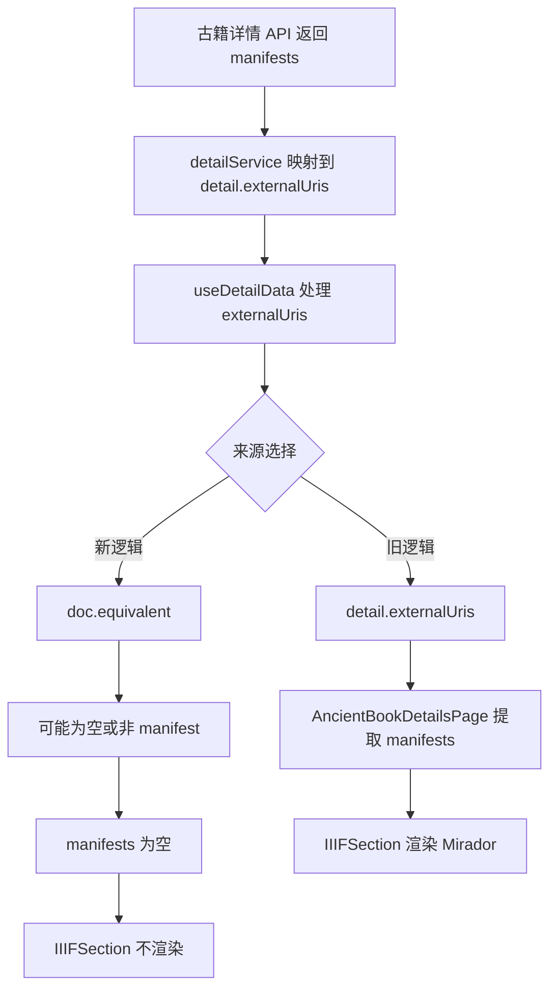

# 古籍详情页 Mirador 缺失问题分析与修复计划

## 背景
在古籍详情页中，Mirador 内嵌区块依赖 `manifests` 数据。当前线上现象为：古籍详情页未出现 Mirador 内嵌区域。

## 现象拆解
- 页面组件仍保留 `IIIFSection` 内嵌调用。
- 渲染条件是 `manifests.length > 0`。
- 近期数据链路将 `externalUris` 的来源切换为 `doc.equivalent`，导致部分古籍详情无法拿到 `manifests`。

## 根因分析

## 修复目标
- 保留 `doc.equivalent` 的补充价值。
- 恢复古籍详情对 `detail.externalUris(manifests)` 的优先兼容。
- 保证 `externalUris` 输出去重、稳定，避免重复链接。

## 修复策略
- 将 `useDetailData` 中 `externalUris` 组装改为“合并策略”：
  - 主来源：`detail.externalUris`
  - 补充来源：`doc.equivalent` 中的 HTTP URI
  - 输出：去重后的数组
- 通过单元测试锁定该行为，覆盖古籍 manifest 回归场景。

## 边界情况
- `detail.externalUris` 为空但 `equivalent` 存在时，仍应保留 `equivalent`。
- `detail.externalUris` 与 `equivalent` 同时包含相同链接时，不应重复。
- `equivalent` 中非 HTTP 值、空值、对象缺失 `id/uri/@id` 时应被忽略。

## TODO LIST
1. 新增 `useDetailData` 行为测试，先复现回归（预期失败）。
2. 修改 `useDetailData` 的 `externalUris` 合并逻辑。
3. 运行相关测试并确认通过。
4. 复核古籍详情页 manifests 传递链路的稳定性。
