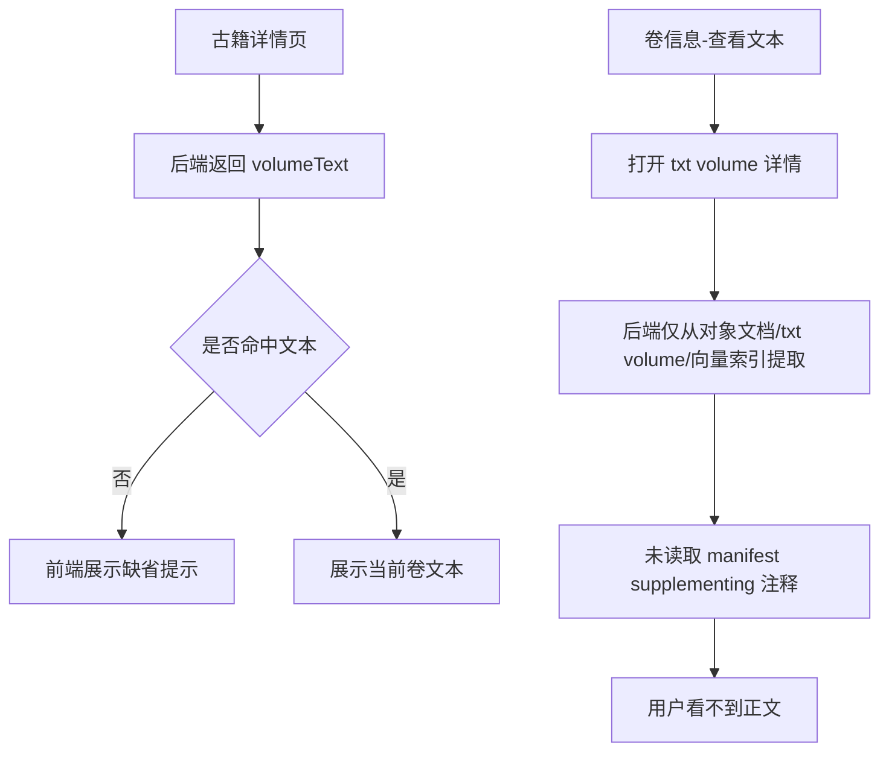
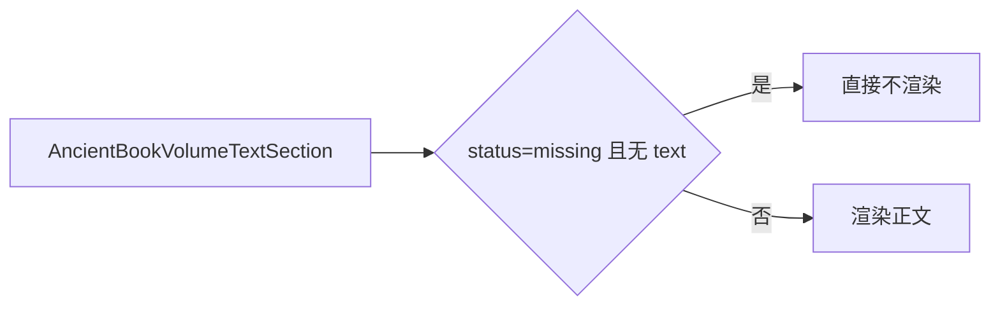
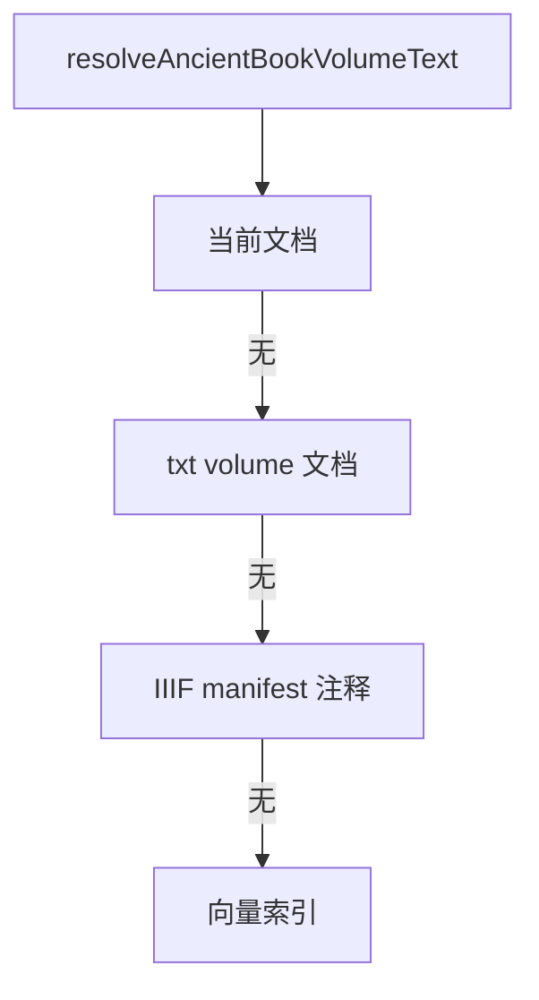

# 古籍卷文本与卷信息展示修正方案

## 问题概述

当前古籍详情页有三个直接问题：

1. 当卷文本未解析成功时，界面会显示一段强提示文案，干扰阅读。
2. `卷信息` 表格仍然展示 `影像` 列，但这个列只是对象详情跳转，和当前页面目标不一致。
3. `查看文本` 跳转后经常看不到正文，因为后端卷文本解析并没有真正读取 IIIF manifest 中 `supplementing` 注释里的文本。

## 现状链路

## 根因

### 前端

- `AncientBookVolumeTextSection` 在 `status === missing` 时固定渲染缺省提示。
- `AncientBookVolumesSection` 的列定义仍保留 `影像`。

### 后端

`resolveAncientBookVolumeText` 当前只按以下顺序查找：

1. 当前文档
2. `txt/volume`
3. `/heluo/vector/iiif/manifests/`

但真实古籍正文可能只存在于 IIIF manifest 的 canvas 注释中，形式通常为：

- `canvas.annotations[].items[].motivation = supplementing`
- `annotation.body.value = 正文`

因此需要增加 manifest 注释回退解析。

## 修复目标

1. 缺少正文时，古籍详情页不显示“暂无可解析文本”提示块。
2. `卷信息` 表格只保留：
   - 卷
   - 文本
   - IIIF
3. 卷文本解析增加 IIIF manifest supplementing 注释回退。

## 实现策略

### 前端展示收敛

- 去掉缺省缺文提示。
- 仅在存在真实文本时展示文本区。

### 卷信息表简化

- 移除 `影像` 列。
- 保留 `查看文本` 与 `打开 IIIF` 两种入口。

### 后端文本解析增强

manifest 注释解析步骤：

1. 从古籍详情已有 manifest URI 中确定候选 manifest
2. 拉取 manifest 文档
3. 遍历 `items`
4. 根据卷号/卷标题优先匹配 canvas label
5. 从 `supplementing` 注释中提取 `body.value`

## 测试策略

1. 前端组件测试
   - 缺文时不显示提示区
   - `卷信息` 不再包含 `影像`
2. 后端集成/单元测试
   - 当对象文档和 txt volume 都无正文时，可从 manifest 注释提取文本
   - `volumeTextStatus` 应变为 `available`

## 风险与边界

- manifest 中可能存在多个 canvas，需要按卷号或卷标签优先匹配。
- 注释可能是数组 body，需要兼容字符串对象两种结构。
- 不应破坏已有向量文本回退逻辑。

## TODO

1. 新增前端展示测试
2. 新增 manifest 注释回退测试
3. 修改前端两个组件
4. 修改后端文本提取器
5. 回归古籍详情相关测试
