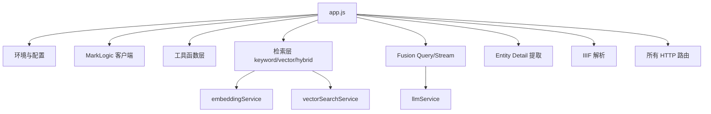
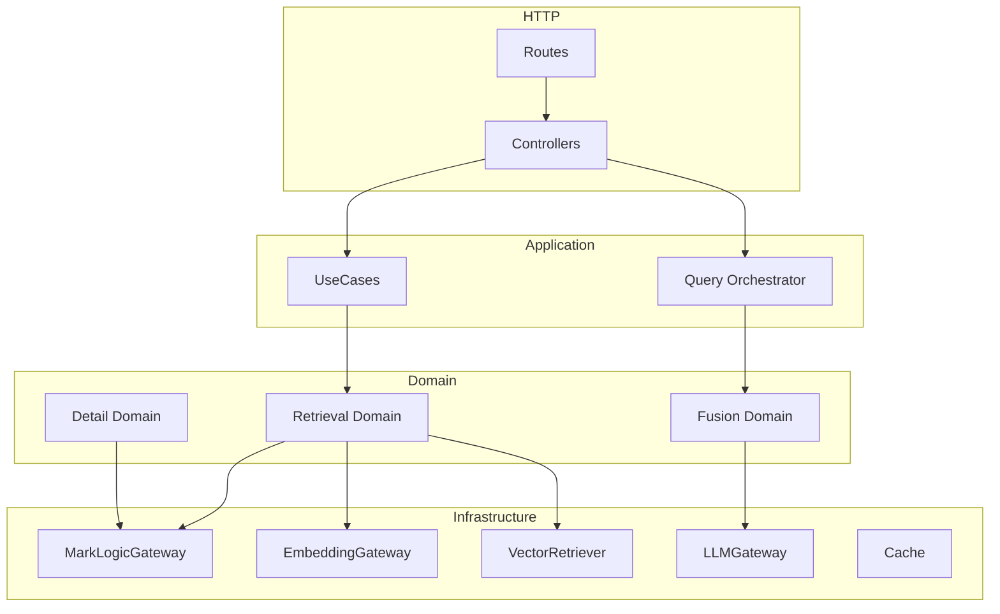
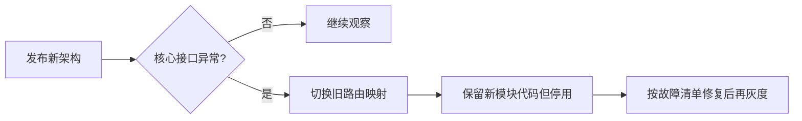

# app.js 破坏性重构计划（v2）

## 1. 目标与边界

| 项目 | 内容 |
|---|---|
| 目标 | 将 `server/src/app.js` 从“巨石文件”重构为“分层模块化后端”，降低耦合与回归风险 |
| 重构类型 | **破坏性重构**（允许接口与内部契约调整） |
| 适用范围 | 后端 `server/src/`，重点是检索、融合问答、详情、IIIF、代理路由 |
| 不在范围 | 前端页面视觉与交互改版 |
| 约束 | 先完成模块拆分与契约收敛，再做性能优化 |

## 2. 现状二次分析结论

### 2.1 结构事实

| 指标 | 当前值 | 说明 |
|---|---:|---|
| 主文件 | `server/src/app.js` | 单文件承载环境配置、基础设施、业务逻辑、路由 |
| 路由数量 | 22 | `health/stats/mvp/v1/ml/vector/root` 全混在同文件 |
| 函数/类声明数量 | 169 | 函数密集、层次不清晰 |
| 关键问题 | 职责重叠 | 同时做“检索编排 + 领域规则 + HTTP 组装 + 容错” |

### 2.2 当前逻辑拓扑



### 2.3 主要复杂度来源

| 来源 | 现象 | 影响 |
|---|---|---|
| 分层缺失 | 路由层直接调用复杂领域逻辑 | 修改一个逻辑牵动多个 API |
| 检索路径并存 | `keyword/vector/hybrid` 与多重 fallback 交织 | 调试困难，行为不可预测 |
| 业务特化下沉到检索层 | poem/iiif 特化混入通用检索 | 难以复用，难以替换底层实现 |
| 参数与常量散落 | 超时、并发、阈值分散定义 | 配置一致性差 |
| 历史兼容逻辑堆积 | MVP 与 v1 混合维护 | 新功能推进成本高 |

## 3. 破坏性重构目标架构

### 3.1 目标分层



### 3.2 目标目录（建议）

```text
server/src/
  app.js                        # 仅装配中间件和挂载路由
  bootstrap/
    config.js
    dependencies.js
  routes/
    healthRoutes.js
    searchRoutes.js
    fusionRoutes.js
    detailRoutes.js
    vectorRoutes.js
    proxyRoutes.js
  controllers/
    searchController.js
    fusionController.js
    detailController.js
  usecases/
    searchUnifiedUseCase.js
    fusionQueryUseCase.js
    fusionStreamUseCase.js
    getDetailUseCase.js
  domain/
    retrieval/
    fusion/
    detail/
  infra/
    gateways/
      marklogicGateway.js
      embeddingGateway.js
      llmGateway.js
    retrievers/
      keywordRetriever.js
      vectorRetriever.js
      hybridRetriever.js
    cache/
      ttlCache.js
```

## 4. 破坏面定义（Breaking Changes）

| 破坏项 | 当前 | 目标 | 影响对象 |
|---|---|---|---|
| 内部函数直接调用 | `app.js` 内部函数彼此引用 | 通过 UseCase + Gateway 契约调用 | 后端实现 |
| 搜索模式入口 | 多处自由解析 `mode` | 统一入口与白名单策略 | 前后端联调 |
| Fusion 参数默认策略 | 分散在多个函数 | 收敛到 `fusionQueryUseCase` | API 行为 |
| 错误结构 | 各路由风格不一 | 统一错误码与响应模板 | 前端处理逻辑 |
| 缓存策略 | 分散多 Map | 统一 cache abstraction | 运维与调试 |

## 5. 分阶段执行计划（破坏性迁移）

### 阶段 P0：冻结与测量（1-2 天）

| 动作 | 产出 |
|---|---|
| 冻结 `app.js` 新增需求 | 变更窗口控制 |
| 建立接口基线快照（search/fusion/detail） | 回归对照样本 |
| 补齐关键链路基准测试 | 性能与行为基线 |

### 阶段 P1：骨架拆分（2-4 天）

| 动作 | 产出 |
|---|---|
| 新建 routes/controllers/usecases 目录骨架 | 可运行空架构 |
| 将路由注册从 `app.js` 抽离 | `app.js` 缩减为装配层 |
| 引入统一错误与响应适配器 | 响应格式一致 |

### 阶段 P2：检索域迁移（3-5 天）

| 动作 | 产出 |
|---|---|
| 抽离 `searchScopeData*` 为 retriever 组件 | keyword/vector/hybrid 独立实现 |
| 抽离 `rerank` 与 score 语义规范 | 单一评分出口 |
| 移除路由层中的检索细节 | controller 仅编排参数 |

### 阶段 P3：Fusion/Detail 迁移（4-6 天）

| 动作 | 产出 |
|---|---|
| Fusion Query/Stream 迁移到 usecase | 流式和非流式共享核心逻辑 |
| Detail 聚合逻辑迁移到 detail domain | 人物/诗文/古籍职责清晰 |
| IIIF 解析迁移到独立 domain + gateway | IIIF 逻辑可独立测试 |

### 阶段 P4：删旧与收口（2-3 天）

| 动作 | 产出 |
|---|---|
| 删除 `app.js` 中废弃函数与常量 | 巨石文件收缩 |
| 清理冗余兼容分支（含历史 Graph 相关残留） | 逻辑闭环 |
| 更新文档与测试映射 | 可维护基线 |

## 6. 验证与验收标准

### 6.1 验收门槛

| 维度 | 验收标准 |
|---|---|
| 功能 | `/api/v1/search`、`/api/v1/fusion/query`、`/api/v1/fusion/stream`、详情接口行为对齐基线 |
| 质量 | 单测/集成测试通过，且新增模块测试覆盖核心分支 |
| 性能 | P95 延迟不劣于基线 10% 以上 |
| 可维护性 | `app.js` 仅保留装配逻辑，不承载业务算法 |

### 6.2 回滚策略



## 7. 任务清单（可执行 TODO）

- [ ] 建立 API 基线快照（输入/输出样本）
- [ ] 新建 `routes/controllers/usecases/infra` 骨架
- [ ] `app.js` 仅保留中间件与路由挂载
- [ ] 迁移统一搜索链路到 `searchUnifiedUseCase`
- [ ] 迁移 Fusion Query/Stream 到 `fusion*UseCase`
- [ ] 迁移 detail 聚合逻辑到 detail domain
- [ ] 统一错误码、响应包装与日志字段
- [ ] 删除旧函数与冗余常量
- [ ] 更新文档与测试映射

## 8. 风险与应对

| 风险 | 等级 | 应对 |
|---|---|---|
| 接口行为细节漂移 | 高 | 基线快照 + 契约测试 |
| 流式接口事件顺序变化 | 高 | SSE 回放测试 + 事件契约校验 |
| 检索相关性短期波动 | 中 | 先对齐旧分数语义，再替换算法 |
| 重构周期内需求插队 | 中 | 冻结窗口 + 分支隔离 |

## 9. 结论

本计划采用“**先分层、再迁移、后删旧**”的破坏性重构路径，核心目标不是局部修补，而是把 `app.js` 从巨石实现改为可演进架构。完成后，搜索/Fusion/详情三条主链将具备独立演进能力，并显著降低后续向量检索与问答策略迭代成本。
