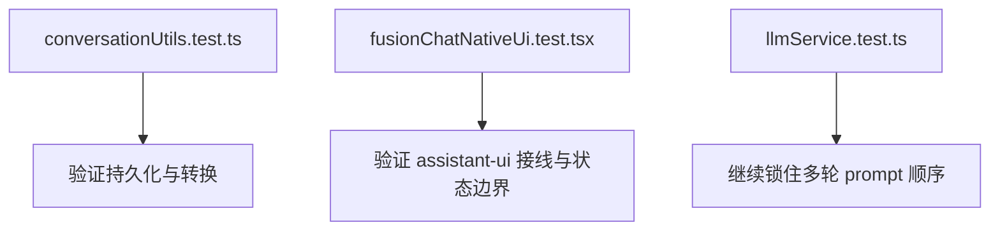

# assistant-ui 多轮对话稳态化方案分析

## 1. 目标

在保持 `assistant-ui + useLocalRuntime + 后端 SSE` 架构不变的前提下，增强当前 AI 聊天页的多轮对话稳定性，重点覆盖以下能力：

- 页面刷新后恢复历史线程；
- 前端只把“当前轮问题 + 历史消息”传给后端；
- cancel 只停止当前流式请求，不清空线程；
- reload 复用当前线程历史重新发起请求；
- 来源侧栏、状态栏等界面增强不写入对话历史。

## 2. 当前现状

### 2.1 已具备能力

当前 [`FusionChat.tsx`](/S:/vibe_coding/heluo-frontend/src/features/fusion/FusionChat.tsx) 已经具备：

- `AssistantRuntimeProvider` 作为运行时容器；
- `useLocalRuntime(adapter)` 作为本地线程运行时；
- `Thread` 负责消息渲染、输入与重试；
- `extractConversation()` 与 `trimConversationHistory()` 用于把线程消息转换成后端 `conversationHistory`；
- `/api/v1/fusion/stream` 五段式 SSE：`status / evidence / chunk / done / error`。

### 2.2 当前缺口

当前实现仍缺少：

- 基于本地存储恢复 `assistant-ui` 初始消息；
- 对线程消息的统一持久化出口；
- 对 reload / cancel 行为的显式回归测试；
- 对“状态栏和来源栏不污染对话历史”的测试保障。

## 3. 可行性判断

通过检查 `assistant-ui` 包内实现，可以确认：

```mermaid
flowchart TD
  A[useLocalRuntime] --> B[支持 initialMessages]
  B --> C[runtime.thread.reset(initialMessages)]
  C --> D[线程历史可原生恢复]
```

这意味着本次不需要替换组件，也不需要额外引入新的聊天状态库。只要：

- 从本地存储读取消息；
- 转换为 `ThreadMessageLike[]`；
- 在 `useLocalRuntime(adapter, { initialMessages })` 中导入；

就能完成刷新恢复。

## 4. 设计原则

### 4.1 状态分层

前端状态应固定分为三层：

| 层 | 职责 |
|---|---|
| assistant-ui runtime | 线程真相源，负责消息树、重试、取消、运行中状态 |
| conversationUtils | 会话持久化、导出、裁剪、格式转换 |
| FusionChat 页面状态 | 来源侧栏、检索阶段、状态提示等界面增强 |

### 4.2 边界约束

- `conversationUtils` 不参与 prompt 改写；
- 来源侧栏和状态栏只属于视图状态，不进入线程历史；
- 多轮上下文仍只由线程消息派生；
- reload 和 cancel 必须继续交给 `assistant-ui` 的线程运行时能力。

## 5. 实施策略

### 5.1 conversationUtils 扩展

为 `conversationUtils.ts` 补充两类能力：

- `ConversationSession <-> ThreadMessageLike[]` 转换；
- 从线程消息快照生成并保存会话；

这样可以让 `FusionChat` 不直接处理本地存储细节。

### 5.2 FusionChat 接线

在 `FusionChat.tsx` 中增加：

- 初始加载时读取本地会话并构建 `initialMessages`；
- 运行时通过 `runtime.thread.subscribe()` 监听线程变化并持久化；
- 仅将真实线程消息参与 `extractConversation()`；
- 保持来源侧栏与状态栏在 React state 中单独维护。

### 5.3 测试策略

测试优先围绕现有单元和 UI 测试补强：



## 6. 风险

| 风险 | 说明 | 控制方式 |
|---|---|---|
| assistant-ui 线程消息结构复杂 | 初始导入格式必须兼容 `ThreadMessageLike` | 仅恢复 user/assistant 文本消息 |
| 订阅过于频繁 | 每次线程变化都写本地存储 | 只保存文本消息快照，保持轻量 |
| 运行中半截消息污染历史 | 流式未完成时可能被持久化 | 仅持久化 user/assistant 文本快照，忽略临时 UI 状态 |
| reload/cancel 语义误判 | 误把页面状态当线程状态 | 测试中显式校验只影响运行，不清空历史 |

## 7. 结论

本次应继续使用 `assistant-ui`，并围绕其原生 runtime 能力做增强，而不是引入新的聊天组件或状态层。最小可行实现路径是：

1. 扩展 `conversationUtils.ts`；
2. 在 `FusionChat.tsx` 中接入初始消息恢复和线程订阅持久化；
3. 补充 `conversationUtils` 与 `FusionChat` 回归测试。
