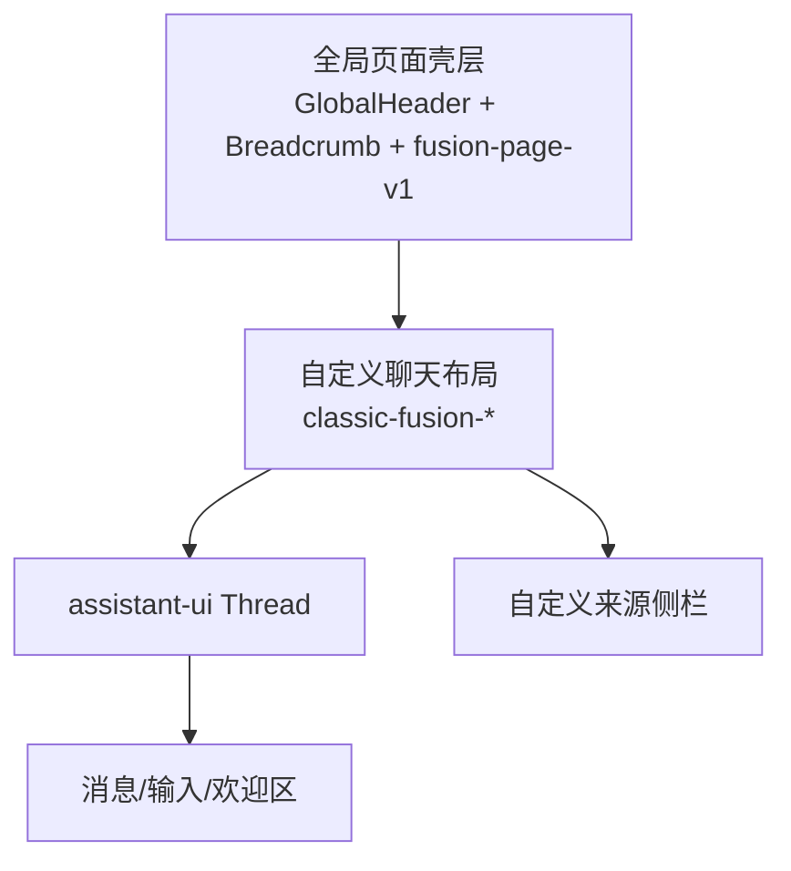
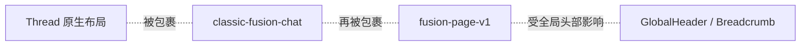
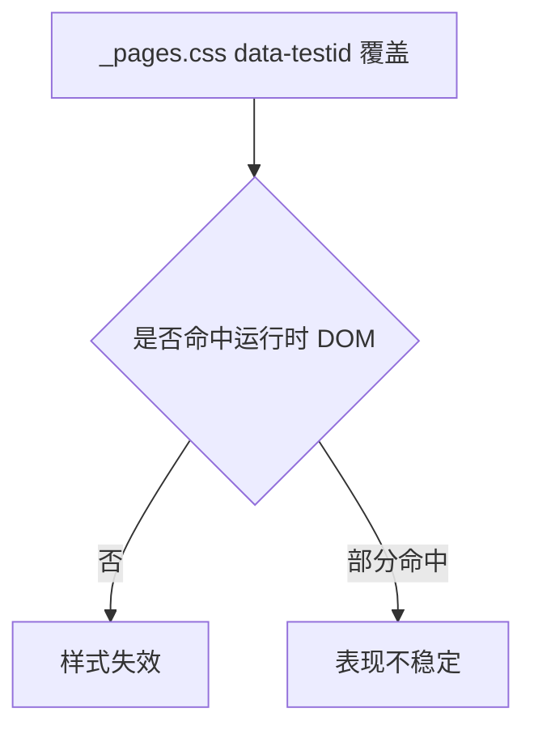
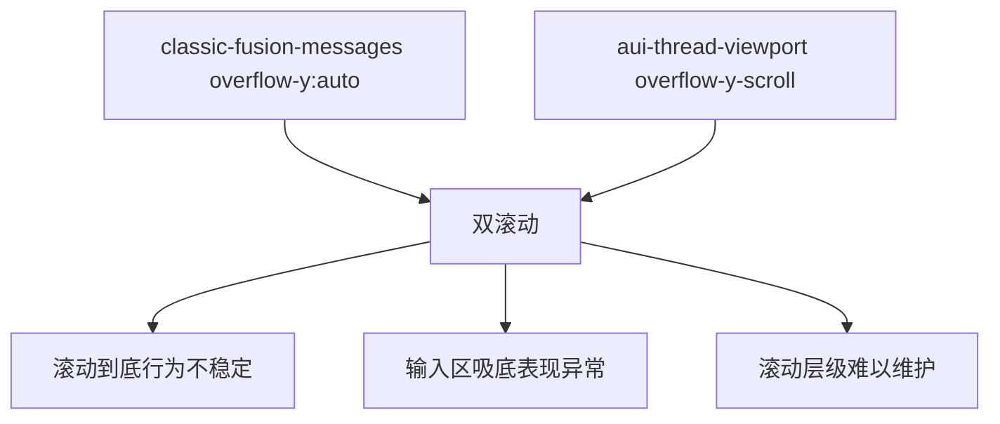
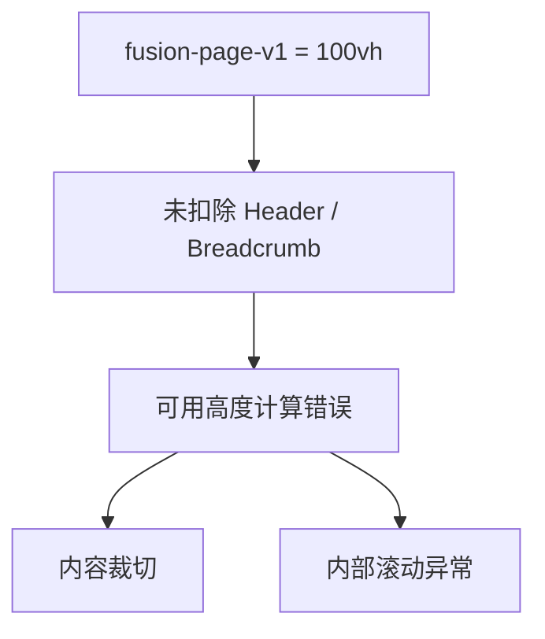
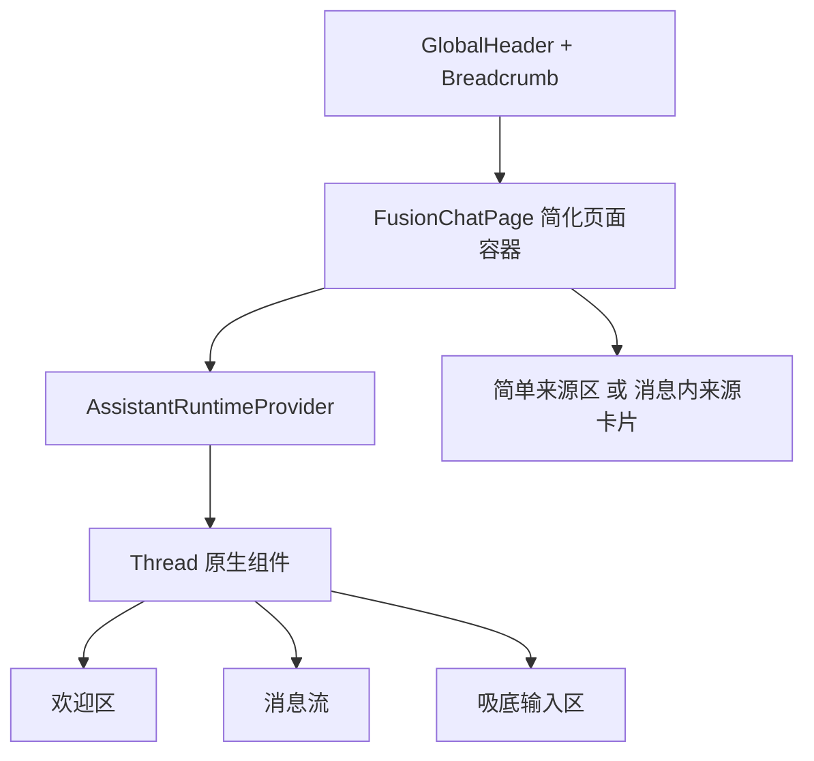
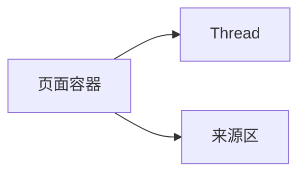
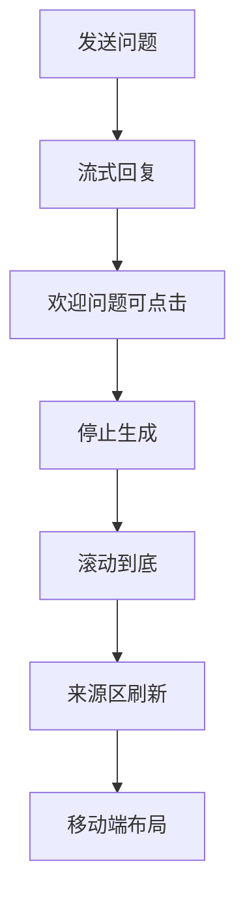

# assistant-ui 原生对话界面收敛方案

## 背景

当前对话页已经接入 `@assistant-ui/react-ui`，但页面外层仍保留一套自定义聊天壳层、来源侧栏和大量定向样式覆盖，形成了三层并行体系：

这导致布局、滚动、主题变量和消息渲染方式都存在冲突，复杂度高，维护成本大。

## 当前问题分析

### 1. 结构重复

页面已经使用 `assistant-ui` 的 `Thread` 作为完整聊天组件，但外层仍包裹自定义头部、消息区、状态区和来源侧栏。

问题：

| 问题 | 说明 |
| --- | --- |
| 布局职责重复 | `Thread` 已自带消息视口、吸底输入区、欢迎区 |
| 外层结构侵入 | 自定义容器强行接管宽度、高度和滚动 |
| 维护成本高 | 每次升级 `assistant-ui` 都要重新适配 |

### 2. 样式覆盖目标错误

当前样式大量使用 `[data-testid="..."]` 选择器覆盖欢迎区、输入框、消息气泡和 Markdown 区域，但 `assistant-ui` 当前版本实际主要暴露的是 `.aui-*` 类名。

直接结果：

1. 代码看起来已经定制过，但运行时大量样式没有真正生效。
2. 不同版本 DOM 变动时，覆盖策略极易整体失效。

### 3. 滚动体系冲突

`assistant-ui` 的 `Thread` 内部已经有消息滚动视口和底部吸附输入区；自定义容器又额外给消息区域设置滚动。

### 4. 高度模型冲突

聊天页按独占全屏设计，但应用实际始终渲染全局头部和面包屑。

### 5. 来源侧栏实现过重

来源信息当前通过绝对定位侧滑面板呈现，强绑定聊天主区宽度和页面中心线。

问题：

| 问题 | 说明 |
| --- | --- |
| 定位脆弱 | 使用硬编码宽度和绝对定位 |
| 响应式成本高 | 桌面与移动端行为差异大 |
| 与原生线程脱节 | 证据区不属于消息流的一部分 |

### 6. Markdown 渲染链路不完整

项目已安装 `@assistant-ui/react-markdown`，但当前 `Thread` 未显式接入 Markdown 文本组件，导致样式预期与实际渲染模式不一致。

## 目标状态

核心原则：完全使用开源组件承担聊天 UI，自定义代码只保留业务运行时和业务数据展示。

目标收敛结果：

| 模块 | 处理方式 |
| --- | --- |
| `classic-fusion-*` 外层聊天结构 | 删除 |
| `fusion-page-v1` 全屏独占布局 | 删除或改成普通页面容器 |
| `data-testid` 覆盖样式 | 删除 |
| 重复 `aui-root` 包裹 | 删除 |
| 重复主题导入 | 删除重复项 |
| Markdown 渲染 | 改为显式接入官方 Markdown 组件 |

## 建议的页面方案

### 方案选择

建议采用“原生线程 + 简单来源区”的轻量方案。

原因：

1. 对话体验优先恢复稳定。
2. 避免右侧绝对定位侧栏带来的布局耦合。
3. 来源区保留业务价值，但不再影响聊天主线程行为。

### 来源区展示建议

短期建议：

| 方案 | 描述 | 复杂度 | 推荐度 |
| --- | --- | --- | --- |
| A | 放在线程下方，作为普通页面区块 | 低 | 高 |
| B | 作为 assistant 消息后的证据卡片块 | 中 | 中 |
| C | 保留右侧浮动侧栏 | 高 | 低 |

本次建议先做 A。

## 实施步骤

### 第一步：删除自定义聊天布局

处理目标：

1. 删除 `classic-fusion-wrapper`
2. 删除 `classic-fusion-layout`
3. 删除 `classic-fusion-chat-header`
4. 删除自定义消息区包裹层
5. 删除右侧来源侧栏折叠交互

### 第二步：回归 assistant-ui 原生 Thread

保留：

1. `AssistantRuntimeProvider`
2. `useLocalRuntime`
3. `Thread`
4. 业务 `adapter`
5. 必要的 `strings`

补充：

1. 显式接入 Markdown 文本组件
2. 仅做最小化的主题变量配置

### 第三步：删除聊天页专属重样式

优先删除：

1. `fusion-page-v1` 全屏布局
2. `classic-fusion-*` 相关样式
3. `[data-testid="..."]` 覆盖
4. 侧栏定位与展开收起样式

### 第四步：重建最小页面样式

仅保留：

1. 页面外层容器间距
2. 原生线程最大宽度适配
3. 来源区卡片样式

## 测试与验证计划

本次改造应优先使用前端测试覆盖回归路径。

验证清单：

| 场景 | 验证点 |
| --- | --- |
| 首次进入页面 | 欢迎语和建议问题正常展示 |
| 发送问题 | 用户消息和助手消息按原生布局显示 |
| 流式输出 | 消息逐步更新，输入区保持可用 |
| 停止生成 | cancel 能中断请求 |
| 长消息 | 仅一个主滚动容器，滚动行为正常 |
| 来源更新 | 不再影响主线程布局 |
| 移动端 | 不出现绝对定位遮挡 |

## 风险与边界

| 风险 | 说明 | 处理策略 |
| --- | --- | --- |
| 视觉风格回退 | 删掉自定义壳层后页面会更朴素 | 先保功能稳定，再做轻量主题化 |
| 来源区交互简化 | 失去侧滑面板效果 | 以可用性优先，后续再优化 |
| 旧样式残留 | 删除不彻底会产生脏规则 | 通过搜索 `classic-fusion` 和 `data-testid` 清理 |
| Markdown 显示差异 | 原先样式建立在错误 DOM 假设上 | 用官方 Markdown 组件重新对齐 |

## TODO LIST

- [ ] 梳理并删除 `FusionChat.tsx` 中的自定义聊天壳层
- [ ] 将 `FusionChatPage.tsx` 收敛为普通页面容器
- [ ] 删除 `_pages.css` 中聊天页定制大段样式
- [ ] 显式接入 assistant-ui Markdown 文本组件
- [ ] 设计来源区的最小实现
- [ ] 为原生对话页补充回归测试
- [ ] 验证桌面端和移动端滚动行为

## 结论

这次改造不应该再修补现有自定义聊天布局，而应直接删除其职责，让 `assistant-ui` 成为唯一对话 UI 实现。这样能明显减少样式冲突、滚动冲突和版本适配成本，也更符合“减少复杂性，增强可用性”的目标。
