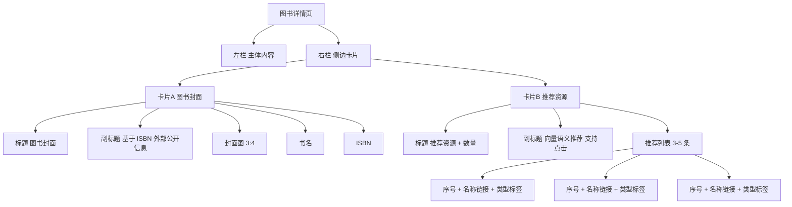

# 图书详情卡片重排原型（推荐资源）

## 目标
- 将右侧栏目从“相关资源”统一为“推荐资源”。
- 保持最小改动：不改数据来源，只改呈现结构与信息层级。
- 提升扫读效率：先看封面，再看可点击推荐列表。

## 原型图（线框）

## 交互约定
- 推荐条目点击后，跳转到 `/details?uri=...`。
- 列表项显示：`序号`、`名称（可点击）`、`类型标签`。
- 空态文案：`暂无推荐资源`。
- 异常文案：`推荐资源加载失败，请稍后重试。`。

## 验收清单
- 页面出现“推荐资源”标题，不再出现“相关资源”。
- 图书详情右侧先展示封面卡，再展示推荐资源卡。
- 推荐列表每条都可点击跳转，且可看到名称。
- 移动端保持单列，不出现内容挤压。
