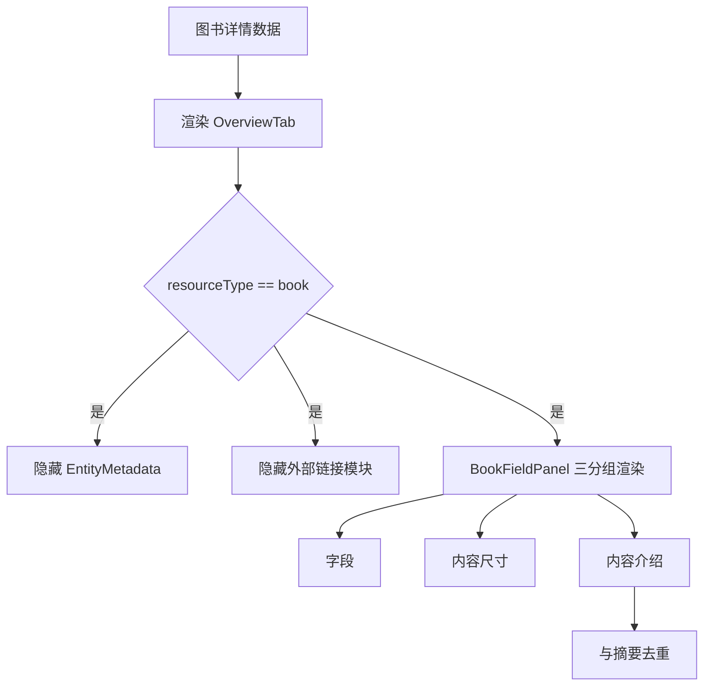

# 图书详情展示优化方案

## 问题识别
当前图书详情页存在以下问题：
- 信息重复：图书字段面板与通用元数据面板重复展示。
- 可读性不足：尺寸与长文本介绍在同一视觉层级中，重点不清。
- 外部链接误判：`equivalent` 中的链接被并入外链，导致图书页出现不应出现的“外部链接”模块。

## 优化目标
- 图书详情聚焦 3 类信息：`字段`、`内容尺寸`、`内容介绍`。
- 移除图书场景重复信息展示。
- 图书场景不展示外部链接模块。

## 实施设计

## 关键策略
- 字段分组重构：图书字段改为 `字段`、`内容尺寸`、`内容介绍` 三块。
- 文本去重：`内容介绍` 与摘要文本语义一致时不重复展示。
- 编号拆分：按标识类型拆成独立字段（如 `ISBN`、`馆藏检索号`），不再混合为同一行。
- 编号清洗：排除书名/题名类值，仅保留真实标识。
- 外链策略：图书类型 `externalUris` 直接返回空数组，前端同时禁用图书外链卡片渲染。
- 方案A验证：从 `current_location.defined_by` 解析 WKT 坐标，复用当前地图加载器自动渲染地图。

## 验证项
- 图书详情不出现“外部链接”标题。
- 页面仅出现一份摘要文本。
- 图书字段分组标题与尺寸值格式正确（如 `287 页`）。

## 增量修正规则（2026-02）
- dimension.type == MonetaryAmount 或存在 currency 时，不按“尺寸”渲染。
- 金额字段统一渲染为：金额，值为 数值 + 币种（例如 38 元）。
- 币种兼容：Chinese Yuan/CNY/人民币 统一展示为 元。
