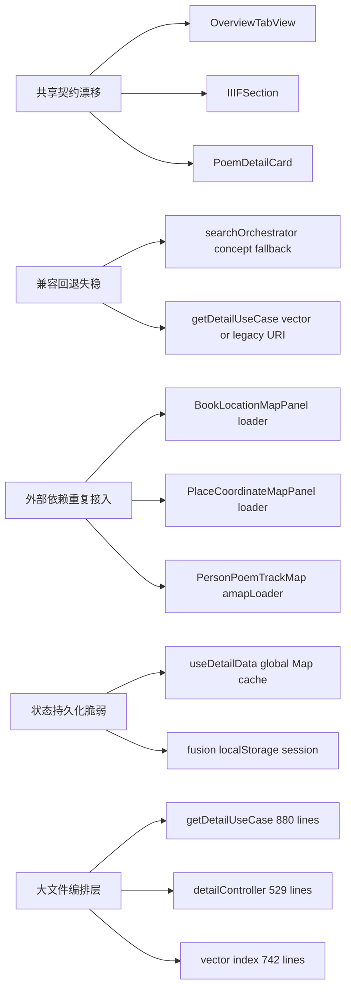

# 设计：当前功能代码脆弱性扫描与硬化路线

Generated by office-hours on 2026-04-08
Branch: master
Repo: Harryleft/heluo-frontend
Status: DRAFT
Mode: Builder
Related prior design: `afkxw-master-design-20260328-225803.md`

## Problem Statement

当前仓库的主要风险已经不是“某一个功能点有 bug”，而是多个功能区共享的契约、兼容回退和状态持久化正在同时漂移。

用户希望“扫描当前我的各个功能代码中的脆弱性”，目标不是立刻写修复代码，而是先把哪一类问题已经真实回归、哪一类问题会在后续继续反复炸、以及应该按什么顺序收口，说清楚。

本次扫描覆盖：

- 前端详情页体系：`src/features/details/**`
- 融合问答：`src/features/fusion/**`
- IIIF 查看：`src/features/iiif/**` 与 `src/features/common/IIIFSection.tsx`
- 后端检索与详情链路：`server/src/usecases/**`、`server/src/domain/retrieval/**`、`server/src/controllers/**`

## What Makes This Cool

这次扫描的价值，不是再补一轮零散修复，而是把“为什么这个系统一改就牵一片”定位到共享机制上。

把脆弱性从“测试又挂了”升级成“哪些共享约定已经失效”，后面的修复才能从止血走向硬化。

## Constraints

- 本轮只做诊断，不写实现代码。
- 诊断基于当前 `master` 分支和本地工作区。
- `npm run typescript` 通过，说明类型层没有立即阻塞。
- `npm run test` 当前失败 11 项，说明已经存在可复现回归，不是纯静态味道分析。
- 仓库存在 `origin`，但本地没有可用的 `origin/main` 引用，因此本轮无法直接使用 `git diff origin/main --stat` 做主干对比。
- 项目已有待办记录，`docs/tasks/todo.md` 已经把一部分失败归因为“预先存在的测试失败”，这与本轮扫描结果一致。

## Current Evidence

| 维度 | 证据 | 结论 |
| --- | --- | --- |
| 测试状态 | `npm run test` 失败 11 项 | 脆弱性已经落成真实回归 |
| 类型状态 | `npm run typescript` 通过 | 问题集中在运行时契约与结构组织，不是类型系统失守 |
| 前端测试覆盖分布 | `details` 58 个源码文件 / 12 个测试文件，`common` 6 / 0，`home` 1 / 0 | 详情页是高变更区，但保护网不对称 |
| 后端测试覆盖分布 | `controllers` 7 / 0，`usecases` 7 / 0，`domain` 27 / 0，`routes` 14 / 10 | 后端大量依赖 API 集成测试兜底，同层回归定位成本高 |
| 大文件热点 | `server/src/usecases/getDetailUseCase.js` 880 行，`server/src/services/vector/index.js` 742 行，`server/src/controllers/detailController.js` 529 行 | 共享编排点过大，局部改动容易穿透多个功能区 |

## Fragility Map

## Findings

### 1. 详情页共享契约已经漂移，而且是成簇漂移

`npm run test` 里失败最多的是详情页回归，说明问题不是一个组件掉链子，而是整个详情体系的共享约定没有被固定住。

直接证据：

- `tests/features/details/ancientBookDetailUiRegression.test.tsx:116`
- `tests/features/details/bookDetailUiRegression.test.tsx:123`
- `tests/features/details/placeDetailUiRegression.test.tsx:120`
- `tests/features/details/poemDetailRelatedResources.test.tsx:86`
- `tests/features/details/poemDetailUiRegression.test.tsx:130`

代码侧对应点：

- `src/features/details/components/overview/OverviewTabView.tsx:605`
- `src/features/details/components/overview/OverviewTabView.tsx:647`
- `src/features/details/components/overview/OverviewTabView.tsx:680`
- `src/features/details/PoemDetailCard.tsx:83`
- `src/features/common/IIIFSection.tsx:268`
- `src/features/iiif/InlineMiradorViewer.tsx:83`

这组问题至少包含四种漂移：

- 推荐资源 DOM 结构变了，测试还在找旧的 `.yale-overview-tab__relation-link`，而实现已经输出 `.yale-sidebar-accordion__related-item`
- 外部链接区域被折叠进侧边栏后，测试和调用方仍按旧层级找节点
- IIIF 查看器从 iframe 契约切成了运行时挂载 Mirador，本地测试仍按 iframe 和 `allowfullscreen` 断言
- 诗文、图书、地点详情里的“该出现什么是产品契约，什么只是 DOM 细节”没有统一定义，导致 refactor 很容易把回归测试一起打碎

结论：详情页的真实脆弱点不是单个页面，而是“共享展示契约没有单独建模”。

### 2. 概念检索的旧路径回退已经失稳

`tests/server/api/v1Search.integration.test.ts:346` 当前失败，预期是在 `json-ld only` 模式下，`concept` 目录没数据时回退到旧概念集合，但实际返回了 0 条。

相关代码：

- `server/src/domain/retrieval/searchOrchestrator.js:12`
- `server/src/domain/retrieval/searchOrchestrator.js:115`
- `server/src/domain/retrieval/searchOrchestrator.js:156`
- `server/src/domain/retrieval/searchOrchestrator.js:289`
- `server/src/usecases/searchUnifiedUseCase.js:180`

这说明现在的兼容层虽然还写在代码里，但没有被稳定锁住。也就是“看起来支持旧路径”，但一旦链路上任何一层改动，兜底就可能空掉。

这类问题最危险，因为它不会在 happy path 上第一时间暴露，只会在老数据、老集合、老索引仍然承担流量时突然掉结果。

### 3. 古籍字段解析已经从“核心字段”退化成“残留字段”

`tests/features/details/entityFieldParsers.test.ts:89` 当前失败，期望古籍解析器输出“古籍核心字段”，并包含标题、类型和数字资源数量。

但当前实现 `src/features/details/components/entity-fields/parsers.ts:352` 到 `src/features/details/components/entity-fields/parsers.ts:376` 只输出：

- 创作者
- 时间
- 版本/来源

它没有消费 `_label`、`type`，也没有消费 `digitalResourceCount`。

这不是测试太严，而是解析器的语义中心已经缩窄了。组件名叫“古籍字段面板”，但真实输出只剩一组辅助字段，导致调用方还得在别处补语义。

### 4. 前端详情缓存是无 TTL、无版本、无回收策略的会话级全局缓存

相关代码：

- `src/features/details/hooks/useDetailData.ts:29`
- `src/features/details/hooks/useDetailData.ts:278`
- `src/features/details/hooks/useDetailData.ts:347`
- `src/features/details/hooks/useDetailData.ts:386`

当前 `detailCache` 是模块级 `Map`，键只由 `uri + query` 组成，没有：

- TTL
- 版本号
- 最大容量
- 主动失效策略

这意味着只要一个详情页在当前会话被访问过，后续哪怕后端字段结构已经更新、解析逻辑已经变了、外链规则已经调整，前端仍可能继续复用旧快照。

这类问题短期会表现为“偶发看见旧数据”，长期会表现为“为什么我改了后端，前端还像没更新”。

### 5. 地图加载器被复制了三遍，外部依赖接入逻辑已经分叉

重复实现证据：

- `src/features/details/components/entity-fields/BookLocationMapPanel.tsx:54`
- `src/features/details/components/entity-fields/BookLocationMapPanel.tsx:93`
- `src/features/details/components/entity-fields/PlaceCoordinateMapPanel.tsx:23`
- `src/features/details/components/entity-fields/PlaceCoordinateMapPanel.tsx:44`
- `src/features/details/components/PersonPoemTrackMap/services/amapLoader.ts:16`
- `src/features/details/components/PersonPoemTrackMap/services/amapLoader.ts:34`

三个 loader 都在做同一组事：

- 检查 `window.AMap`
- 检查 Key 和安全码
- 检查脚本标签
- 设置 `window._AMapSecurityConfig`
- 处理脚本重复加载

这会带来三个问题：

- 一个地方修 race condition，另外两个地方照旧
- 不同地图面板的报错、缩放、销毁语义开始分叉
- 测试无法稳定 mock 一个统一入口

这类问题平时不一定炸，但每次碰地图都在增加不一致。

### 6. 融合问答会话持久化没有版本层，恢复逻辑偏“尽量不崩”，不偏“严格可信”

相关代码：

- `src/features/fusion/conversationUtils.ts:9`
- `src/features/fusion/conversationUtils.ts:51`
- `src/features/fusion/conversationUtils.ts:173`
- `src/features/fusion/conversationUtils.ts:208`

当前策略的优点是宽容，坏处是 schema 演进脆弱：

- `localStorage` 只存单 key，没有版本号
- `loadSessionFromStorage` 只校验最外层 `messages` 是否为数组
- `sourceSnapshot` 会被尽量“修”成可用结构，但不会标记旧版本
- ID 生成基于 `Date.now() + Math.random()`，适合前端临时标识，不适合跨版本数据治理

这不是立刻致命，但只要以后会话结构继续演进，恢复逻辑就会越来越像“兼容历史事故”的拼接层。

### 7. 大文件共享编排层已经是回归放大器

直接证据：

- `server/src/usecases/getDetailUseCase.js` 880 行
- `server/src/controllers/detailController.js` 529 行
- `server/src/services/vector/index.js` 742 行
- `src/features/fusion/FusionChat.tsx` 约 700 行

这些文件共同特点是：

- 同时承担参数解析、兼容回退、外部调用、结果整形和错误处理
- 同时服务多个功能面
- 缺少同层单元测试

结果就是，一个新需求看起来只是在加分支，实际是在继续把共享编排点做厚。这样短期能交付，长期每次改动都会提高“无关功能一起回归”的概率。

## Premises

1. 当前最危险的不是单个 bug，而是共享契约和兼容回退没有独立收口。
2. 先把详情页和检索回退的契约冻结，再继续做新功能，收益高于继续向现状上堆功能。
3. 只把 11 个失败测试修绿还不够，必须同步处理缓存、地图加载器和大文件编排点的结构问题，否则回归会再次出现。

## Approaches Considered

### APPROACH A: 只做止血

Summary: 只围绕当前 11 个失败测试改实现或改测试，把红灯先清空。

Effort: M
Risk: Low
Pros:

- 最快恢复 CI 绿灯
- 适合短期交付压力
- 变更面最小

Cons:

- 共享契约不会被说清楚
- 相同类型回归很快会再次出现
- 地图加载器、缓存和大文件问题原样保留

Reuses:

- 现有回归测试
- 现有 `docs/tasks/todo.md` 遗留项

### APPROACH B: 直接做理想架构硬化

Summary: 一次性拆分详情页契约、统一地图加载器、重构兼容回退注册表、切薄大文件。

Effort: XL
Risk: High
Pros:

- 长期最干净
- 能系统降低耦合
- 后续功能开发体验最好

Cons:

- 范围容易从“湖”烧成“海”
- 当前回归会和重构叠在一起，验证成本高
- 需要较长冻结窗口

Reuses:

- `docs/tasks/todo.md` 已识别的大文件热点
- 现有 hook、utils 和 v1 API 分层

### APPROACH C: 两阶段硬化，先冻契约，再减耦合

Summary: 先把 details/search/iiif 的共享契约明确成一组公共约束，用回归测试锁住，再对缓存、地图加载器和大文件编排做第二阶段收口。

Effort: L
Risk: Medium
Pros:

- 先解决已经在炸的地方
- 结构优化有清晰边界，不会直接冲成大重构
- 适合当前仓库“快速迭代 + 持续修正”的节奏

Cons:

- 需要先定义哪些是产品契约，哪些只是测试细节
- 两个阶段之间要保持纪律，不能半做半不做

Reuses:

- 现有失败测试
- 现有 `useOverviewTabData`、`externalLinkUtils`、`searchOrchestrator`
- 现有文档里的 refactor backlog

## Recommended Approach

选择 Approach C。

原因很直接：现在已经有一簇真实回归在详情页和检索回退上冒出来，说明第一优先级必须是“冻结共享契约”。但如果只止血，不顺手把无 TTL 缓存、地图加载器复制和超大编排文件的边界收回来，下一轮改动还会继续炸。

推荐执行顺序：

1. 定义 details/search/iiif 的公共契约。
2. 把当前失败测试按“产品契约”与“DOM 细节”分类，修正不该脆弱的断言。
3. 让 11 个失败测试全部变为通过或被明确废弃。
4. 统一地图加载入口，补充缓存失效策略。
5. 最后再拆大文件，不反过来。

## Open Questions

- `IIIFSection` 的标准契约到底是 iframe，还是直接挂载 Mirador 组件树？
- 推荐资源和外部链接的 DOM class，哪些要对测试稳定暴露，哪些只应该通过语义断言验证？
- `useDetailData` 的缓存生存期应该是单页面、单会话，还是显式 TTL？
- `concept` 的旧集合回退还要保留多久，何时才能真正移除？

## Success Criteria

- 当前 11 个失败测试全部通过，或者每一项都有经过批准的废弃理由。
- `concept` 在 `json-ld only` 模式下的旧集合回退恢复稳定。
- 古籍字段解析重新覆盖标题、类型和数字资源数量，不再只剩辅助字段。
- 详情页共享契约被收敛成一组稳定断言，不再依赖脆弱 CSS selector。
- 地图加载器收敛为单入口，图书、地点、轨迹地图不再各自维护脚本注入逻辑。
- 详情缓存拥有 TTL 或版本化失效策略。

## Distribution Plan

这是现有 Web 服务的内部硬化工作，不新增新的交付介质。

发布方式沿用现有前后端部署链路即可，但上线前必须把回归测试和关键路径手测一起纳入准入条件。

## Next Steps

1. 先把 11 个失败测试按“真实产品回归 / 过度依赖 DOM 细节”做一次分组。
2. 为 details 体系补一份共享契约清单，覆盖推荐资源、外部链接、IIIF、地图容器和字段面板。
3. 为 `concept` 回退链路补同层单元测试，不只依赖 API 集成测试。
4. 把 AMap loader 收成一个公共服务，再让图书、地点、轨迹地图复用。
5. 拆 `getDetailUseCase.js` 与 `detailController.js` 的兼容判断和分发逻辑，避免继续把共享入口做厚。

## What I noticed about how you think

- 你没有问“哪个测试挂了”，你直接说“扫描当前我的各个功能代码中的脆弱性”。这说明你盯的是系统层稳定性，不是一次性补洞。
- 你显式点了 `office-hours`，这其实是在要求“先把问题抽象对，再动手”，而不是边修边猜。
- 你要的是“各个功能代码”的整体扫描，不是只盯一个模块，这个视角很适合在继续堆需求前先做一次硬化收口。
