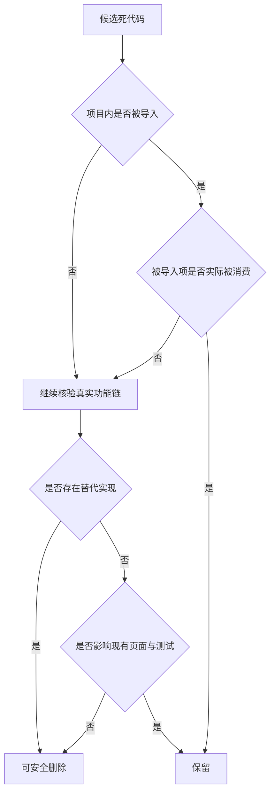

# 死代码清理最终实施说明

## 目标

在不影响当前功能运行的前提下，删除已完成最终核验的无效函数、未使用函数和闲置模块。

## 范围

本次清理对象共 8 处：

| 序号 | 对象 | 类型 |
| --- | --- | --- |
| 1 | `src/lib/dom/injectStyles.ts` 中的 `isStylesInjected` | 未使用函数 |
| 2 | `src/features/details/utils/entityExtract.ts` 中的 `extractPersonBirthDeath` | 未使用函数 |
| 3 | `src/features/details/components/entity-fields/utils.ts` 中的 `pickTypeLabel` | 未使用函数 |
| 4 | `src/features/details/components/PersonPoemTrackMap/utils/trackUtils.ts` 中的 `getAvailableYears` | 未使用函数 |
| 5 | `src/lib/api/v1Api.ts` 中的 `queryFusion` | 未使用函数 |
| 6 | `src/features/details/hooks/useOverviewTabData.ts` 中的 `useBookCover` | 未使用函数 |
| 7 | `src/features/details/utils/externalLinksUtils.ts` | 整体闲置模块 |
| 8 | `src/lib/fallback/index.ts` | 整体闲置模块 |

## 最终核验结论

结论：

- `queryFusion`、`useBookCover`、`isStylesInjected`、`extractPersonBirthDeath`、`pickTypeLabel` 可直接删除
- `getAvailableYears` 可删除，年份计算由 `useTrackData` 内部承担
- `externalLinksUtils.ts` 可整体删除，功能由 `OverviewTabView.tsx` 内部私有实现承担
- `fallback/index.ts` 可整体删除，常量与回退逻辑已被其他模块本地实现替代

## 风险边界

1. 本次判断基于当前仓库内部调用链与测试链
2. 不覆盖仓库外部项目对源码文件的直接引用
3. 清理时严格一文件一提交，避免扩大影响面

## 实施顺序

| 顺序 | 文件 | 原因 |
| --- | --- | --- |
| 1 | `src/lib/dom/injectStyles.ts` | 删除局部函数，风险最低 |
| 2 | `src/features/details/utils/entityExtract.ts` | 删除单函数，不影响现有详情页调用链 |
| 3 | `src/features/details/components/entity-fields/utils.ts` | 删除单函数，不影响字段解析主链 |
| 4 | `src/features/details/components/PersonPoemTrackMap/utils/trackUtils.ts` | 删除单函数，轨迹年份由 Hook 负责 |
| 5 | `src/lib/api/v1Api.ts` | 删除未使用 facade，不影响真实 API 调用 |
| 6 | `src/features/details/hooks/useOverviewTabData.ts` | 删除未使用图书封面 Hook |
| 7 | `src/features/details/utils/externalLinksUtils.ts` | 删除闲置重复模块 |
| 8 | `src/lib/fallback/index.ts` | 删除闲置回退模块 |

## 验证方式

每次删除后执行：

1. `git diff <file>`
2. `git add <file>`
3. `git diff --staged`
4. `git commit`

收尾时执行与相关功能链对应的测试回归。
