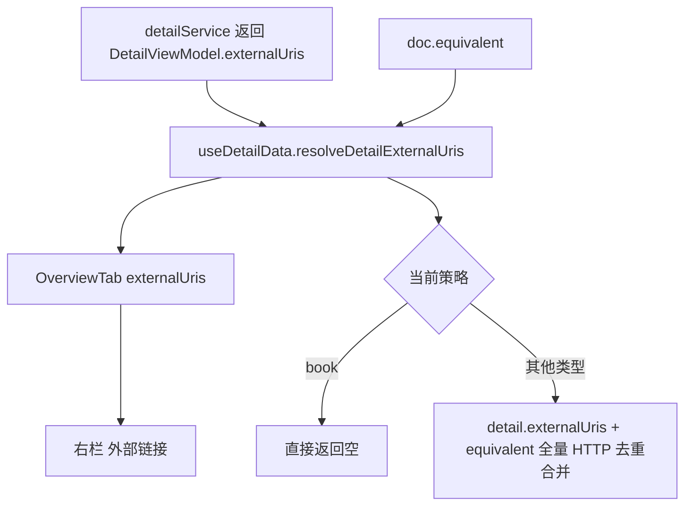
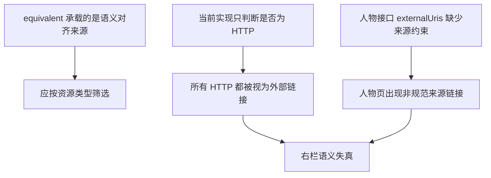

# 详情页外部链接策略收口与同类问题修复方案

## 1. 问题背景

当前详情页右栏“外部链接”的数据来源已经出现策略漂移：

- 人物详情会混入接口层 `externalUris`
- `useDetailData` 又会继续把 `doc.equivalent` 中所有 HTTP 链接无差别并入
- 结果是右栏不再体现“规范对齐链接”，而退化成“任意 HTTP 链接收纳区”

这会导致人物详情把不应展示的链接全部压到右栏底部，也会让其他资源类型存在同类风险。

## 2. 现状链路

## 3. 根因分析

根因不是右栏渲染组件，而是详情数据层没有维护“不同资源类型的外链策略”。

## 4. 目标策略

| 资源类型 | 允许进入右栏的来源 | 说明 |
|---|---|---|
| `person` | `doc.equivalent` 中的 HTTP 链接 | 展示外链，但忽略接口层 `externalUris` |
| `place` | `doc.equivalent` 中的 HTTP 链接 | 展示外链，但忽略接口层 `externalUris` |
| `ancient_book` | `detail.externalUris` 中的 IIIF manifest + `equivalent` 中的 IIIF manifest | 保留古籍数字资源链路 |
| `book` | 不展示 | 现有规则保持不变 |
| `poem` | 不展示 | 现有规则保持不变 |
| `concept` | `doc.equivalent` 中的 HTTP 链接 | 展示外链，但忽略接口层 `externalUris` |

## 5. 来源识别规则

| 资源类型 | 域名 / 路径规则 | 展示语义 |
|---|---|---|
| `person` | `equivalent` 下任意 HTTP URI | 直接作为外链展示 |
| `place` | `equivalent` 下任意 HTTP URI | 直接作为外链展示 |
| `concept` | `equivalent` 下任意 HTTP URI | 直接作为外链展示 |
| `ancient_book` | 路径含 `manifest` 或 `iiif` | IIIF Manifest |

## 6. 修复原则

1. 策略判断收口在 `useDetailData`，而不是视图层。
2. 不再以“是否为 HTTP”作为唯一判断依据。
3. 用资源类型驱动链接筛选，避免不同详情页互相污染。
4. 先补测试再改实现，锁住人物、地点、古籍三条主链路。

## 7. 边界情况

- `person` 的接口层 `externalUris` 即使有值，也不应直接进入右栏。
- `person/place/concept` 的右栏外链只从 `equivalent` 读取，不再混入详情接口层 `externalUris`。
- `equivalent` 中的普通 HTTP 链接应保留展示，不再额外做来源白名单裁剪。
- `ancient_book` 仍需优先保留接口返回的 manifest，避免 Mirador 回归。
- `equivalent` 中空值、非 HTTP、无 `id/uri/@id` 的对象应忽略。

## 8. TODO LIST

- [ ] 新增外链策略分析文档并确认规则边界。
- [ ] 扩充 `useDetailData` 单元测试，覆盖人物/地点/古籍/图书/概念。
- [ ] 修改 `useDetailData` 外链解析逻辑，按资源类型筛选。
- [ ] 运行相关测试，确认不存在旧回归。
- [ ] 按单文件提交要求逐个提交。
