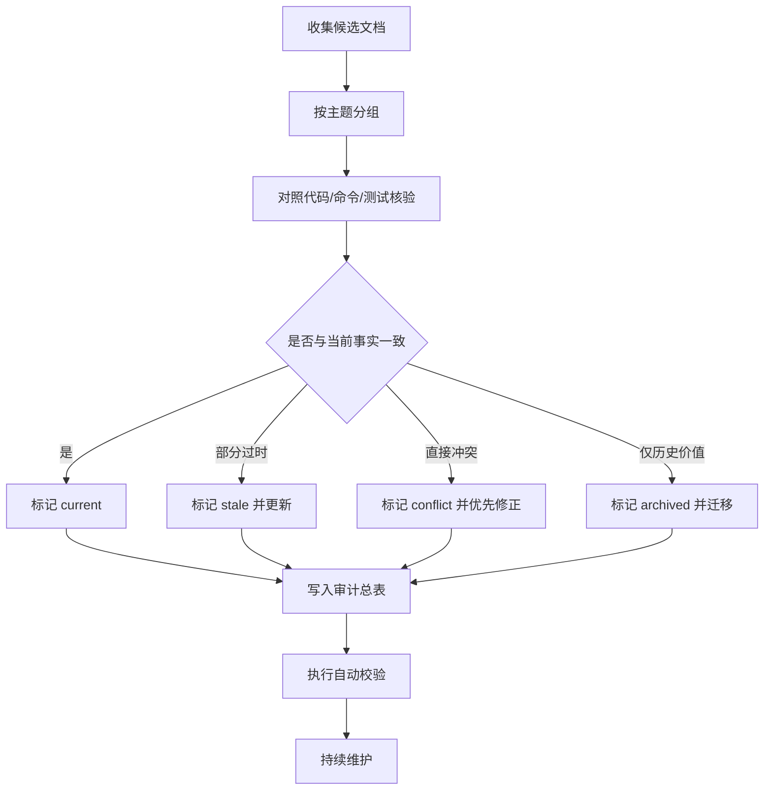

# 文档治理与失效信息清理方案

- 创建时间: 2026-04-10
- 适用分支: `chore/doc-gardening`
- 目标仓库: `heluo-frontend`

## 背景

当前仓库已经积累了大量分析文档、设计稿、原型稿和任务记录，但这些资料存在以下风险：

1. 部分文档与当前代码、测试结果、目录结构和命令入口不一致。
2. 部分文档仍然有历史价值，但已经不适合作为当前事实依据。
3. `AGENTS.md`、`README.md`、`docs/README.md`、`docs/tasks/todo.md` 等高频入口文档，一旦失真，会同时误导人类和智能体。
4. 当前缺少稳定的“文档是否仍然可信”的机械检查，导致失效信息会重复出现。

## 目标

本次治理不是“把文档写得更多”，而是把文档体系改造成可核验、可归档、可持续维护的记录系统。

目标分为四层：

| 层级 | 目标 | 衡量方式 |
| --- | --- | --- |
| P0 | 找出当前失效或冲突的高优先级文档 | 形成首版审计清单 |
| P0 | 明确权威文档入口 | 每个主题最多一个权威入口 |
| P1 | 将历史文档与当前文档分层 | 归档目录和状态标识清晰 |
| P1 | 建立最小自动校验 | 至少能检查路径、命令、目录、锚点事实 |

## 审计对象

优先级从高到低如下：

1. 一级入口文档
   - `AGENTS.md`
   - `README.md`
   - `docs/README.md`
   - `docs/tasks/todo.md`
2. 与运行方式直接相关的文档
   - 启动命令
   - 测试说明
   - 目录结构说明
   - MCP / gstack / 视觉工具说明
3. 与当前产品行为直接相关的设计与方案文档
4. 历史设计稿、原型稿、阶段性报告

## 文档分级规则

每份文档必须在审计结果中落到以下四类之一：

| 状态 | 含义 | 处理动作 |
| --- | --- | --- |
| `current` | 与当前事实一致，可继续作为依据 | 保留并补核验时间 |
| `stale` | 主题仍有效，但局部内容过时 | 更新内容 |
| `conflict` | 与当前事实冲突，继续保留会误导 | 优先修正 |
| `archived` | 仅保留历史价值，不应再作为当前依据 | 移入归档区并标记 |

## 核验原则

所有判断必须基于可验证事实，而不是印象。

优先信源如下：

1. 仓库内真实存在的文件与目录。
2. `package.json` 中真实存在的命令入口。
3. 实际执行结果，例如 `npm run test`、`npm run lint`、`npm run typescript`。
4. 当前源码中的端口、路由、配置和导出名称。
5. 可直接运行的脚本与自动化检查结果。

以下信息不能直接当作事实源：

- 旧计划中的预估状态
- 过期截图上的文案
- 未再次验证的历史报告
- 只存在于对话中的口头结论

## 治理流程

## 执行阶段

### 第一阶段：建立基线

- 新建本方案文档
- 产出首版审计总表
- 先核查高频入口文档

### 第二阶段：修正冲突

- 修正与代码事实冲突的入口文档
- 统一启动命令、测试状态、目录说明
- 去掉会误导智能体的过期断言

### 第三阶段：归档历史资产

- 将纯历史原型、失效方案、过时报告移入归档区
- 为归档文档补“历史资料”标记
- 避免历史文档继续混入当前导航入口

### 第四阶段：补自动化

- 增加 `docs-check` 或同类命令
- 自动检测文档中引用的路径是否存在
- 自动检测高频文档中的关键命令是否仍在 `package.json` 中存在
- 自动检测关键事实是否与最新测试基线冲突

## TODO LIST

- [ ] 形成文档审计总表
- [ ] 核验一级入口文档
- [ ] 标记归档候选文档
- [ ] 补最小文档校验脚本
- [ ] 更新治理后的使用说明

## 边界情况

- 历史设计稿可能仍被后续页面重构参考，不能直接删除，应先归档。
- 某些“失效文档”只是命名过时，但分析结论仍有参考价值，应优先迁移而不是废弃。
- 如果文档描述的是“计划”而不是“现状”，必须明确标识，避免被误读为当前事实。
- 审计工作不能隐式修改产品代码事实，只能修正文档或补校验工具。

## 验收标准

- [ ] 当前分支存在一份可持续更新的文档审计总表
- [ ] 至少完成一级入口文档的事实核验
- [ ] 高风险冲突信息被显式标记或修正
- [ ] 文档治理流程可被后续智能体复用
