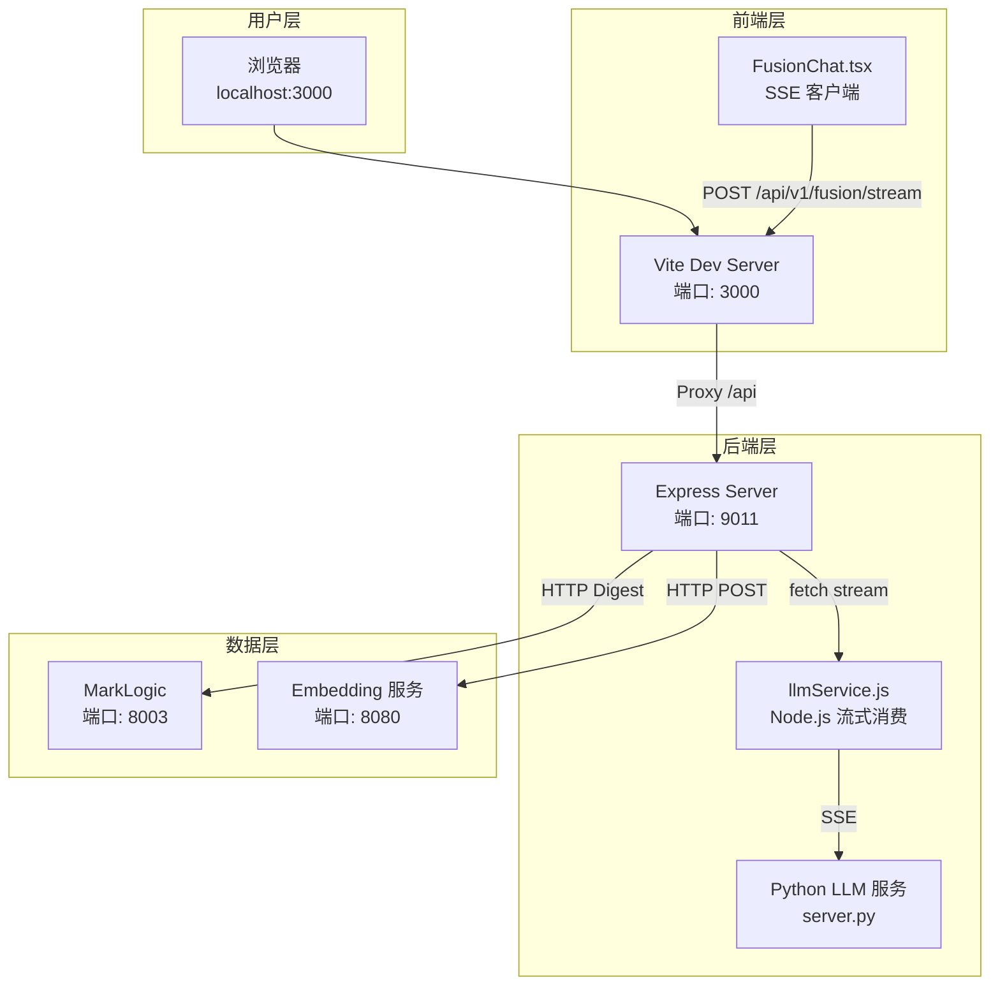
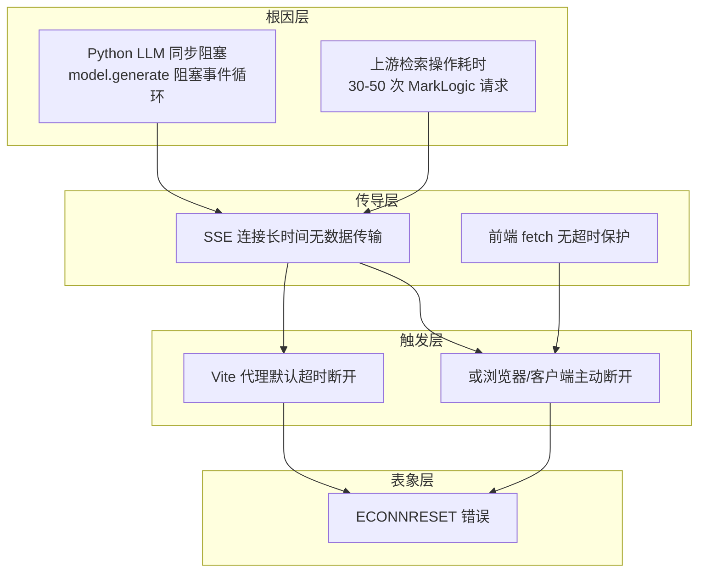
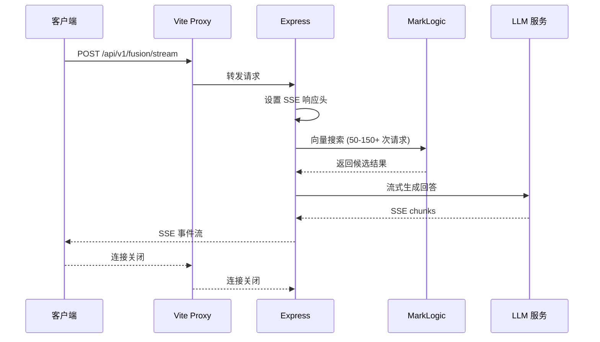
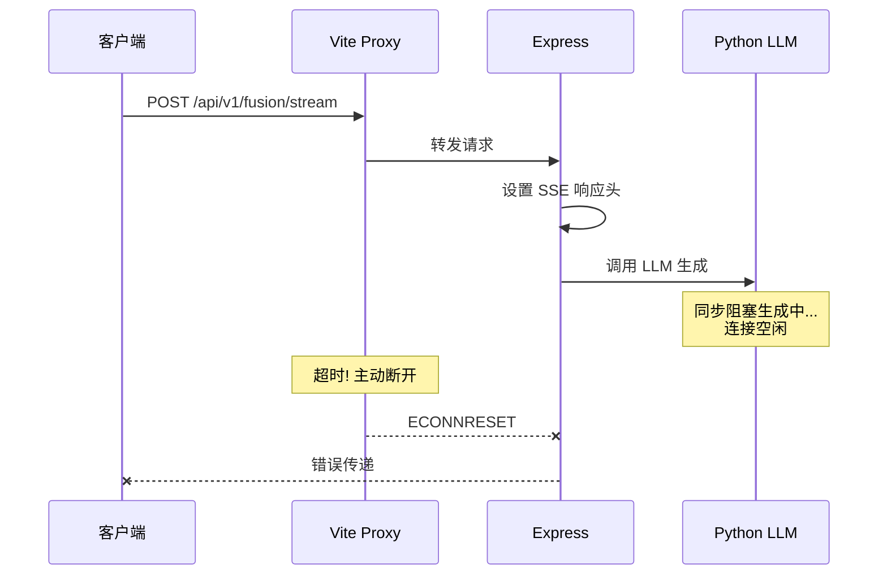

# ECONNRESET 错误诊断报告

> **报告日期**: 2026-02-27
> **错误现象**: 首页对话区域加载失败，Vite 代理报错 `read ECONNRESET`
> **诊断团队**: 前端专家、后端专家、数据库专家、PI
> **评审状态**: ✅ 已通过质量评审并修正

---

## 〇、评审修订说明

本报告经过质量评审团队（前端评审、后端评审、连接架构评审）交叉验证，修正了以下原始分析错误：

| 原始结论 | 评审发现 | 修正结果 |
|----------|----------|----------|
| "50-150+ 次 MarkLogic 请求" | 夸大，实际约 30-50 次 | 已修正 |
| ECONNRESET 与数据库连接池直接相关 | 因果链不成立 | 已删除错误归因 |
| 建议配置 `ws: true` | SSE 不需要 WebSocket | 已删除无效建议 |
| Python 阻塞是唯一根因 | 缺少对代理超时的分析 | 已补充完整因果链 |

---

## 一、问题概述

### 1.1 错误信息

```
[vite] http proxy error: /api/v1/fusion/stream
Error: read ECONNRESET
    at TCP.onStreamRead (node:internal/stream_base_http_commons:216:20)
```

### 1.2 错误含义

`ECONNRESET` 表示 **TCP 连接被对端异常关闭**。

**关键定位**：此错误发生在 **Vite Dev Server → Express 后端** 之间的代理连接，而非 Express → MarkLogic 之间的数据库连接。

---

## 二、系统架构



---

## 三、根因分析（评审修正版）

### 3.1 正确的因果链



### 3.2 关键定位修正

| 层级 | 连接位置 | 问题 | 与 ECONNRESET 的关系 |
|------|----------|------|---------------------|
| **代理层** | Vite → Express | 默认超时断开 | 🔴 **直接触发点** |
| **后端层** | Express → Python LLM | 同步阻塞 | 🟡 **根本原因** |
| **数据层** | Express → MarkLogic | 无连接池 | 🟢 **性能问题，非直接原因** |

**评审结论**：ECONNRESET 发生在 **Vite→Express** 代理层，而非 Express→MarkLogic 数据层。

### 3.3 详细分析

#### 🔴 根因一：Python LLM 服务同步阻塞（高优先级）

| 问题 | 详情 |
|------|------|
| **文件** | `server/llm-service/server.py:127-145` |
| **代码** | `_generate_text()` 是同步函数，在 `async def` 路由中直接调用 |
| **影响** | 阻塞 FastAPI 事件循环，Python 服务无响应，无法发送 SSE 数据 |

```python
# 问题代码 (server.py:127-145, 211-214)
def _generate_text(req: ChatCompletionRequest) -> str:  # 同步函数
    with torch.no_grad():
        output_ids = model.generate(input_ids, **generate_kwargs)  # 阻塞！

@app.post("/v1/chat/completions")
async def create_chat_completion(req: ChatCompletionRequest):  # async 路由
    content = _generate_text(req)  # 直接调用同步函数，阻塞事件循环！
```

#### 🔴 根因二：Vite 代理缺少超时配置（高优先级）

| 问题 | 详情 |
|------|------|
| **文件** | `vite.config.ts:20-25` |
| **代码** | `'/api': backend` 简写形式，无超时配置 |
| **影响** | Vite 使用默认超时，长时间无数据时主动断开连接 |

```typescript
// 当前配置（问题代码）
proxy: {
  '/api': backend,  // 缺少 timeout、proxyTimeout 等配置
}
```

#### 🟡 根因三：SSE 无心跳机制（中优先级）

| 问题 | 详情 |
|------|------|
| **文件** | `server/src/app.js:4601-4829` |
| **现象** | 检索和生成阶段可能长时间（30秒+）无数据传输 |
| **影响** | 代理或客户端认为连接死亡，主动断开 |

#### 🟡 根因四：前端 fetch 无超时保护（中优先级）

| 问题 | 详情 |
|------|------|
| **文件** | `src/features/fusion/FusionChat.tsx:142-155` |
| **代码** | `fetch` 调用没有设置超时，仅用 `AbortController` 处理用户取消 |
| **影响** | 浏览器可能使用默认超时主动断开 |

```typescript
// 当前实现（遗漏超时保护）
const response = await globalThis.fetch('/api/v1/fusion/stream', {
  method: 'POST',
  // 无 timeout 配置
  signal,  // 仅用于用户取消，非超时
})
```

#### 🟢 性能问题：缺少 HTTP 连接池（低优先级）

| 问题 | 详情 |
|------|------|
| **文件** | `server/src/app.js:72-74` |
| **请求数量** | 单次请求触发 **30-50 次** MarkLogic 请求（评审修正：原 "50-150+" 夸大） |
| **影响** | 性能开销，但**不是 ECONNRESET 的直接原因** |

---

## 四、请求流程分析

### 4.1 正常流程



### 4.2 错误流程



---

## 五、修复方案（评审修正版）

### 5.1 方案总览

| 优先级 | 修复项 | 负责模块 | 复杂度 | 作用 |
|--------|--------|----------|--------|------|
| P0 | Vite 代理超时配置 | 前端 | 低 | 延长开发环境超时 |
| P0 | Express 请求超时配置 | 后端 | 低 | 延长服务端超时 |
| P0 | 前端 fetch 超时保护 | 前端 | 低 | 主动取消慢请求 |
| P1 | Python LLM 异步化 | 后端 | 高 | **根本解决方案** |
| P1 | 添加 SSE 心跳 | 后端 | 中 | 防止空闲断开 |
| P2 | HTTP 连接池配置 | 数据层 | 低 | 性能优化 |
| P2 | 请求重试机制 | 数据层 | 中 | 容错增强 |

### 5.2 P0 修复：Vite 代理配置

**文件**: `vite.config.ts`

```typescript
// 修改前
proxy: {
  '/api': backend,
}

// 修改后
proxy: {
  '/api/v1/fusion/stream': {
    target: backend,
    changeOrigin: true,
    timeout: 120000,           // 2 分钟总超时
    proxyTimeout: 120000,      // 代理超时
  },
  '/api': backend,
}
```

### 5.3 P0 修复：Express 请求超时

**文件**: `server/src/app.js`

```javascript
// 在 /api/v1/fusion/stream 路由开头添加
app.post('/api/v1/fusion/stream', (req, res, next) => {
  req.setTimeout(120000)   // 2 分钟
  res.setTimeout(120000)
  next()
}, async (req, res) => {
  // ... 原有逻辑
})
```

### 5.4 P0 修复：前端 fetch 超时保护（评审新增）

**文件**: `src/features/fusion/FusionChat.tsx`

```typescript
// 在 streamFusionQuery 函数中添加超时保护
async function streamFusionQuery(
  params: FusionQueryParamsV1,
  handlers: FusionStreamHandlers,
  signal: globalThis.AbortSignal,
): Promise<void> {
  const controller = new globalThis.AbortController()

  // 设置 2 分钟超时
  const timeoutId = setTimeout(() => {
    controller.abort()
  }, 120000)

  // 合并外部 signal
  const combinedSignal = AbortSignal.any
    ? AbortSignal.any([signal, controller.signal])
    : controller.signal

  try {
    const response = await globalThis.fetch('/api/v1/fusion/stream', {
      method: 'POST',
      headers: {
        'Content-Type': 'application/json',
        Accept: 'text/event-stream',
      },
      body: JSON.stringify(params),
      signal: combinedSignal,
    })
    // ... 原有逻辑
  } finally {
    clearTimeout(timeoutId)
  }
}
```

### 5.5 P1 修复：SSE 心跳机制

**文件**: `server/src/app.js`

```javascript
// 在发送第一个事件后启动心跳
const heartbeatInterval = setInterval(() => {
  res.write(': heartbeat\n\n')  // SSE 注释作为心跳
}, 15000)

// 在 res.end() 之前清除
clearInterval(heartbeatInterval)
```

### 5.6 P1 修复：Python LLM 异步化（根本解决方案）

**文件**: `server/llm-service/server.py`

将同步生成改为真正的异步流式生成：

```python
# 方案 A: 使用 asyncio.to_thread（简单）
@app.post("/v1/chat/completions")
async def create_chat_completion(req: ChatCompletionRequest):
    content = await asyncio.to_thread(_generate_text, req)  # 放到线程池执行
    # ...

# 方案 B: 使用 TextIteratorStreamer（真正的流式）
from transformers import TextIteratorStreamer

async def _generate_stream(req: ChatCompletionRequest):
    streamer = TextIteratorStreamer(tokenizer, skip_prompt=True)
    # 在单独线程中运行生成
    thread = threading.Thread(target=generate_with_streamer, args=(streamer,))
    thread.start()
    for text in streamer:
        yield f"data: {json.dumps({'content': text})}\n\n"
```

### 5.7 P2 修复：HTTP 连接池（性能优化，非 ECONNRESET 直接修复）

**文件**: `server/src/app.js`

```javascript
import { Agent } from 'http'

// 创建连接池 Agent
const mlAgent = new Agent({
  keepAlive: true,
  keepAliveMsecs: 30000,
  maxSockets: 50,
  maxFreeSockets: 10,
  timeout: 30000,
})

// 配置到 digest-fetch（需要修改调用方式）
const mlClient = new DigestClient(MARKLOGIC_USER, MARKLOGIC_PASSWORD, {
  algorithm: 'MD5',
})

// 在实际调用时传递 agent
const response = await marklogicFetch(url, {
  ...init,
  agent: mlAgent,  // 添加此配置
})
```

---

## 六、快速排查清单

在实施修复前，请先确认以下事项：

- [ ] 后端服务 `http://127.0.0.1:9011` 正在运行
- [ ] Python LLM 服务正在运行且可访问
- [ ] MarkLogic 服务 `http://localhost:8003` 可访问
- [ ] Embedding 服务端口 8080 可访问
- [ ] 检查后端控制台是否有其他错误日志
- [ ] 尝试直接访问后端（绕过 Vite 代理）测试是否正常

**绕过代理测试命令**：

```bash
curl http://127.0.0.1:9011/api/v1/fusion/stream \
  -X POST \
  -H "Content-Type: application/json" \
  -H "Accept: text/event-stream" \
  -d '{"query":"测试"}'
```

---

## 七、相关文件索引

| 文件 | 作用 | 关键行号 |
|------|------|----------|
| `vite.config.ts` | Vite 代理配置 | 20-25 |
| `src/features/fusion/FusionChat.tsx` | 前端 SSE 调用 | 142-214 |
| `server/src/app.js` | Express 路由和 SSE 响应 | 72-74, 4597-4829 |
| `server/src/services/llmService.js` | LLM 流式调用 | 10, 368-467 |
| `server/llm-service/server.py` | Python LLM 服务 | 127-145, 211-259 |
| `server/src/services/vectorSearchService.js` | 向量搜索服务 | 37 |
| `server/src/services/embeddingService.js` | Embedding 服务 | 26 |

---

## 八、总结

### 核心问题

本次 ECONNRESET 错误的**正确因果链**：

```
Python LLM 同步阻塞 → SSE 长时间无数据 → Vite 代理/客户端超时 → 主动断开 → ECONNRESET
```

**评审修正要点：**

| 原始分析 | 修正后 |
|----------|--------|
| 数据库连接池导致 ECONNRESET | ❌ 错误，连接池问题仅影响性能 |
| "50-150+ 次请求" | ❌ 夸大，实际 30-50 次 |
| Python 阻塞是唯一根因 | ⚠️ 不完整，需配合代理超时配置 |
| 建议配置 `ws: true` | ❌ 无效，SSE 不需要 WebSocket |

### 推荐修复顺序

1. **立即（5-10 分钟）**：
   - Vite 代理超时配置
   - Express 请求超时配置
   - 前端 fetch 超时保护

2. **短期（1-2 小时）**：
   - SSE 心跳机制

3. **中期（需单独排期）**：
   - Python LLM 异步化（**根本解决方案**）

4. **低优先级**：
   - HTTP 连接池（性能优化）

---

*报告生成时间: 2026-02-27 14:15*
*评审修正时间: 2026-02-27 14:25*
*诊断团队: Agent Team (前端专家 + 后端专家 + 数据库专家 + PI + 质量评审团队)*
