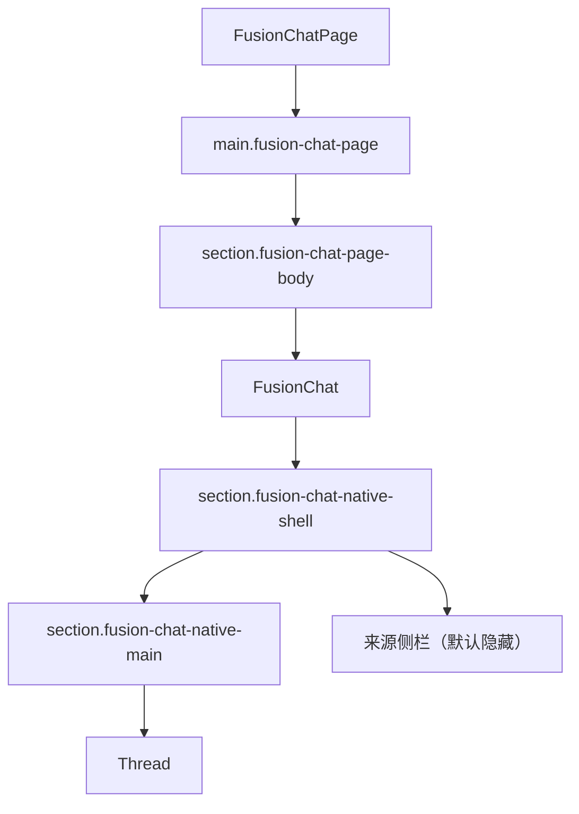
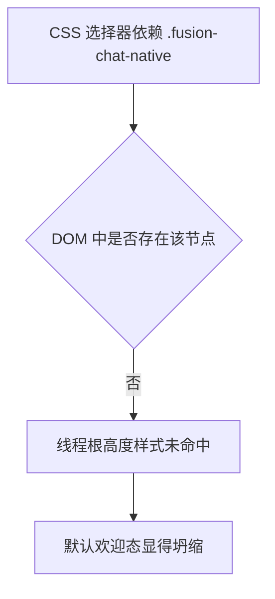

# AI 问答默认单栏欢迎态坍缩修复分析

## 问题概述

当前 AI 问答页面在默认状态下保持单栏是正确的，但欢迎态视觉高度不足，页面会显得“塌”。这不是来源侧栏逻辑引起的，而是默认高度模型和样式命中链路存在缺口。

## 现状结构

当前页面结构如下：

默认状态下：

- `shouldShowSourceSidebar('', 0)` 返回 `false`
- 页面固定走单栏
- 右侧来源栏不会渲染

## 根因分析

### 1. 高度链路不足

目前聊天页只给线程根设置了固定最小高度思路，但页面外层没有“首屏剩余高度”链路。

实际实现里，`B -> C -> D -> E` 这条链路不完整，因此默认欢迎态无法稳定占满首屏剩余空间。

### 2. 选择器未命中

当前样式大量写成：

- `.fusion-chat-native .aui-thread-root`
- `.fusion-chat-native .aui-thread-viewport`

但实际结构中并没有 `.fusion-chat-native` 包裹节点，因此这些样式命中条件并不成立。

## 修复方向

### 结构层

- 在 `FusionChatPage` 中补上稳定的页面壳层类名
- 让现有 `.fusion-chat-native .aui-*` 规则真正命中聊天线程

### 样式层

- 在页面容器定义“首屏剩余高度”变量
- 让 `page -> page-body -> shell -> main -> thread root` 建立完整的最小高度传递
- 使用“固定最小高度 + 视口兜底高度”组合，而不是单独拉高一个 magic number

## 测试重点

| 场景 | 预期 |
| --- | --- |
| 默认进入 `/chat` | 仍然是单栏 |
| 默认欢迎态 | 存在新的页面壳层高度钩子 |
| 线程根样式 | 能被 `.fusion-chat-native .aui-thread-root` 命中 |
| 进入回答态 | 不影响后续来源栏显示逻辑 |

## 实施顺序

1. 先补测试，锁定默认欢迎态的结构钩子
2. 修改 `FusionChatPage.tsx`，补齐页面壳层类名
3. 修改 `_pages.css`，建立首屏剩余高度链路
4. 执行前端测试与构建回归
