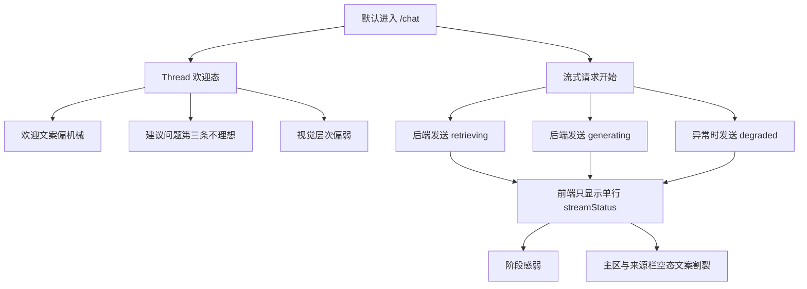

# AI 问答默认欢迎态优化分析

## 背景

当前 AI 问答默认欢迎态已经完成了基础布局修复，但仍存在三个体验层面的不足：

1. 默认欢迎区视觉层次偏弱，虽然不再坍缩，但缺少“默认可用入口”的引导感。
2. 默认文案过于机械，只描述“自然语言回答”，没有突出“证据支撑”的价值。
3. 等待过程只有底部单行状态，无法清晰区分“检索中”“生成中”“降级提示”。

本轮优化只聚焦默认欢迎态、默认建议问题与等待流程展示，不改对话接口、来源栏触发逻辑和后端事件协议。

## 当前实现现状

- 默认建议问题定义在 `src/features/fusion/FusionChat.tsx` 的 `QUICK_QUESTIONS` 常量。
- 欢迎区文案通过 `Thread` 的 `welcome.message` 传入。
- 等待状态由前端 `streamStatus` 字符串驱动，只在聊天区底部显示单行状态块。
- 后端 SSE 已经提供阶段语义：`retrieving`、`generating`、`degraded`，但前端尚未将其结构化展示。

## 问题拆解

## 目标状态

### 视觉层面

- 保持当前单栏欢迎态与居中布局。
- 在不改变整体品牌主色的前提下，引入更明确的暖色点缀、细边框、柔和底纹与留白层次。
- 让欢迎区、建议问题、输入区形成统一的纵向视觉节奏。

### 文案层面

- 欢迎文案更短，更强调“基于证据回答”。
- 第三条建议问题替换为作品比较类问题，避免重复与泛化：
  - `《春望》和《望岳》表达的情感有什么不同？`

### 流程层面

- 将当前单行状态升级为“阶段提示条”。
- 阶段提示条至少支持：
  - `retrieving`：强调正在检索证据与来源
  - `generating`：强调正在整合证据并生成回答
  - `degraded`：强调服务降级与稍后重试建议
- 来源栏在无条目时的空态文案与当前阶段提示保持语义一致。

## 实施策略

### 1. 欢迎态逻辑收口到 FusionChat

- 在 `FusionChat.tsx` 中集中定义：
  - 默认欢迎文案
  - 默认建议问题
  - 等待阶段映射
  - 来源空态文案映射
- 避免把文案散落在 JSX 和 CSS 中，便于后续再调整。

### 2. 等待过程从“字符串”升级为“阶段模型”

- 前端继续接收后端原始 `status.message`。
- 额外解析 `status.stage`，生成统一的阶段视图模型：
  - 标题
  - 描述
  - 样式变体
- 若后端未提供有效阶段，保底回退到原始文案显示。

### 3. 视觉优化主要落在 _pages.css

- 为欢迎区补充：
  - 中心内容容器的间距和最大宽度控制
  - 欢迎提示文字的字重、颜色和对齐
  - 建议问题按钮的卡片化与悬停反馈
- 为阶段提示条补充：
  - 基础容器
  - 检索中 / 生成中 / 降级三种视觉变体
- 为来源栏空态补充与阶段一致的视觉语气。

## 预期验证点

1. 默认进入 `/chat` 时仍为单栏欢迎态。
2. 欢迎文案、第三条建议问题已更新。
3. 发送问题后，前端能区分至少三种等待阶段提示。
4. 来源栏空态会随阶段改变提示文案，不再是固定“正在整理来源”。
5. 已修复的欢迎态居中、底部对齐和来源栏逻辑不回退。
