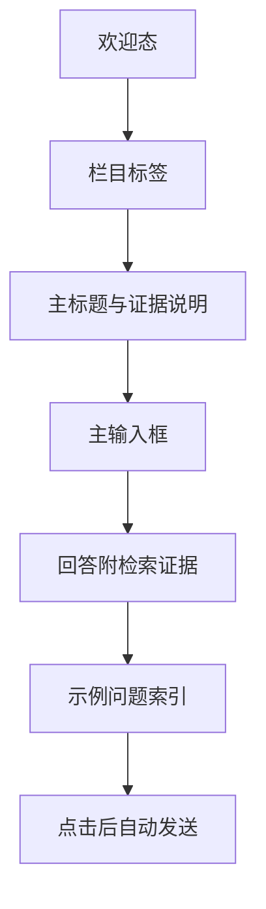

# 智能对话输入优先重设计方案

## 问题

默认欢迎态把欢迎语、示例问题和输入框分别放进多层圆角容器，导致三个问题：

1. 输入框不是首要动作，用户先看到装饰再看到可操作区域。
2. 三条示例问题看起来像并列卡片，缺少“文献索引”的连续阅读感。
3. 外框、渐变、粒子和阴影叠加，削弱现有深蓝、金色与宣纸体系的学术气质。

## 目标结构

## 实施边界

- 保留全局搜索、主导航、面包屑、路由和后端问答流程。
- 保留 assistant-ui 的输入、发送、停止、消息、清除会话与来源侧栏能力。
- 只替换默认空会话的欢迎区和输入区编排，并收敛对应样式。
- 有消息时不显示欢迎标题、证据提示和示例索引，输入框继续作为普通对话输入区。
- 使用现有图标库，不新增图片、手绘 SVG 或装饰资产。

## 验收条件

- 欢迎态顺序为标题说明、输入框、证据提示、示例问题索引。
- 三条示例问题保持原文，点击后仍自动发送。
- 默认页不再显示圆形字母头像、粒子背景、嵌套玻璃卡片和大面积阴影。
- 桌面端 599 × 863 与移动端 390 × 844 均无横向溢出或遮挡。
- 输入、发送、示例问题、导航和清除会话交互可用。
- 相关 Vitest、全量测试、生产构建与 ESLint 通过。
