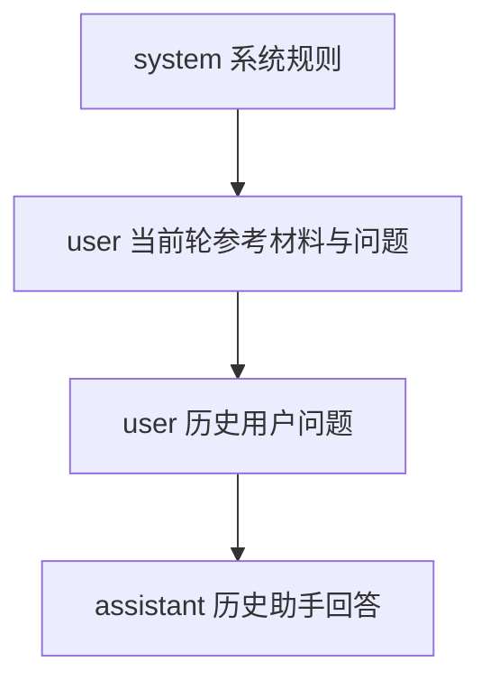
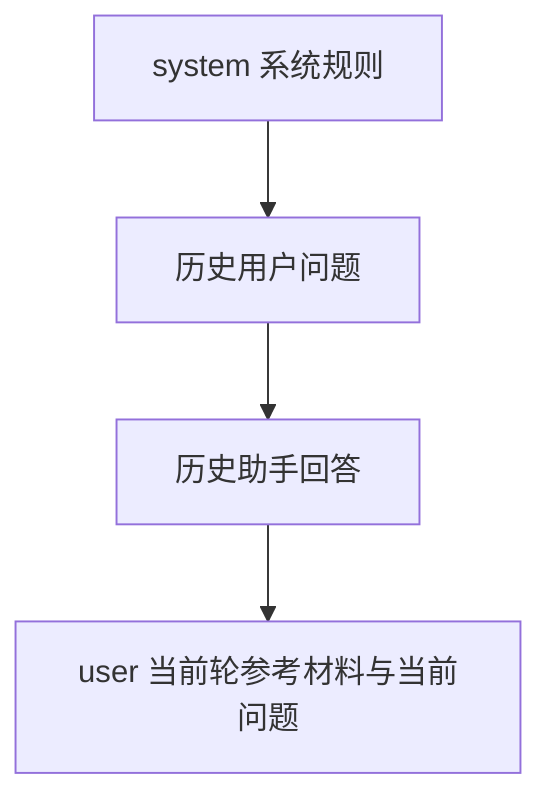
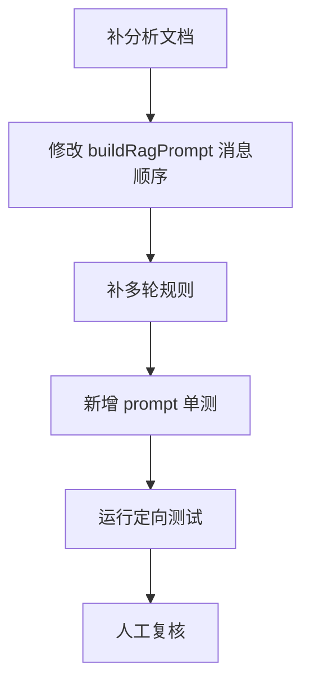

# Fusion Chat 多轮串题修复分析

## 1. 问题现象

在 AI 聊天中，第一轮提问“杜甫写给李白的诗有哪些？”后，第二轮改问“《春望》和《望岳》表达的情感有什么不同？”，系统会错误回到上一轮主题，输出围绕“杜甫写给李白的诗”是否可答的说明，而不是比较《春望》《望岳》的情感差异。

这说明当前系统虽然携带了多轮上下文，但没有把“当前轮问题”稳定地作为最终回答焦点。

## 2. 现状分析

### 2.1 前端上下文传递

[`server/src/services/llm/prompts/index.js`](/S:/vibe_coding/heluo-frontend/server/src/services/llm/prompts/index.js) 之外的调用链显示：

- 前端会提取当前线程中的历史消息；
- 后端会接收 `conversationHistory`；
- LLM 生成阶段会把历史对话拼入 prompt。

因此，问题不在“历史没有传到后端”，而在“历史如何参与最终 prompt”。

### 2.2 Prompt 组装顺序

当前 `buildRagPrompt()` 的消息顺序是：

这种顺序会让历史消息出现在当前问题之后。对于聊天模型来说，越靠后的消息通常越容易被当成“最近的真实轮次”。结果就是：

- 模型读到当前轮问题；
- 随后又看到上一轮问答；
- 最终把上一轮问题误当成最新问题，发生串题。

### 2.3 检索与生成职责分离

当前检索主要围绕本轮 `query` 执行，生成阶段才引入 `conversationHistory`。这意味着：

- 检索侧已经能找到《春望》《望岳》相关材料；
- 但 LLM 生成侧被错误的消息顺序带偏；
- 最终答案出现“材料对了，问题答偏了”的现象。

## 3. 根因判断

根因可以概括为两点：

| 编号 | 根因 | 影响 |
|---|---|---|
| 1 | `buildRagPrompt()` 将历史对话放在当前问题之后 | 模型把上一轮问题误判为当前轮主问题 |
| 2 | 多轮规则不够明确 | 模型即使看见当前问题，也可能被历史主题拖走 |

其中，第 1 点是主因，第 2 点是放大器。

## 4. 修复策略

### 4.1 调整消息时序

将消息顺序改为真实对话顺序：

这样可以保证：

- 历史只提供语义背景；
- 最后一条 `user` 消息始终代表当前轮真实需求；
- 模型回答时优先聚焦当前问题。

### 4.2 收紧多轮约束

在 prompt 规则中补充明确要求：

- 若当前问题与上一轮主题不同，优先回答当前问题；
- 只有当当前问题出现“这首诗”“这两首”“它”等承接表达时，才使用历史补全；
- 禁止把上一轮问题重新当成当前问题作答。

### 4.3 测试策略

优先在 `tests/server/llmService.test.ts` 补充 `buildRagPrompt()` 回归测试，因为这里可以直接验证消息数组顺序和内容归属，不依赖真实 LLM。

测试重点：

- 历史消息应位于当前问题之前；
- 最后一条 `user` 消息必须包含当前轮参考材料与当前轮问题；
- 当前轮问题为“《春望》和《望岳》表达的情感有什么不同？”时，最后一条消息不能被历史问题覆盖；
- 系统规则中必须包含“优先回答当前问题”的约束。

## 5. 实施步骤

## 6. 风险与边界

| 场景 | 处理方式 |
|---|---|
| 当前问题是明确新问题 | 忽略上一轮主题漂移，直接回答当前轮 |
| 当前问题是承接式追问 | 允许使用历史补全省略指代 |
| 无历史消息 | 行为保持不变 |
| 历史很多轮 | 仍以最后一条当前用户问题为回答锚点 |

## 7. 结论

这次修复应聚焦在 LLM prompt 组装层，而不是前端参数或检索逻辑。只要把历史消息移到当前问题之前，并在 prompt 中显式声明“当前问题优先”，就能以最小改动修复这类多轮串题问题，并通过单元测试稳定防回归。
