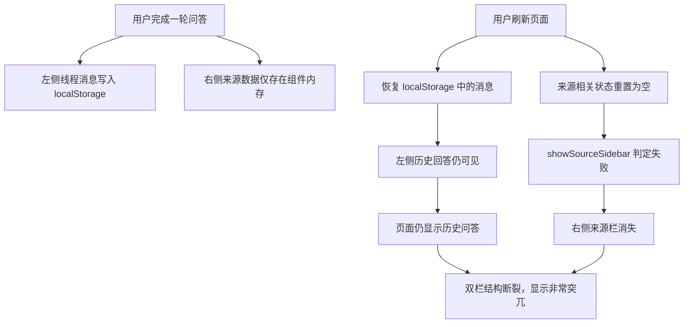
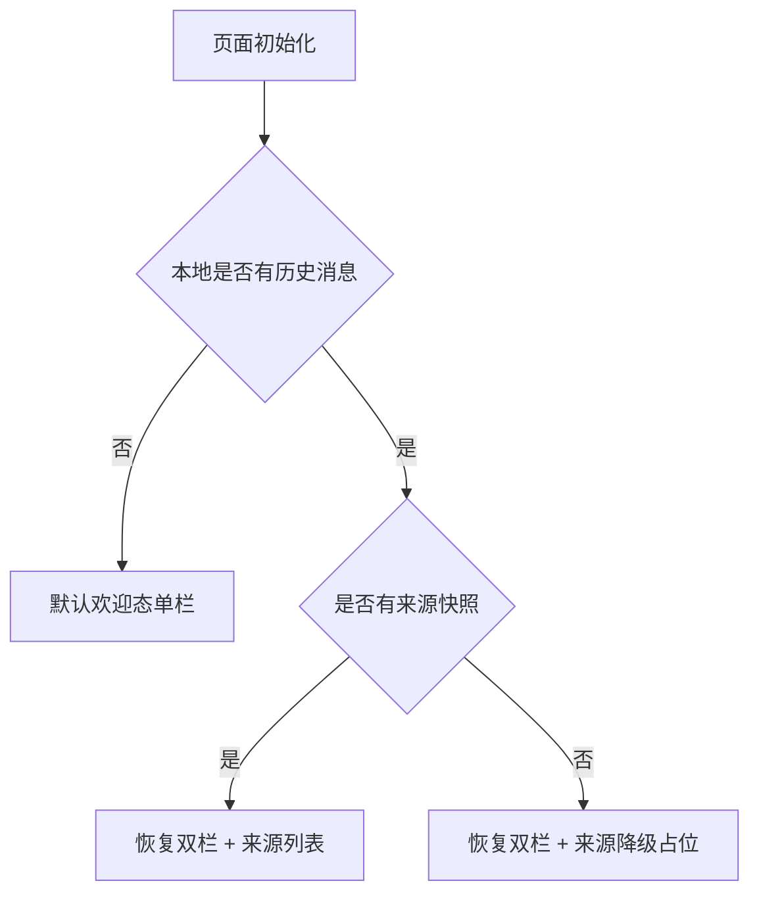

# AI 对话刷新后来源侧栏丢失修复分析

## 问题概述

当前融合问答页会在刷新后恢复左侧历史消息，但不会恢复右侧来源侧栏需要的来源快照。结果是页面从“双栏问答态”退化为“只有历史回答的单栏态”，界面结构突变，显示效果很差。

## 现状分析

- [`/S:/vibe_coding/heluo-frontend/src/features/fusion/FusionChat.tsx`](/S:/vibe_coding/heluo-frontend/src/features/fusion/FusionChat.tsx) 只从本地存储恢复 `initialMessages`
- [`/S:/vibe_coding/heluo-frontend/src/features/fusion/conversationUtils.ts`](/S:/vibe_coding/heluo-frontend/src/features/fusion/conversationUtils.ts) 只持久化消息会话，不保存来源快照
- 右侧来源栏显示依赖 `streamStatus` 或 `sourceItems.length`，两者刷新后都会回到内存初始值
- 因此历史消息仍在，但 `shouldShowSourceSidebar('', 0)` 为 `false`，右侧来源栏直接消失

## 根因图

## 修复策略

### 1. 扩展会话持久化模型

在会话结构中增加最小来源快照字段，只保存刷新后恢复页面所需的信息：

- `sidebarItems`
- `sourceSnapshotStatus`
- `hasSourceSnapshot`

其中 `sidebarItems` 直接复用现有右侧来源条目结构，避免另起一套存储格式。

### 2. 只持久化“最终可见来源态”

不重放整个流式过程，只在来源已稳定可见时覆盖保存最新来源快照：

- 正在流式生成时，仍使用内存态
- 回答完成后，保存最后一轮来源列表
- 清空会话时，同时清空来源快照

### 3. 刷新后的右栏展示分两类

- 若恢复出来源快照：直接恢复双栏，并展示来源列表
- 若恢复出历史消息但没有来源快照：仍保留右栏，但展示降级占位文案

这样可以保证“恢复态”始终有稳定的页面结构，不会出现左边一大块历史回答、右边整列消失的错位体验。

## 渲染决策图

## 测试重点

- 会话工具应能保存和读取来源快照
- 旧版仅含消息的本地存储应兼容读取
- 刷新恢复后，有来源快照时应继续显示来源栏
- 刷新恢复后，无来源快照时应显示降级占位，而不是直接隐藏右栏
- 首次进入无历史消息时，仍保持当前单栏欢迎态

## 默认文案

- 降级标题：`来源暂未恢复`
- 降级说明：`当前为已恢复会话，原始来源未保留；如需查看来源，请重新提问。`

## 实施边界

- 不修改后端接口
- 不从历史回答正文中反推来源
- 不实现“点击历史某一轮切换对应来源”
- 仅修复刷新恢复后的显示一致性问题
