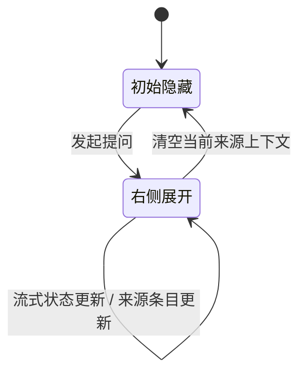
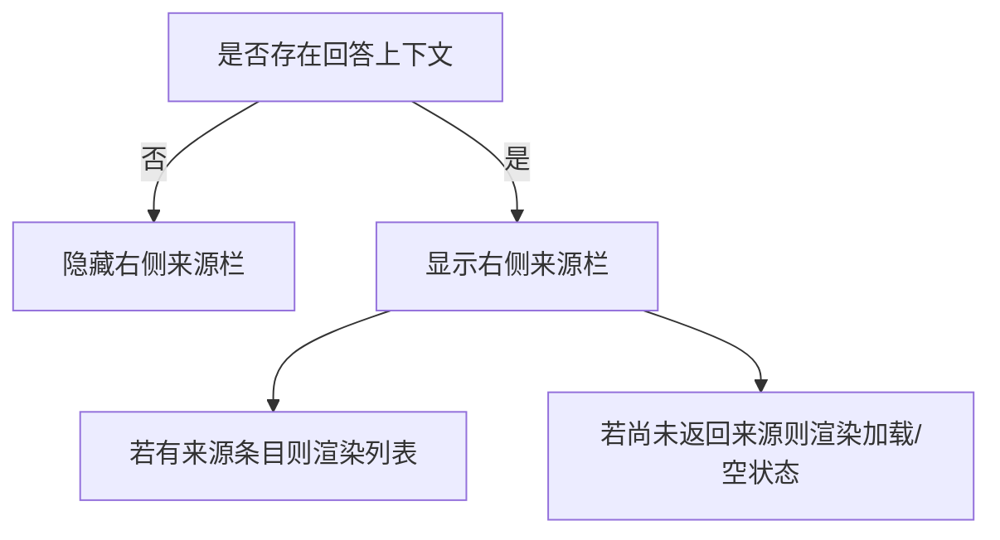
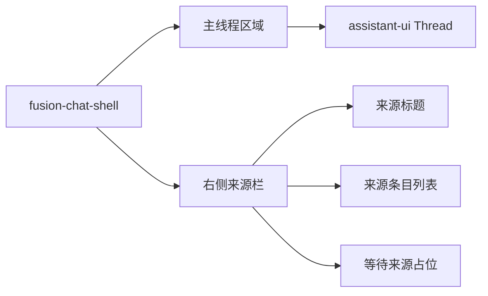
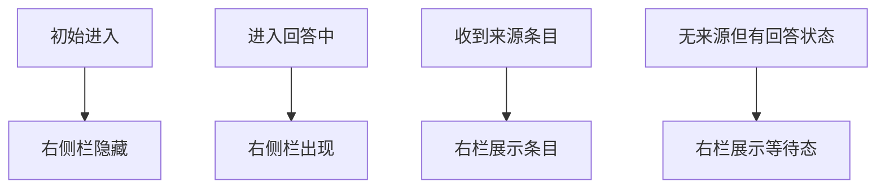

# 融合问答来源区右侧展开方案

## 背景

当前对话页已经收敛为 `assistant-ui` 原生主线程，但来源区仍位于主线程下方，和“回答过程中动态出现来源条目”的使用场景不完全匹配。

本次目标：

1. 来源区域默认隐藏。
2. 当问答进入回答阶段时，在右侧栏展开。
3. 在右侧栏中列出当前回答对应的来源条目。

## 目标交互

## 显隐规则

建议将来源区显隐收敛为一个简单状态：

“存在回答上下文”可定义为：

1. 当前存在流式状态文案。
2. 或当前已收到来源条目。

这样可以满足：

- 首次进入页面不显示右栏。
- 用户提问后，右栏立刻参与布局。
- 来源返回慢于正文时，右栏仍保留占位，不会让布局抖动。
- 本轮回答完成后，如果已有来源条目，右栏继续显示，便于查看。

## 页面结构

建议采用双栏布局，只让右栏承担来源区职责，不再让来源区出现在主线程下方。

## 样式方向

### 主布局

| 状态 | 布局 |
| --- | --- |
| 来源隐藏 | 单列，主线程最大宽度居中 |
| 来源展开 | 两列，主线程在左，来源栏固定宽度在右 |

### 右侧栏

| 项目 | 建议 |
| --- | --- |
| 宽度 | 320px 左右 |
| 定位 | 普通网格列，不使用绝对定位 |
| 空态 | “正在整理来源...” 或 “暂无相关来源” |
| 滚动 | 栏内独立滚动，避免影响主线程 |

## 实施步骤

1. 在 `FusionChat.tsx` 中提炼“来源区是否显示”的判断逻辑。
2. 将现有页面结构从单列改为“主线程 + 右侧来源栏”。
3. 在来源区隐藏时，不渲染右侧栏节点。
4. 在来源区显示但无条目时，渲染等待态。
5. 保留现有来源条目卡片渲染函数，减少重复实现。

## 测试重点

测试覆盖建议：

| 场景 | 预期 |
| --- | --- |
| 初始渲染 | 不显示右侧来源栏 |
| 有流式状态无来源条目 | 显示右侧来源栏和等待态 |
| 有来源条目 | 显示右侧来源栏和条目列表 |
| 清空回答上下文 | 右侧来源栏隐藏 |

## 结论

这次调整不应回退到旧的绝对定位滑出面板，而应继续保持原生主线程不动，只在外层增加一个简单、可预测的右侧来源栏。这样复杂度最低，也能满足“默认隐藏，回答时在右侧展开”的需求。
