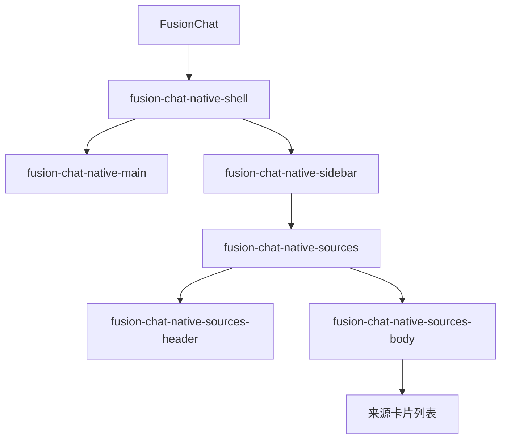
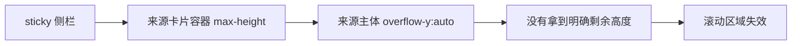
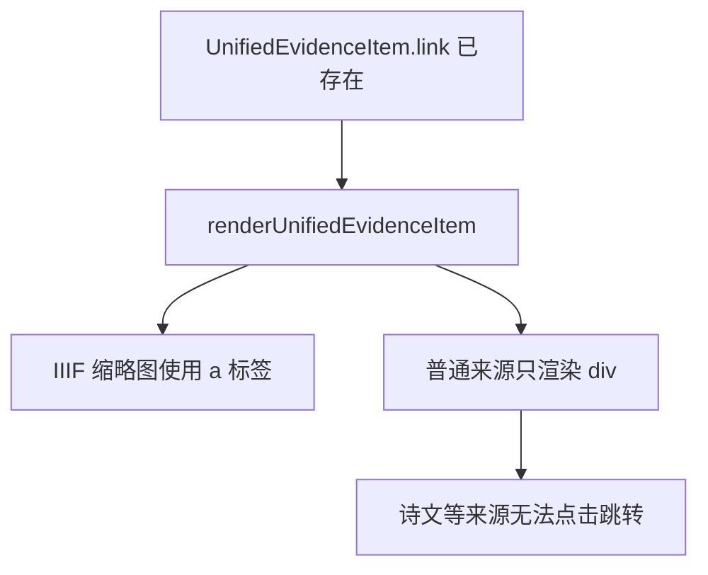

# AI 对话来源侧栏滚动与跳转修复分析

## 问题概述

当前 AI 对话界面的来源侧栏存在两个直接影响使用的问题：

| 问题 | 表现 | 影响 |
| --- | --- | --- |
| 来源列表无法下滑 | 来源条目超过可视区域后，桌面端侧栏无法继续向下滚动 | 用户无法查看完整来源 |
| 诗文来源无法点击跳转 | 来源卡片中的诗文、人物、古籍等条目没有可点击入口 | 用户无法从回答快速跳到详情页 |

## 现状结构

来源侧栏由 `FusionChat` 渲染，结构如下：

## 根因分析

### 1. 滚动问题

桌面端来源区当前只有 `.fusion-chat-native-sources-body` 设置了 `overflow-y: auto`，但上层容器没有建立稳定的纵向弹性高度链路。

问题点：

- `.fusion-chat-native-sidebar` 是 `position: sticky`
- `.fusion-chat-native-sources` 只有 `max-height`，没有 `display: flex`
- `.fusion-chat-native-sources-body` 没有 `flex: 1` 与 `min-height: 0`

因此浏览器不会把“头部之外的剩余高度”稳定分配给正文滚动区。

### 2. 点击跳转问题

来源卡片当前只给 IIIF 缩略图包裹了 `<a>`，普通条目标题和整张卡片都不是链接。

这说明问题不在数据层，而在渲染层没有消费现成的 `item.link`。

## 修复策略

### 样式层

- 让 `.fusion-chat-native-sidebar`、`.fusion-chat-native-sources`、`.fusion-chat-native-sources-body` 形成完整高度链路
- 在桌面端为来源卡片容器启用纵向 `flex`
- 让正文区域独占剩余高度并负责滚动

### 交互层

- 对存在 `item.link` 的来源项统一提供点击入口
- 站内 `/details?...` 链接使用路由友好的方式跳转
- 外部链接保持普通链接语义
- 避免出现“外层卡片可点、内层缩略图也可点”的嵌套冲突

## 验证重点

| 场景 | 预期 |
| --- | --- |
| 桌面端来源很多 | 右侧来源区可以持续滚动到底 |
| 点击诗文来源 | 跳转到 `/details?uri=...` |
| 点击 IIIF 来源 | 仍能打开对应影像链接 |
| 移动端窄屏 | 不引入新的双重滚动问题 |

## 实施顺序

1. 先补测试，锁定“来源项具备点击跳转入口”的行为
2. 修改 `FusionChat.tsx`，统一来源卡片点击逻辑
3. 修改 `_pages.css`，修复桌面端侧栏滚动容器高度分配
4. 执行相关前端测试与构建回归
