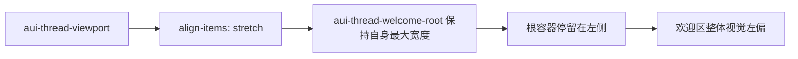

# AI 问答欢迎区根容器居中修复分析

## 问题概述

当前 AI 问答默认欢迎态里，`div.aui-thread-welcome-root` 仍然是向左贴齐，而不是在大卡片内部水平居中。这会让欢迎语、建议问题和输入框整体看起来偏左，不符合欢迎态应有的居中视觉。

## 根因分析

当前我们对 `assistant-ui` 的欢迎态做了高度修复，但没有显式处理欢迎区根容器在 viewport 里的横向对齐。

具体表现：

- `aui-thread-viewport` 当前被覆盖为 `align-items: stretch`
- `aui-thread-welcome-root` 没有 `align-self: center`
- 因此欢迎区根容器虽然有 `max-width`，但仍然以左对齐方式放置

## 修复方向

### 样式层

- 为 `.fusion-chat-native .aui-thread-welcome-root` 增加自居中规则
- 让欢迎区根容器宽度和线程主内容宽度保持一致
- 必要时补充欢迎区中心块的文本居中，避免视觉上仍然偏左

### 测试层

- 补一个最小样式契约测试
- 锁定欢迎区根容器必须具备居中规则，避免后续再次被覆盖掉

## 预期结果

| 场景 | 预期 |
| --- | --- |
| 默认欢迎态桌面端 | 欢迎区整体水平居中 |
| 默认欢迎态移动端 | 仍然居中，不引入横向溢出 |
| 输入框与欢迎建议 | 在同一视觉中心线上 |
