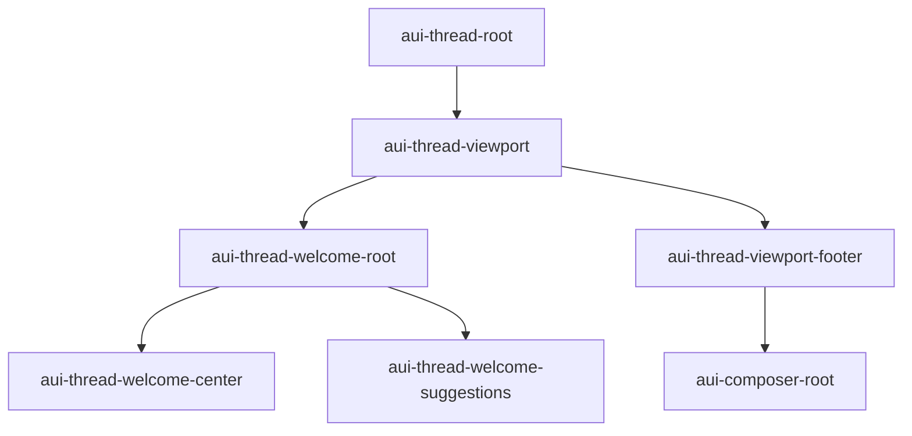
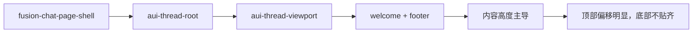
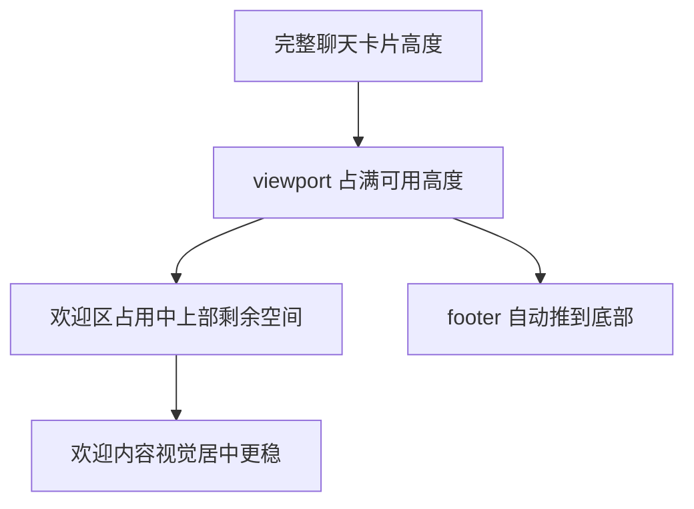

# AI 问答欢迎态 viewport 底部对齐修复分析

## 问题概述

当前 AI 问答页面默认欢迎态虽然已经不再整体坍缩，但 `assistant-ui` 的欢迎区内部仍存在布局问题：

| 问题 | 表现 |
| --- | --- |
| 欢迎区位置偏上 | 欢迎语、建议问题和输入区整体离顶部过近 |
| 底部未对齐 | composer 区域没有稳定贴到底部，视觉重心上移 |
| 布局显得“歪” | 欢迎态内部垂直分配不均衡，和大卡片容器不匹配 |

## 当前 DOM 结构

## 根因分析

### 1. 线程根高度与 viewport 高度没有完全打通

虽然外层页面已经给了首屏最小高度，但 `assistant-ui` 内部的 `.aui-thread-viewport` 仍主要按内容高度收缩。

### 2. footer 缺少“自动顶到底部”的约束

`assistant-ui` 默认 footer 是 sticky bottom，但在 viewport 自身没有被拉满时，sticky 只会停留在当前内容盒子的底部，而不是整张聊天卡片的底部。

### 3. 这不是欢迎内容本身的文案或按钮数量问题

问题主要在于：

- `.aui-thread-root`
- `.aui-thread-viewport`
- `.aui-thread-viewport-footer`

这三层之间缺少稳定的 `flex` 高度传递和 `margin-top: auto` 推底逻辑。

## 修复方向

### 样式层

- 让 `.aui-thread-root` 在主栏中继续作为可伸展 flex 子项
- 让 `.aui-thread-viewport` 明确承担剩余高度，而不是按内容自然收缩
- 让 `.aui-thread-viewport-footer` 使用 `margin-top: auto` 贴底

### 预期效果

## 验证重点

| 场景 | 预期 |
| --- | --- |
| 默认欢迎态 | 欢迎语与建议问题不再挤在顶部 |
| 默认欢迎态 | 输入框稳定贴近卡片底部 |
| 桌面端大屏 | 垂直重心自然，不卡在上半区 |
| 移动端窄屏 | 不引入新的双滚动或裁切 |
