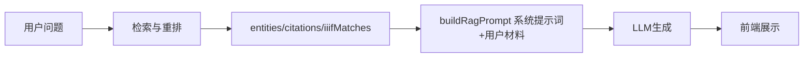
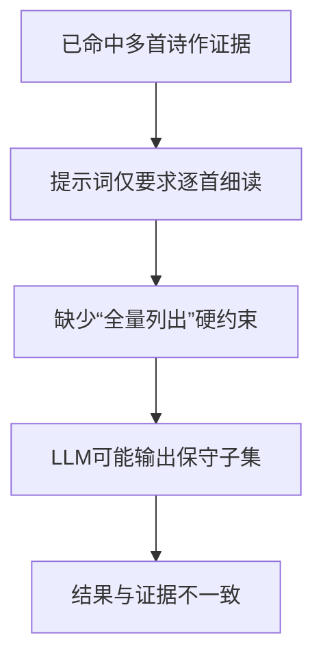

# 融合问答全量列出约束调整分析

## 背景
当前问题“杜甫给李白写的诗有哪些？”在证据侧已命中《梦李白二首》《赠李白》《天末忆李白》，但回答正文偶发只输出子集，导致“回答结论”和“已检索证据”不一致。

## 目标
- 在提示词层面强制“命中多首候选诗作时全量列出，不得遗漏”。
- 保持现有“纯文本输出、逐首细读、四维分析、IIIF文本解读”约束不回退。

## 现状链路

## 问题定位

## 方案
1. 在 `buildRagPrompt` 的系统提示词中新增“全量列出”硬约束。
2. 在 `tests/server/llmService.test.ts` 新增断言，锁定提示词文本中必须包含该约束。
3. 运行 `tests/server/llmService.test.ts` 验证不回归。

## 边界与风险
- 风险1：全量列出可能引入弱相关候选。
  - 约束补充：仅列“与问题直接相关且材料明确命中”的候选。
- 风险2：回答变长。
  - 保持“先结论再解释”，避免冗余。

## TODO LIST
- [ ] 更新提示词：加入“全量列出，不得遗漏”规则。
- [ ] 更新测试：新增/调整断言覆盖该规则。
- [ ] 运行单测并记录结果。
- [ ] 前端实测同一问题确认稳定性提升。
