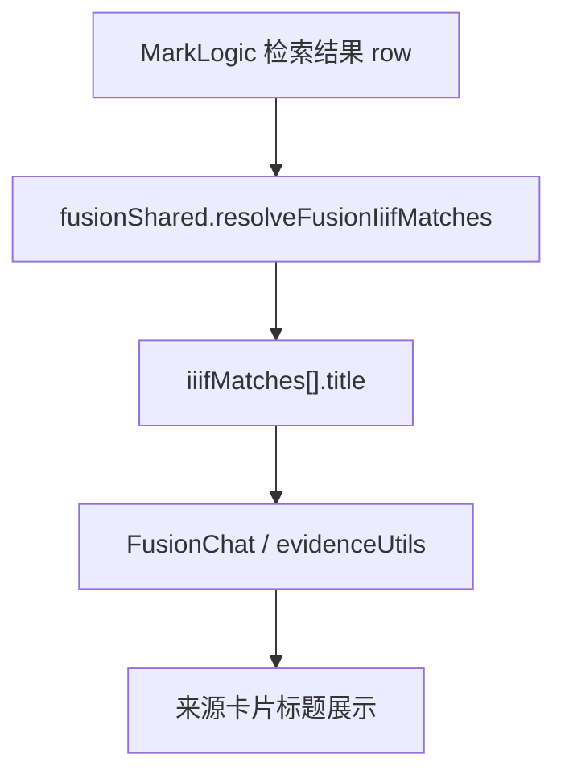
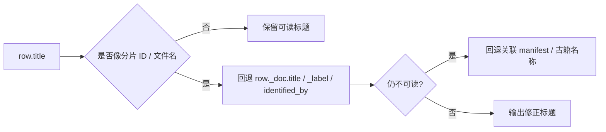

## AI 来源栏 IIIF 标题回显为 ID 问题分析

### 现象

AI 聊天右侧来源栏中的 IIIF 古籍卡片，标题展示为类似 `17270_1181_1397_1` 的分片 ID，而不是用户可读的古籍名称。

### 当前数据链路



### 根因

| 环节 | 当前行为 | 结果 |
| --- | --- | --- |
| `server/src/usecases/fusionShared.js` | IIIF 命中标题直接取 `row.title` | 当检索层标题是分片 ID 时，UI 直接显示 ID |
| `src/features/fusion/evidenceUtils.ts` | IIIF 标题直接展示 `item.canvasLabel` 或 `item.title` | 不负责纠正标题语义 |

### 判断

当前问题主要发生在后端 IIIF 命中结构化阶段，而不是前端渲染阶段。

只要后端返回的 `iiifMatches[].title` 是正确名称，来源栏就会自然显示正确文本。

### 修复目标

1. IIIF 来源卡片标题优先显示古籍名称或卷名。
2. 当检索层 `row.title` 是分片 ID、manifest ID、文件名时，不直接回显。
3. 保持现有 `canvasLabel`、`segmentText`、`openUrl` 逻辑不变。

### 修复策略



### 伪代码

```text
解析 iiif 标题:
  先取 row.title
  如果像纯 ID / 文件名
    取 row._doc.title
    再取 row._doc._label / identified_by
  如果仍然为空
    使用保底标题 "IIIF 注释文本"
```

### 测试点

| 用例 | 期望 |
| --- | --- |
| 检索层标题为 `17270_1181_1397_1` | 返回可读古籍名 |
| 检索层标题已是 `杜诗编年 卷一` | 保持原值 |
| 缺少标题但有文档 `_label` | 使用 `_label` |
