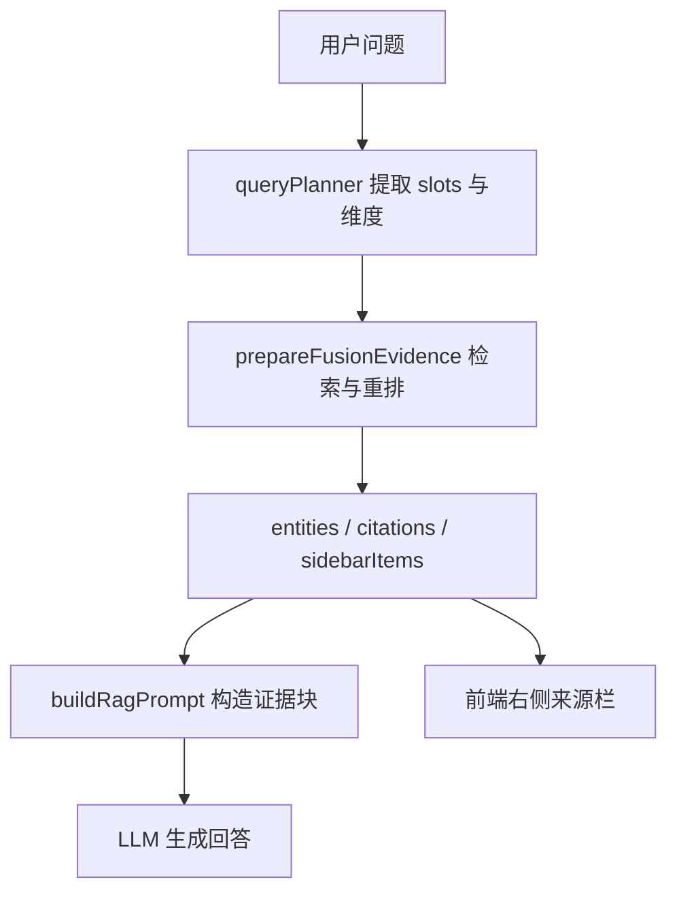
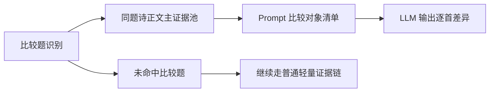

# 同名诗作比较题正文优先证据链修复分析

## 问题现象

当用户提问“几首《望岳》之间有何区别？”时，右侧来源栏已经展示出多条《望岳》诗文来源，但最终回答仍判断“现有材料仅重复提及一首《望岳》”，没有对多首同题诗进行正文对比。

这说明问题不在前端来源展示，而在服务端回答链路没有把这些同名诗作提升为可比较的主证据。

## 当前链路

当前 `G` 与 `F` 共享原始数据来源，但用途不同：

- 右侧来源栏只需要“展示多个入口”
- LLM 需要“区分这些入口是否是多首可比较的不同作品”

## 根因分析

### 1. 查询规划没有识别“同名诗作比较”意图

现有 `queryPlanner` 能识别：

- 单首诗解读
- 诗单列举（如“有哪些”“哪几首”）

但不能识别：

- 多首同题诗之间的比较
- 同名作品差异分析

因此后续证据构建不会切换到“正文优先模式”。

### 2. 诗单覆盖兜底逻辑未覆盖比较题

现有 `ensurePoemListCoverage` 只对“有哪些/哪几首”类列举题生效，不对“区别/比较/不同”类比较题生效。

因此即便检索阶段命中了多首《望岳》，生成阶段也不会强制把它们全部纳入答案。

### 3. LLM Prompt 缺少“比较对象清单”

当前 `buildRagPrompt` 将证据统一拼成“材料1、材料2、材料3”，若多条材料标题都叫《望岳》，但缺少唯一标识与比较任务约束，模型容易把它们误读成同一首诗的重复命中。

### 4. 证据准备未单独构建“正文优先比较池”

当前 `prepareFusionEvidence` 会构建：

- `entities`
- `citations`
- `iiifMatches`
- `sidebarItems`

但没有专门输出“同题不同诗”的主比较证据集合。导致比较题和普通问答共享同一套轻量证据输入。

## 修复目标

1. 能识别“几首《望岳》之间有何区别？”这类同名诗作比较题。
2. 对命中的比较题，优先提取同标题、不同 URI、带正文的 poem 证据。
3. 将这些比较对象以结构化方式送入 Prompt，而不是混在普通材料块里。
4. 当不足 2 首可比较诗文时，明确告诉模型材料不足，禁止它把重复标题误当成单首诗。

## 方案设计

### 1. 查询规划层新增比较意图

在 `queryPlanner` 中新增：

- 比较题识别函数
- 目标诗题提取函数
- 在 `buildFusionQueryPlan` 或等价规划结果中记录比较意图与目标标题

目标类型：

- `poem_compare_by_title`

### 2. 证据构建层新增比较主证据池

在 `prepareFusionEvidence` 中，从 poem 候选里筛出：

- `title === 目标诗题`
- `uri` 唯一
- 正文存在
- 按相关度排序

输出单独的比较对象集合，建议上限 4 首。

### 3. Prompt 层新增比较对象区块

在 `buildRagPrompt` 中：

- 若存在比较主证据池，则在“参考材料”前新增“比较对象清单”
- 每首诗包含：
  - 标题
  - URI 或唯一标识
  - 作者
  - 朝代
  - 背景
  - 正文

同时在系统/用户提示词中增加限制：

- 必须逐首比较
- 不得将同题不同诗合并为一首
- 若材料不足两首，必须明确说明不足

### 4. 调用链透传比较证据

`fusionQueryUseCase` 与 `fusionStreamUseCase` 需要把比较主证据池一并传给 LLM 构造 Prompt，但不改变 API 出参协议。

## 风险与控制

### 风险

- 比较题正文过长，token 迅速膨胀
- 同名诗去重不稳，仍可能把不同来源压成同一首
- 普通问答误触发比较模式

### 控制

- 比较主证据池上限固定为 4 首
- 同标题必须以 `uri` 去重，不能只按标题去重
- 比较模式必须同时满足“比较表达 + 明确诗题”

## 验证点

需要验证：

1. “几首《望岳》之间有何区别？”命中比较意图。
2. 比较主证据池至少保留多首不同 URI 的《望岳》。
3. Prompt 中明确出现多首《望岳》的标题与正文。
4. 普通题不进入比较模式。
