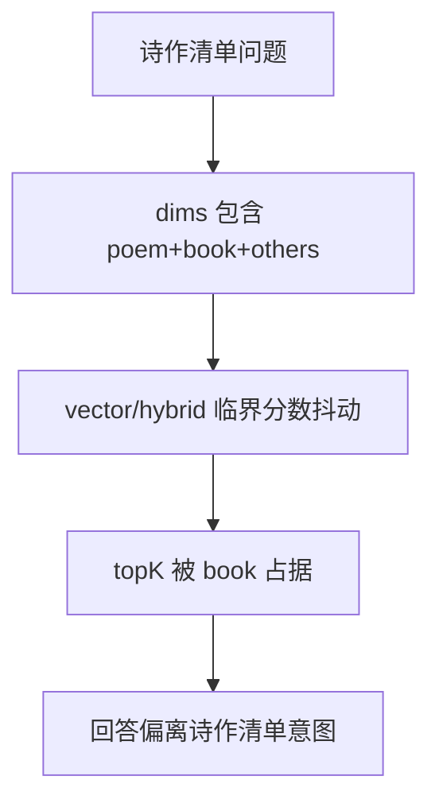

# 融合问答：诗作清单问题强制 poem 优先（P0）

## 背景
同一问题“杜甫给李白写的诗有哪些？”在多次请求中会出现证据类型抖动：
- 一次命中大量 book 证据
- 一次命中 poem 证据
导致回答稳定性差。

## 目标
对“诗作清单类问题”在检索阶段执行强约束：
- 强制 poem 优先（P0 版本采用 poem-only 检索）
- 降低 book 侧干扰，提升结果稳定性。

## 现状链路

## 问题定位

## P0 方案
1. 新增“诗作清单问题”识别规则（正则）。
2. 在 `/api/v1/fusion/query` 与 `/api/v1/fusion/stream` 的 dims 解析后应用策略：
   - 若命中诗作清单意图且请求 dims 包含 `poem`，则将有效 dims 固定为 `['poem']`。
3. 其余链路保持不变（queryPlan、rerank、LLM）。

## 风险与缓解
- 风险：用户问题同时需要人名/地理背景，poem-only 可能丢辅助证据。
- 缓解：该策略仅对“诗作清单类问题”生效，不影响一般问题。

## TODO LIST
- [ ] 新增意图识别函数。
- [ ] 在 query/stream 两个入口应用 dims 策略。
- [ ] 回归测试：同问题多次请求证据类型稳定为 poem。
