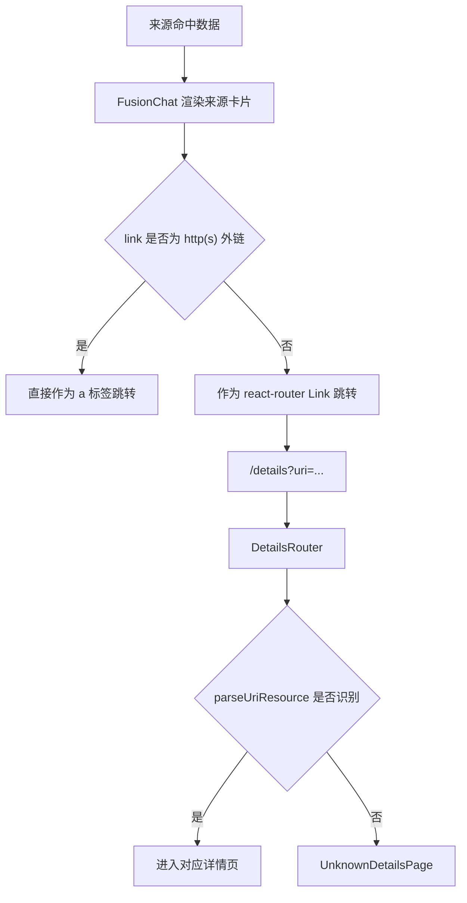
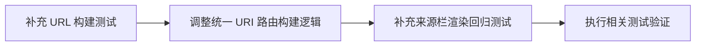

## AI 来源栏 URI 跳转改造分析

### 问题概述

当前 AI 聊天界面右侧来源栏的跳转逻辑默认优先走 `/details?uri=...`。

这条路径对常规实体有效，但对 IIIF manifest 一类 URI 会落入未知类型页，典型现象如下：

- 来源卡片可以点击
- 点击后进入详情路由
- `DetailsRouter` 无法识别该 URI
- 页面展示“未知资源类型”

### 当前链路



### 根因分析

| 模块 | 当前行为 | 问题 |
| --- | --- | --- |
| `src/lib/url/heluoUrl.ts` | 只把“可识别实体路径”转换成详情页路由 | IIIF manifest、其他内部 URI 无法被正确分流 |
| `src/features/details/utils/uriParser.ts` | 不支持 IIIF 类型 | `/details?uri=<iiif manifest>` 必然落入未知页 |
| `src/features/fusion/FusionChat.tsx` | 只区分“外链”和“站内链接” | 站内链接是否能正确命中具体页面，依赖上游路由构建是否准确 |

### 改造目标

1. AI 来源栏中的 URI 只要命中，就应生成可跳转链接。
2. IIIF manifest URI 不再进入 `/details`，而是直接进入 `/iiif?manifest=...`。
3. 现有人物、诗文、地点、古籍、图书、概念等详情跳转保持不回退。
4. 保持 URL 构建逻辑集中，避免在多个组件里重复写 URI 类型判断。

### 改造方案

#### 方案核心

在统一 URL 构建层增加“URI 到站内跳转地址”的能力：

- 如果 URI 命中 IIIF manifest 规则，则构建 `/iiif?manifest=...`
- 如果 URI 命中已支持的实体路径，则构建 `/details?uri=...`
- 如果传入的本身已经是 `/details?...` 或 `/iiif?...`，则返回规范化后的自身
- 其余 URI 不返回空字符串时，允许保留原始跳转目标，避免来源栏彻底失去跳转能力

#### 伪代码

```text
输入 uri
  先做 trim 和多轮 decode
  如果是 iiif manifest 或 iiif viewer 可识别路径
    返回 iiif 路由
  如果是已有 details 路由
    继续解析内部 uri 后返回规范化 details 路由
  如果是已有 iiif 路由
    返回规范化 iiif 路由
  如果能提取实体路径
    返回 details 路由
  否则
    根据原始 uri 的形态决定是否直接保留
```

### 测试策略

| 层级 | 验证点 |
| --- | --- |
| `tests/lib/url/heluoUrl.test.ts` | IIIF manifest、已编码 details URI、未知内部 URI 的路由生成 |
| `tests/features/fusion/fusionChatNativeUi.test.tsx` | 来源栏 IIIF 卡片应落到 `/iiif?manifest=...`，而不是 `/details?uri=...` |

### 风险与边界

| 场景 | 风险 | 应对 |
| --- | --- | --- |
| 上游返回相对 IIIF manifest 路径 | 被误当成普通内部 URI | 在 URL 构建层补充 IIIF 路径判定 |
| 已经是 `/iiif?...` 的链接再次包装 | 参数重复编码 | 统一走规范化构建函数 |
| 未知内部 URI | 无详情页承接 | 至少保留可跳转目标，不再让来源栏完全失效 |

### 实施顺序


