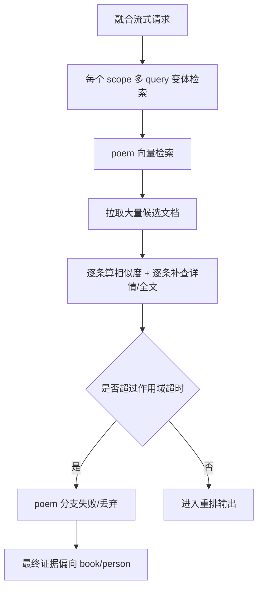
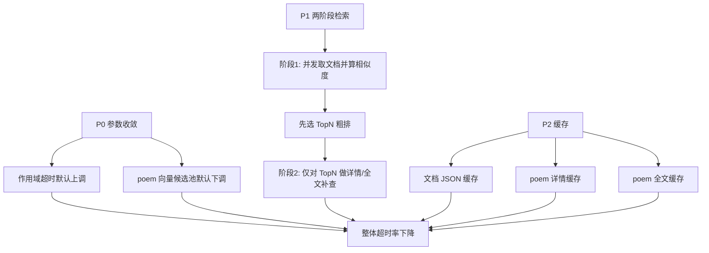

# Fusion 向量链路提速方案（P0 + P1 + P2）

## 背景

- 当前首页融合问答在 `hybrid/vector` 下，`poem` 召回存在明显超时。
- 已确认向量数据目录存在且有数据，不是路径缺失问题。
- 主要瓶颈集中在：
  - 候选池过大（默认 120）
  - 候选文档处理串行
  - 对大量候选执行“诗词详情/全文补查”
  - 上层作用域超时较紧（默认 9s）

## 目标

- P0：先止血，减少超时概率。
- P1：重构慢路径，降低单请求处理时延。
- P2：引入缓存降低重复请求成本。

## 现状链路

## 方案设计

## TODO LIST

- [ ] 新增向量链路性能回归测试：
  - [ ] 验证 poem 向量只对前置 TopN 做重补查（避免全量补查）。
  - [ ] 验证重复请求可命中缓存减少上游读取。
- [ ] 运行新增测试并确认在改造前失败（证明测试有效）。
- [ ] 实现 P0：
  - [ ] `SEARCH_SCOPE_TIMEOUT_MS` 默认 9000 -> 15000。
  - [ ] `VECTOR_CANDIDATE_POOL_SIZE` 默认 120 -> 60。
- [ ] 实现 P1：
  - [ ] `executeVectorSearch` 改为“两阶段处理”。
  - [ ] 文档处理从串行改为并发限流。
- [ ] 实现 P2：
  - [ ] 文档级缓存。
  - [ ] poem 详情缓存。
  - [ ] poem 全文缓存。
- [ ] 跑目标测试验证通过。
- [ ] 用真实请求回归验证（杜甫问题链路）。

## 边界与风险

- 缓存需要 TTL + 容量上限，避免内存膨胀。
- 两阶段 TopN 太小会影响召回质量，需可配置。
- 并发度过高会反向压垮 MarkLogic，需要限流上限。
- 默认超时上调会增加尾延迟，但可换取可用性。
