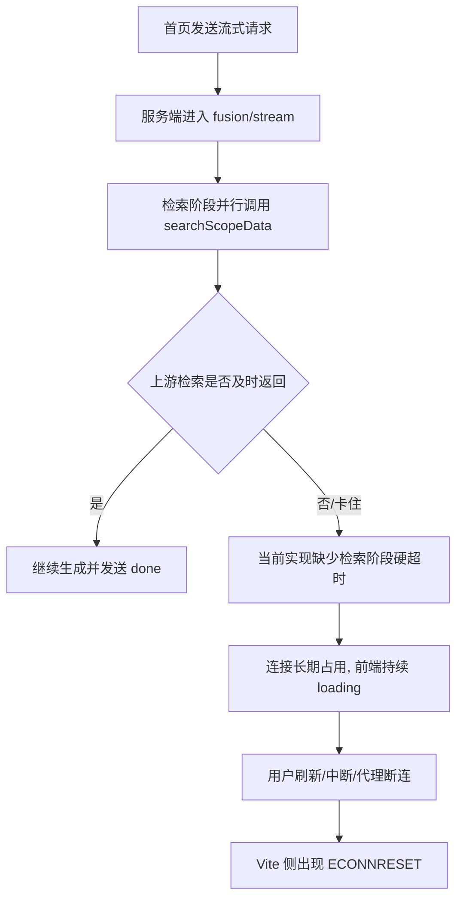
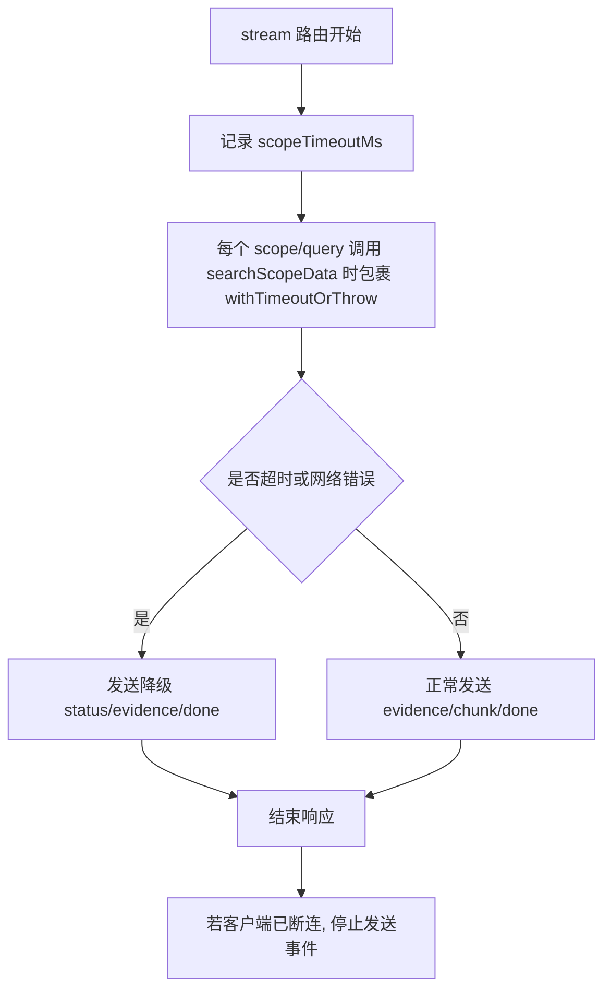

# 首页融合对话流式超时保护修复方案

## 背景与现象

- 触发场景：首页 `FusionChat` 调用 `POST /api/v1/fusion/stream`。
- 现象表现：前端会长时间显示“生成中...”，用户侧感知为“迟迟加载不出来”。
- 终端日志：Vite 代理层出现 `http proxy error`，并伴随 `read ECONNRESET`。

## 现状链路分析

## 根因判断

- `/api/v1/fusion/stream` 检索阶段未对 `searchScopeData` 设置与 `/api/v1/search` 一致的“作用域超时保护”。
- 当上游（如 MarkLogic 或向量检索依赖）出现“慢/挂起”时，流式路由可能长期不返回 `done`，前端持续等待。
- 连接被用户或代理层中断后，前端开发服务器记录 `ECONNRESET`，这更像“结果”而不是“初始原因”。

## 修复目标

- 任何上游慢查询都不能导致流式请求无限等待。
- 在超时或可预期网络异常下，统一走降级 `done` 事件，而不是让前端卡住。
- 流式连接关闭后，服务端不再继续写入，避免额外异常噪音。

## 方案设计

## TODO LIST

- [ ] 测试先行：新增集成用例，模拟上游检索 Promise 挂起，验证“不会无限等待，最终返回降级 done”。
- [ ] 运行该测试并确认在当前实现下失败（验证用例有效性）。
- [ ] 在 `server/src/app.js` 为 `fusion/stream` 引入检索阶段超时保护。
- [ ] 在 `fusion/stream` 的异常分支纳入超时降级逻辑（TIMEOUT 归类为可降级异常）。
- [ ] 增加流式连接关闭保护，避免断连后继续写入事件。
- [ ] 运行相关测试，确认新增与回归均通过。

## 边界情况

- 上游“快速失败”（如 `ECONNREFUSED`）应直接降级返回，不应阻塞。
- 上游“永不返回”应在超时窗口后返回降级 `done`。
- 客户端主动中断时，服务端应尽快停止写流，避免 write 相关错误。
- 仍需保持现有成功路径行为不变（正常流式 chunk + done）。
