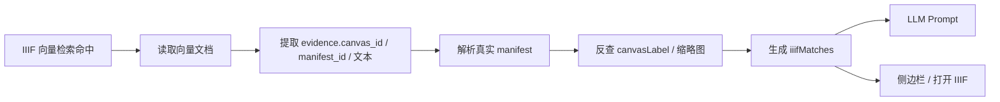

# IIIF AI 证据桥接方案

## 现状

当前融合问答已经具备 IIIF 检索入口：

- `iiif` 维度会检索 `/processed/json-ld-vector/iiif/`
- 结果会进入 `iiifMatches`
- LLM Prompt 支持 `segmentText`、`canvasLabel`、`canvasId`、`manifest`

但证据装配层仍然过浅：

- 目前只把 `row.uri` 和标题塞进 `iiifMatches`
- 没有解析向量文档中的 `evidence.manifest_id`、`evidence.canvas_id`
- 没有补齐 `openUrl`
- 没有利用 manifest 反查 `canvasLabel`

结果是：

- AI 问答“名义上支持 IIIF”
- 实际拿到的 IIIF 证据质量不足

## 目标

把 IIIF 向量命中补齐为真正可用的问答证据：

## 输出字段

| 字段 | 用途 |
|---|---|
| `manifest` | IIIF 打开链接与证据归属 |
| `canvasId` | Mirador 精确跳页 |
| `canvasLabel` | 让用户和 LLM 知道命中页位置 |
| `segmentText` | 送入 LLM 的核心证据文本 |
| `thumbnailUrl` | 前端侧边栏预览 |
| `openUrl` | 直接打开对应画布 |

## 最小实现边界

1. 只增强 `resolveFusionIiifMatches`
2. 优先读取向量文档里的 `evidence`
3. 需要时按 manifest 补齐 `canvasLabel` 与缩略图
4. 不改 LLM Prompt 结构
5. 不改 FusionChat UI 结构

## 风险控制

| 风险 | 控制方式 |
|---|---|
| IIIF 命中导致额外 manifest 拉取过多 | 按 manifest 做缓存，同一 manifest 只读一次 |
| 向量文档字段不统一 | 同时兼容 `manifest_id` / `manifest` / `uri` |
| canvas 缺标签 | 允许 `canvasLabel` 为空，保留 `canvasId` |
| 旧测试只断言 `iiifMatches` 存在 | 增补断言，锁住 `segmentText`、`canvasId`、`openUrl` |

## 验证点

1. 融合问答命中 IIIF 时，`iiifMatches[0].segmentText` 不为空
2. `iiifMatches[0].canvasId` 与向量证据一致
3. `iiifMatches[0].openUrl` 可直接打开 `/iiif?manifest=...&canvas=...`
4. `iiifMatches[0].canvasLabel` 能从 manifest 反查得到
