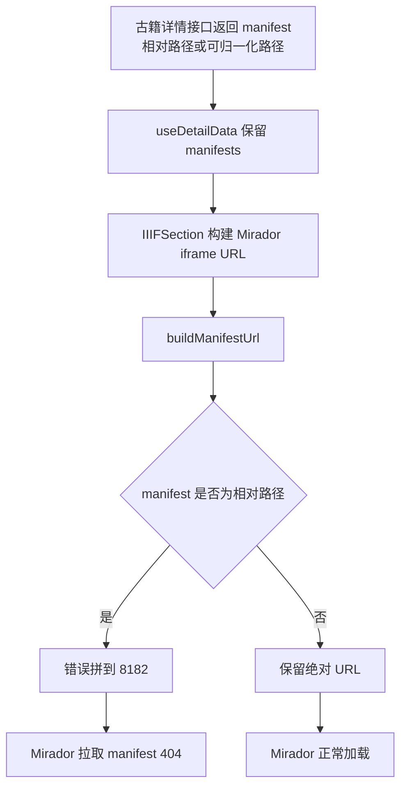

# IIIF Manifest 基地址最小修复分析

## 问题现象

古籍详情页已经恢复嵌入 Mirador，但浏览器提示：

- `TypeError: Failed to fetch`
- manifest 地址为 `http://localhost:8182/iiif/manifests/304/manifest.json`

实际探测结果：

- `http://localhost:8182/iiif/manifests/304/manifest.json` 返回 `404`
- `http://localhost:8083/iiif/manifests/304/manifest.json` 返回 `200`

这说明 manifest 数据存在，但前端请求到了错误的服务地址。

## 原因判断

当前前端把两类资源混用了同一个基础地址：

- IIIF 图片资源基地址：`8182`
- IIIF manifest 相对路径基地址：也被错误地拼到 `8182`

而当前运行环境下：

- manifest 实际由 `8083` 提供
- Mirador 入口也在 `8083`

因此这是一个“前端静态 IIIF URL 配置与当前运行环境不一致”的问题。

## 影响链路

## 最小修复范围

只调整前端 `manifest` 相对路径的基地址解析规则：

- 保持图片 URL 继续走 `8182`
- 保持 Mirador 页面地址继续走 `8083/mirador`
- 仅让相对 manifest 路径走 manifest 专用基地址

## 验证策略

1. 先修改单元测试，明确相对 manifest 应解析到 `8083`
2. 运行测试，确认旧实现失败
3. 修改 `src/lib/config/iiif.ts`
4. 重新运行相关测试，确认通过
5. 额外用真实地址 `304/manifest.json` 进行可达性核验

## 风险评估

风险较低，原因如下：

- 只影响相对 manifest 路径的解析
- 不影响绝对 manifest URL
- 不影响图片资源 URL
- 不影响后端返回结构
