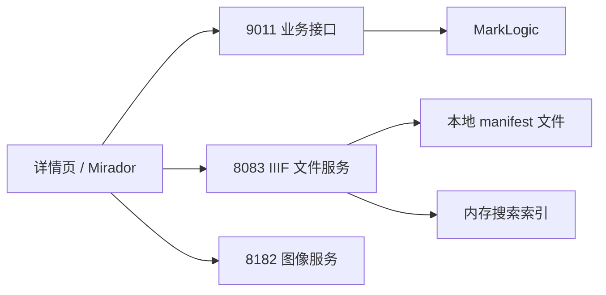
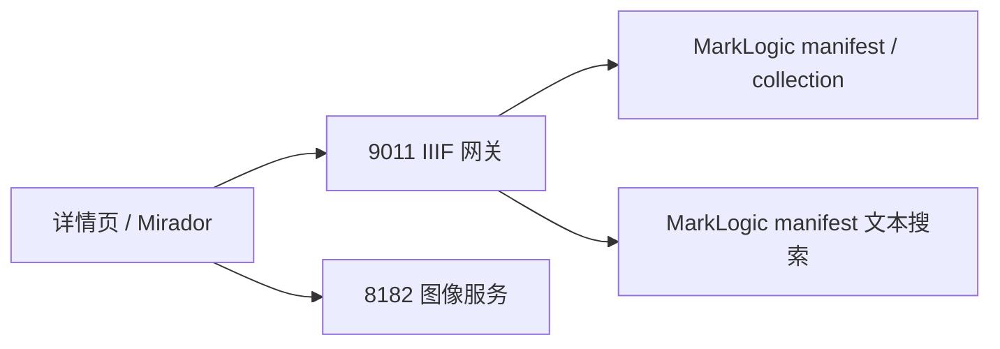

# IIIF MarkLogic 网关收口方案

## 背景

当前古籍详情页中的 IIIF 能力存在两套来源：

- 详情数据中的 `manifests` 来自 MarkLogic 文档提取。
- Mirador 真正加载的 manifest、collection、search 却依赖 `8083` 文件服务。

这会带来三个问题：

1. 权威源分裂，上传文件后容易出现路径与索引漂移。
2. 前端需要同时感知 `9011`、`8083`、`8182` 三个端口。
3. Mirador 搜索依赖 `8083` 的预加载索引，和当前 MarkLogic 数据源脱节。

## 目标

本次只收口公开入口，不改图像服务：

- `MarkLogic` 作为 manifest / collection 的权威数据源
- `9011` 作为公开 IIIF 网关
- `8182` 继续作为图像服务
- Mirador 只访问 `9011` 暴露的 IIIF 地址

## 当前架构

## 目标架构

## 路由收口范围

### 公开读取

| 公开路由 | 数据源 |
|---|---|
| `/iiif/manifests/:bookId/manifest.json` | MarkLogic `/iiif/manifests/{bookId}/manifest.json` |
| `/iiif/manifests/:bookId/collection.json` | MarkLogic `/iiif/manifests/{bookId}/collection.json` |
| `/iiif/manifests/ancientBook/:bookId/:carrierId/manifest.json` | 兼容路由，底层仍读同一本书的 MarkLogic manifest |
| `/iiif/3/collection/ancientBook/:bookId` | MarkLogic `/iiif/manifests/{bookId}/collection.json` |
| `/iiif/3/collection/person/:personId` | MarkLogic `/processed/iiif/collections/{personId}/collection.json` |

### 搜索

| 公开路由 | 策略 |
|---|---|
| `/iiif/3/search/ancientBook/:bookId/:carrierId?q=...` | 从 MarkLogic manifest 读取 canvas 文本，按子串匹配返回 IIIF Search API 结果 |

## 关键实现点

1. 后端返回 manifest / collection 时，只重写公开入口相关 URL：
   - manifest id
   - collection id
   - search service id
2. 不重写 canvas / annotation / image URL，避免影响现有图像与标注结构。
3. `volume-heads` 读取 manifest 时优先走新的 IIIF 网关路径，避免后端再反向请求自己失败。
4. 前端 `buildManifestUrl` 切换到 `9011` 作为 IIIF 基址。

## 风险控制

| 风险 | 控制方式 |
|---|---|
| 重写过度导致 Mirador 请求不存在的 canvas 路由 | 仅重写 manifest / collection / search，不动 canvas 与图像 URL |
| 旧短路径与新长路径混用 | 后端同时支持短路径与长路径公开路由 |
| 搜索结果无法跳页 | 搜索结果中的 canvas id 保持与 manifest 内原始 canvas id 一致 |
| 前端开发环境访问不到 `/iiif` | 前端继续使用显式后端 IIIF 基址，不依赖 Vite 代理 |

## 验证点

1. `GET /iiif/manifests/303/manifest.json` 返回标准 IIIF Manifest。
2. `GET /iiif/manifests/303/collection.json` 返回 collection，且 `items[0].id` 指向 `9011` 的 manifest 路由。
3. `GET /iiif/3/search/ancientBook/303/17270_303?q=蘇軾` 返回至少 1 个 hit。
4. 详情页中的 Mirador 能加载 `303` 图像。
5. Mirador 搜索后能够跳转到命中的 canvas。
