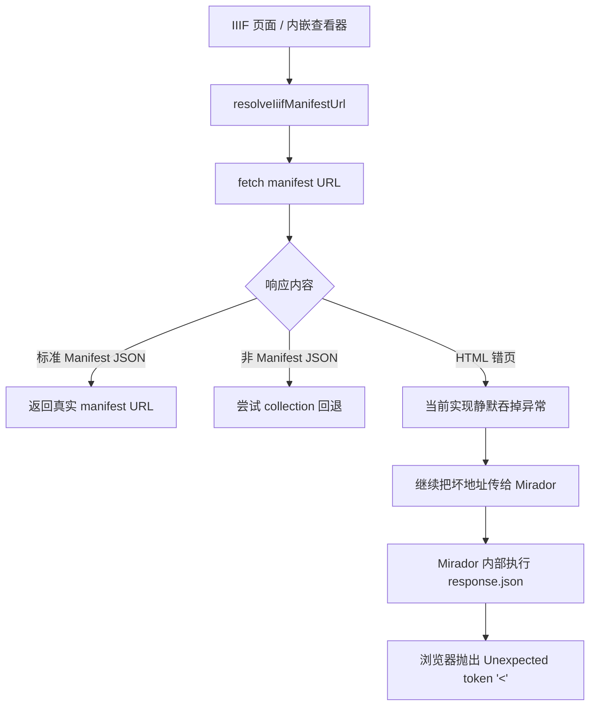
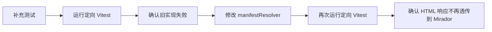

# IIIF Mirador HTML 响应问题分析

## 问题现象

IIIF 浏览界面中的 Mirador 在加载某些 manifest 时抛出异常：

- `SyntaxError: Unexpected token '<'`
- 报错片段包含 `<!doctype html>`

这说明 Mirador 期待拿到的是 IIIF Manifest JSON，但实际收到的是 HTML 页面。

## 根因判断

当前链路里，`resolveIiifManifestUrl` 会先主动探测 manifest 地址是否已经是标准 IIIF Manifest。

问题在于：

1. 如果目标地址返回的是 HTML 页面，当前实现会直接走 `response.json()`
2. `response.json()` 在 HTML 文本上会抛出 `SyntaxError`
3. 这个异常会被解析器静默吞掉，并把原始地址继续交给 Mirador
4. Mirador 再次请求同一个错误地址，于是把底层 JSON 解析错误直接暴露给用户

所以真正的问题不是 “Mirador 不会渲染”，而是 “前置 manifest 解析器在拿到 HTML 错页时没有兜住”

## 影响链路

## 修复目标

1. 在 manifest 解析阶段识别 HTML 响应，而不是把它交给 Mirador
2. 若短路径 manifest 不是标准 Manifest，继续保留 collection 回退能力
3. 若最终仍无法得到合法 IIIF Manifest，抛出可读错误，避免用户看到底层 JSON 解析异常

## 最小修复范围

- `tests/features/iiif/manifestResolver.test.ts`
  - 增加 HTML 响应相关回归测试
- `src/features/iiif/manifestResolver.ts`
  - 增加非 JSON / HTML 响应识别
  - 保留 collection 回退
  - 输出可读错误信息

## 验证策略

## 风险与边界

| 场景 | 风险 | 处理策略 |
| --- | --- | --- |
| 标准 Manifest 正常返回 JSON | 低 | 保持原行为 |
| 短路径 Manifest 返回非标准 JSON | 低 | 继续走 collection 回退 |
| 返回 HTML 登录页 / 错页 / SPA 页面 | 中 | 在解析阶段阻断，并提示检查地址或代理 |
| 后端直接 404 / 500 | 低 | 保持现有失败分支，但输出更可读的错误 |
