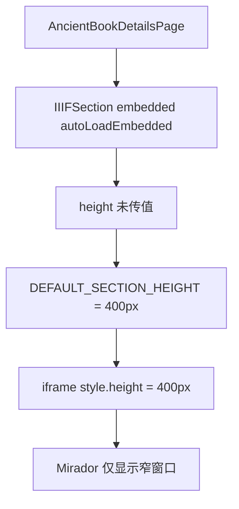

# IIIF 内嵌浏览器视窗高度调整分析

## 问题描述

古籍详情页中的 IIIF Mirador 内嵌窗口当前默认高度为 `400px`，在大屏和常规桌面视窗下明显偏矮，用户无法获得接近整屏阅读的体验。

## 现状判断

当前高度控制集中在 `src/features/common/IIIFSection.tsx`：

- 默认常量 `DEFAULT_SECTION_HEIGHT = '400px'`
- `IIIFSection` 的 `height` 属性默认取该常量
- 古籍详情页未显式传入更高的高度，因此实际始终使用 `400px`

## 影响链路

## 最小修复目标

只调整内嵌 IIIF 浏览器的默认高度策略，不改动：

- manifest 解析
- Mirador URL 构建
- 卷次导航逻辑
- 新窗口打开逻辑

## 最小修复方案

将默认高度从固定的 `400px` 调整为基于视窗高度的值，例如：

- `calc(100vh - 96px)` 或同级别策略

同时保留一个最小高度，避免小屏设备下过度压缩：

- `minHeight: 400px`

这样能达到：

- 在桌面端接近占满视窗
- 在较小视窗下仍有稳定下限

## 验证策略

1. 先补测试，断言默认 iframe 高度不再是 `400px`
2. 实现视窗高度样式
3. 运行 IIIF 相关回归测试
4. 确认古籍详情中的 iframe 仍然保留全屏、卷次定位和 Mirador 跳转能力

## 风险评估

风险较低：

- 仅影响内嵌 iframe 呈现高度
- 不改变数据流
- 不改变接口行为
