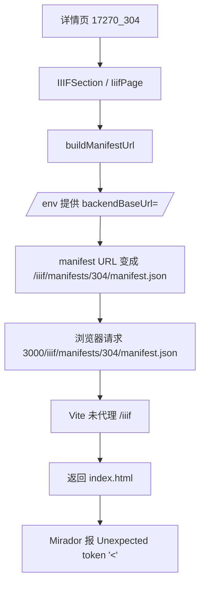

# IIIF 本地开发链路回归修复分析

## 问题现象

以这个页面为例：

- `http://127.0.0.1:3000/details?uri=%2Fprocessed%2Fjson-ld%2Fancient_book%2Fancient_book_set%2Fbook_entry%2F17270_304.json`

当前浏览器里 Mirador 仍会报：

- `SyntaxError: Unexpected token '<'`

实测链路如下：

| 请求 | 结果 |
| --- | --- |
| `http://127.0.0.1:3000/env` | `{"backendBaseUrl":"/"}` |
| `http://127.0.0.1:3000/iiif/manifests/304/manifest.json` | 返回 HTML |
| `http://127.0.0.1:9011/iiif/manifests/304/manifest.json` | 返回 IIIF Manifest JSON |

这说明：

1. 前端把 IIIF manifest 请求发到了 `3000`
2. `3000` 当前没有把 `/iiif/*` 代理到后端
3. 结果 Vite 返回了前端 HTML 壳页面
4. Mirador 按 JSON 解析，最终抛出 `Unexpected token '<'`

## 根因

本地开发环境里，`/env` 默认返回相对地址 `/`，前端因此把 IIIF manifest 当成“当前站点同源资源”处理。

但 `vite.config.ts` 当前只代理了这些前缀：

- `/env`
- `/api`
- `/stats`
- `/ml`

没有代理：

- `/iiif`

于是示例页面里的 IIIF 数据链路断在 Vite 开发服务器。

## 历史回归时间线

```mermaid
flowchart LR
  A[早期: 相对 manifest 走 8083] --> B[切到 9011 后端网关]
  B --> C[本地 Mirador 直接挂载]
  C --> D[/env 运行时配置覆盖 IIIF 基地址]
  D --> E[本地开发仍返回 backendBaseUrl=/]
  E --> F[Vite 未代理 /iiif]
  F --> G[3000 返回 HTML]
  G --> H[Mirador 解析 JSON 失败]
```

## 受影响数据流



## 最小修复方案

只修本地开发链路，最小改动如下：

1. 给 `vite.config.ts` 增加 `/iiif` 代理到后端
2. 增加针对 Vite 代理配置的回归测试
3. 重启前端开发服务器
4. 用示例页面重新验证：
   - `/env`
   - `/iiif/manifests/304/manifest.json`
   - 详情页 Mirador

## 为什么先修这里

这是当前示例页失败的直接断点。

即使 `manifestResolver` 已经能识别 HTML 响应，如果 `3000/iiif/*` 仍然返回 HTML，Mirador 链路仍然不会真正打通，只是报错位置可能变化。

## TODO LIST

1. 补测试，锁定 Vite 代理必须覆盖 `/iiif`
2. 修改 `vite.config.ts`
3. 重启 `dev:frontend`
4. 验证 `3000 -> /iiif -> 9011` 数据链路
5. 打开示例详情页确认 Mirador 正常加载
