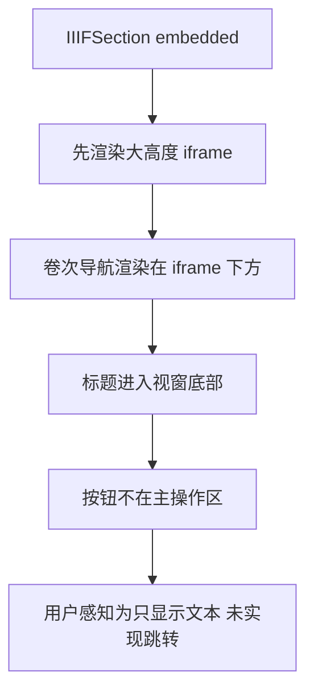

# IIIF 按卷定位恢复分析

## 问题现象

古籍详情页中的“按卷定位”区域当前只在 IIIF 浏览器底部显示标题文本，未形成可用的卷次跳转交互。

## 现状核验

真实链路核验结果：

- `http://localhost:8083/iiif/manifests/304/manifest.json` 可访问
- 服务端 `/api/v1/iiif/volume-heads` 可返回完整卷首列表
- `extractVolumeHeadsFromIiifManifest()` 对真实 `304/manifest.json` 可提取出 `卷一` 到 `卷二十五`

因此问题不在数据，也不在后端接口，而在前端导航的呈现与可见性。

## 原因判断

当前 `IIIFSection` 中卷次导航区域位于内嵌 iframe 下方：

1. 用户首先看到接近整屏高度的 Mirador
2. “按卷定位”标题被挤到 iframe 底部后方
3. 卷次按钮即使存在，也不在主要操作视区内

这使得“按卷定位”在体验上接近未实现。

## 影响链路

## 恢复目标

恢复“按卷定位”的可用性，而不是只保留接口：

- 卷次按钮必须出现在 IIIF 浏览器上方
- 点击卷次按钮后，iframe 应跳转到对应 canvas
- 当前选中的卷次需要有明显高亮

## 最小恢复方案

只调整前端 `IIIFSection`：

1. 将卷次导航区域移动到 iframe 上方
2. 保持现有 `/api/v1/iiif/volume-heads` 请求不变
3. 保持现有 `canvas` 参数跳转机制不变
4. 为卷次按钮区增加更明确的容器布局，确保大量卷次时仍可操作

## 验证策略

1. 补前端回归测试
2. mock 卷次接口返回数据
3. 断言按钮文案渲染
4. 点击按钮后断言 iframe `src` 包含对应 `canvas`
5. 断言导航区位于 iframe 前方

## 风险评估

风险较低：

- 不改后端接口
- 不改 manifest 解析
- 不改 Mirador 嵌入方式
- 只调整前端布局与交互验证
