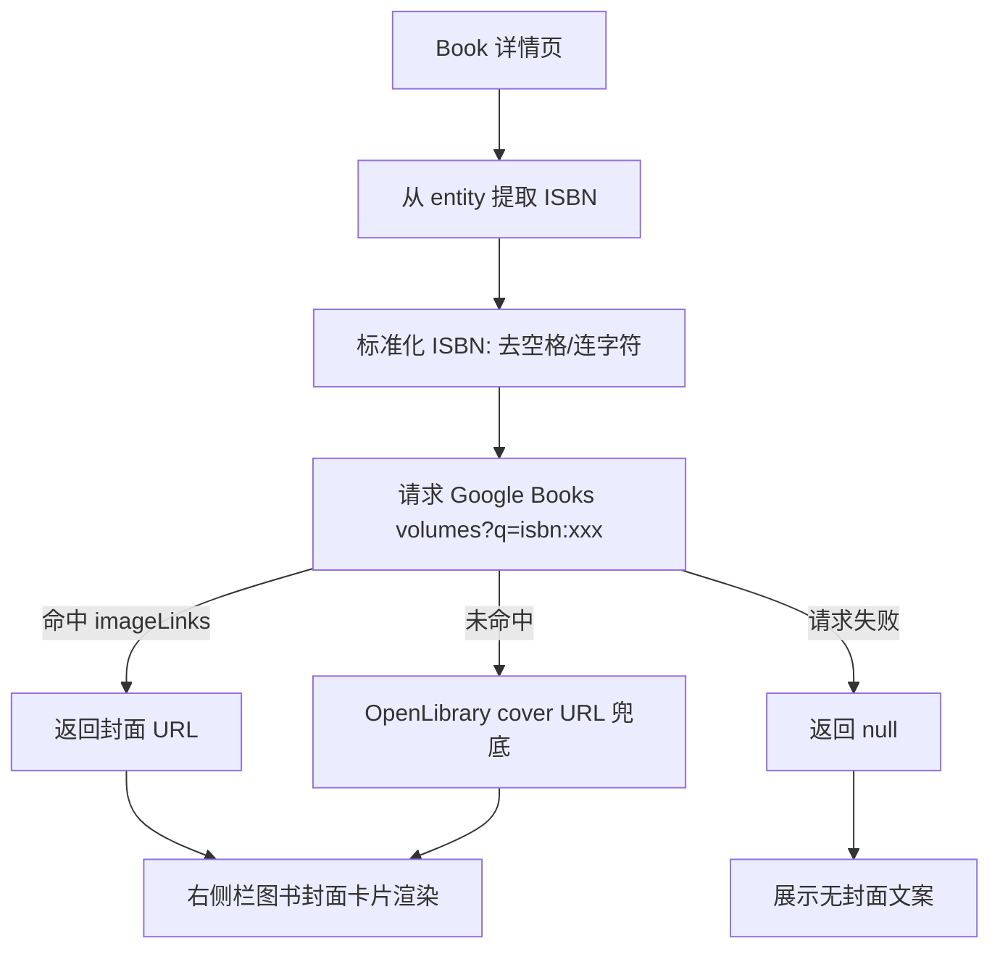

# ISBN 封面接入右侧栏分析（最小修复）

## 问题定义

当前图书详情页右侧栏只有“相关资源”，没有利用 ISBN 外部公开信息展示封面，用户缺少直观识别线索。

## 目标

- 基于详情页已解析出的 ISBN 获取封面图。
- 在右侧栏新增“图书封面”卡片。
- 失败时不影响页面主流程。

## 约束

- 最小改动，不改现有详情主数据流。
- 仅对 `book` 类型启用。
- 优先使用无需鉴权的公开来源。

## 方案

## 边界处理

- ISBN 缺失：不展示封面卡片。
- 外部接口超时/失败：展示“暂无封面”。
- URL 非 HTTPS：不渲染图片（避免混合内容风险）。

## 验收标准

1. 图书详情右侧栏出现“图书封面”模块。
2. 有封面时显示可见图片。
3. 无封面时显示兜底文案，页面其余功能不受影响。
