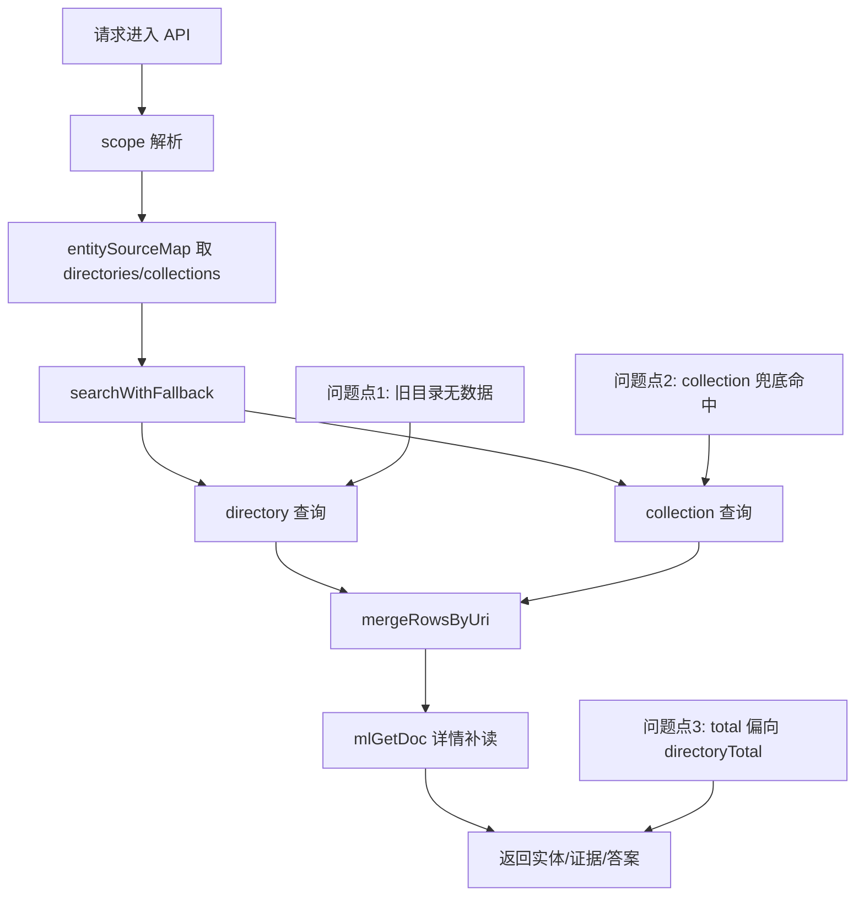
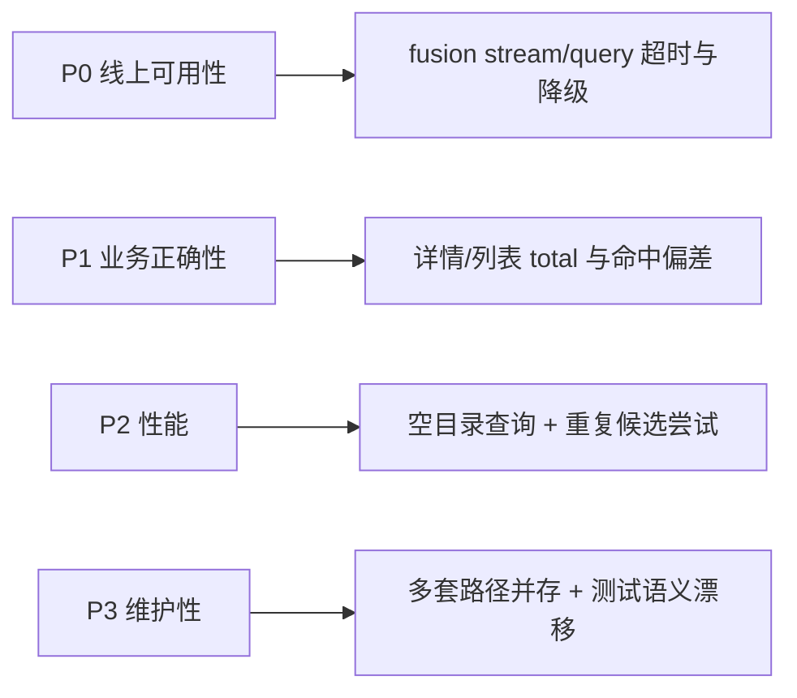

# 旧路径技术债系统评估报告（`/processed/entities/*` -> `/processed/json-ld/*`）

## 1. 评估背景

当前后端已进入“新旧路径并存”阶段。部分能力已切换至 `json-ld`，但大量链路仍保留 `entities` 旧路径作为主入口或高频候选，导致：

- 检索链路存在“先错后对”查询。
- 统计口径依赖旧目录，存在误差风险。
- 测试桩继续强化旧路径，影响迁移信心。
- 代码理解成本上升，后续重构风险累积。

## 2. 执行链路总览

## 3. 关键结论

| 结论 | 现状判断 | 影响等级 |
|---|---|---|
| Fusion 主链 `poem` 已迁移到 `json-ld` | 成立（非全旧路径） | 中 |
| `person/book/place` 在主映射仍以旧目录为主 | 成立 | 高 |
| 详情/列表 API 大量保留旧路径候选 | 成立 | 高 |
| 降级文案“当前检索服务暂不可用”主要由超时/上游异常触发 | 成立（不等同于“空结果”） | 高 |
| 测试中旧路径命中被广泛固化 | 成立 | 高 |

## 4. 代码证据（按模块）

### 4.1 核心映射与检索编排

| 模块 | 证据 | 说明 |
|---|---|---|
| `entitySourceMap()` | `server/src/app.js:347-367` | `person/book/place` 仍指向 `/processed/entities/*`；`poem` 已使用 `/processed/json-ld/poem/*` |
| `searchWithFallback()` | `server/src/app.js:219-244` | 先查 directory，再查 collection，目录空会产生额外查询成本 |
| `searchScopeDataKeyword()` | `server/src/app.js:508-529` | `total` 依赖 `directoryTotal/collectionTotal`，旧目录空时统计表现易失真 |

### 4.2 融合问答链路（`/api/v1/fusion/*`）

| 模块 | 证据 | 说明 |
|---|---|---|
| 同步接口 | `server/src/app.js:4456-4625` | 使用 `dims -> searchScopeData -> entitySourceMap` 主链 |
| 流式接口异常降级 | `server/src/app.js:4766-4770`, `4909-4924` | 所有 scope 变体均失败时进入 degraded，返回“当前检索服务暂不可用，请稍后重试。” |
| `dims` 解析 | `server/src/app.js:1336-1362` | 默认包含全维度，旧路径维度故障会放大超时概率 |

### 4.3 详情与列表 API（高风险遗留）

| 路由 | 证据 | 风险点 |
|---|---|---|
| `/api/v1/persons/:id` | `server/src/app.js:5060-5084` | 直接候选和 fallback 目录都先查旧路径 |
| `/api/v1/persons` | `server/src/app.js:5149-5158` | 列表 total 依赖旧目录 `directoryTotal` |
| `/api/v1/poems` | `server/src/app.js:5303-5315` | 列表查询目录仍是旧 `poem/set`，并按旧前缀过滤 |
| `/api/v1/books/:id` | `server/src/app.js:5509-5513` | 新旧目录混合，旧路径仍在高优先级候选中 |
| `/api/v1/places/:id` | `server/src/app.js:5571-5575` | 新旧目录并查，存在冗余请求 |
| `/api/v1/concepts/:id` | `server/src/app.js:5644-5648` | 多套历史概念路径并存，理解/维护成本高 |

### 4.4 MVP 详情内部关联检索（隐性性能债）

| 模块 | 证据 | 说明 |
|---|---|---|
| `/api/mvp/detail` 内部 `searchWithFallback` | `server/src/app.js:4255-4269` | 关系回链目录几乎全是 `entities` 旧路径，容易出现大量空查 |

### 4.5 测试基线固化旧路径

| 测试文件 | 证据 | 风险 |
|---|---|---|
| `tests/server/api/v1FusionQuery.integration.test.ts` | `:87-100`, `:183-195` | 目录命中主要基于旧路径 mock，迁移后可能“测得过、线上慢” |
| `tests/server/api/v1Search.integration.test.ts` | `:82-97`, `:230-257`, `:506` | 多维度断言仍包含旧路径作为关键预期 |

## 5. 影响面分层

| 层级 | 描述 | 当前等级 |
|---|---|---|
| P0 可用性 | 融合问答是否稳定返回证据与回答 | 高风险 |
| P1 正确性 | 是否能稳定命中真实主文档、统计是否可信 | 高风险 |
| P2 性能 | 单请求额外空查、回退重试、串行候选成本 | 中高风险 |
| P3 可维护性 | 新人理解、后续重构、安全清理成本 | 高风险 |

## 6. 根因归纳

1. 数据迁移后未建立“单一可信路径源（Single Source of Truth）”。
2. 路径兼容策略长期化，兜底路径升格为主路径的一部分。
3. 测试以“当前行为”而非“目标行为”建模，导致迁移阻力。
4. 统计逻辑与目录路径绑定，路径老化直接影响指标可信度。

## 7. 分期整改方案（系统级）

## 7.1 P0（止血，1-2 天）

- [ ] 给 `fusion` 检索加结构化日志：scope、directory 命中数、collection 命中数、超时数。
- [ ] 区分“空结果”与“上游不可用”两类响应埋点，避免误判故障根因。
- [ ] 将 `person/book/place` 的目录候选顺序调整为 `json-ld` 优先，旧路径后置兜底。

## 7.2 P1（主链切换，2-4 天）

- [ ] 重构 `entitySourceMap`：主目录统一改为 `json-ld`，旧路径进入 `legacyFallback` 配置并可开关。
- [ ] 改造 `/api/v1/persons`、`/api/v1/poems` 列表 total 口径，不再依赖旧目录 `directoryTotal`。
- [ ] 清理 `/api/mvp/detail` 关系回链中的旧目录集合，保留必要最小兼容。

## 7.3 P2（收敛与验证，3-5 天）

- [ ] 调整 `tests/server/api/*`：把新路径作为主断言，旧路径仅在兼容测试出现。
- [ ] 建立“路径健康检查”接口或脚本：每日巡检各 scope 的目录命中率。
- [ ] 输出迁移完成基线文档：每个 scope 的主路径、兜底路径、下线日期。

## 8. 验收指标（可量化）

| 指标 | 基线 | 目标 |
|---|---|---|
| fusion degraded 比例 | 待采集 | 降低 60%+ |
| `searchWithFallback` 目录空查占比 | 待采集 | 降低到 < 10% |
| 列表 API total 与真实数据偏差 | 待采集 | 偏差 < 2% |
| 测试中“旧路径主断言”占比 | 待采集 | 降低到 0（仅兼容用例保留） |

## 9. 边界与风险

- 古籍 object/volume 相关路径可能尚未完全 `json-ld` 化，迁移时要分子域推进，避免一次性切断。
- 若直接删除旧路径候选，历史环境可能短期回归；建议采用“灰度开关 + 观测”推进。
- 统计口径切换会引起看板突变，需提前同步数据口径变更说明。

## 10. 推荐落地顺序

1. 先做可观测性（日志与埋点），避免盲改。
2. 再改 `entitySourceMap` 与高流量列表接口。
3. 最后收敛测试语义并清理多余兼容分支。

## 11. 当前已实施（2026-02-27）

- [x] 在 `server/src/app.js` 引入统一实体目录配置 `ENTITY_DIRECTORY_CONFIG`，主路径按 `json-ld` 优先组织。
- [x] 在 `entitySourceMap()` 中统一改为配置驱动，减少散落硬编码目录。
- [x] 引入环境开关 `HELUO_ENABLE_LEGACY_ENTITY_PATHS`（默认开启），用于控制旧路径兜底是否启用。
- [x] `poem` 作用域启用“目录首个命中即停”策略：优先查 `json-ld`，未命中再查旧路径，避免双目录重复计数。
- [x] `/api/v1/persons` 与 `/api/v1/poems` 列表 total 口径改为 `max(directoryTotal, collectionTotal, rows.length)`，降低旧目录空查导致的统计偏差。
- [x] `/api/v1/persons/:id` 增加 `json-ld` 人物候选路径并前置优先级。
- [x] `/api/mvp/detail` 关系回链目录改为配置驱动，不再硬编码全量旧目录列表。

### 11.1 回归验证

- 已执行：
  - `npx vitest run tests/server/api/v1FusionQuery.integration.test.ts tests/server/api/v1Search.integration.test.ts`
- 结果：通过。
