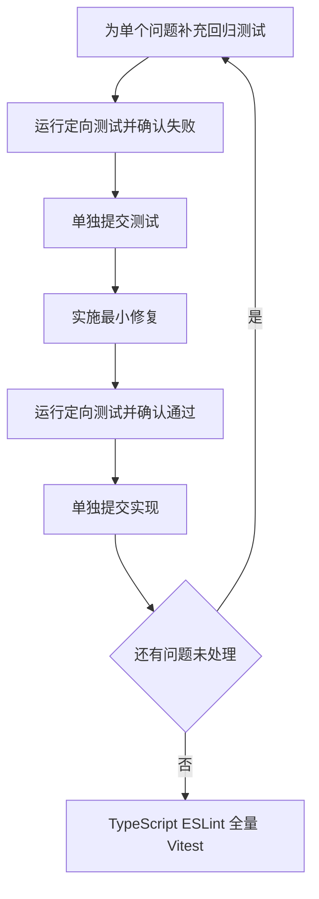

# 低风险遗留缺陷修复分析

## 目标

本次只修复五个已复现、边界明确的遗留缺陷，不扩展产品能力，不调整接口契约，不处理深分页和 IIIF 搜索范围等需要额外决策的问题。

## 问题清单

| 编号 | 问题 | 用户影响 | 修复边界 |
| --- | --- | --- | --- |
| 1 | Axios 超时被误判为主动取消 | 诗文轨迹在超时后永久显示加载中 | 仅修正错误分类与状态收口 |
| 2 | 图书补充检索结果被原始空结果覆盖 | 已找到推荐资源但页面仍显示为空 | 仅以最终推荐集合决定展示结果 |
| 3 | IIIF 解析失败 Promise 被长期缓存 | 瞬时故障恢复后仍无法在当前页面重试 | 失败时失效，成功时继续复用 |
| 4 | 结果页表单不随 URL 参数更新 | 结果与搜索框、范围选择显示不一致 | 仅同步 URL 驱动的表单初值 |
| 5 | 实体 URI 的查询参数和锚点进入 ID | 详情 API 使用错误 ID | 仅从 URI 路径部分提取资源 ID |

## 修复流程

## 边界情况

- 主动取消与请求超时必须保持不同语义。
- 图书主检索为空、补充检索非空时必须保留补充结果；两者都为空时仍允许既有兜底逻辑生效。
- IIIF 同一地址的并发请求仍应去重；只有失败结果需要从缓存移除。
- 结果页用户正在输入时不能因普通重渲染丢失草稿；仅 URL 查询条件变化时同步控件。
- URI 既可能是绝对地址，也可能是站内相对路径；查询参数和锚点都不能成为 ID 的一部分。

## 验收标准

- 每个缺陷都有先红后绿的 Vitest 证据。
- 每个测试文件和实现文件分别单文件提交。
- `npm run typescript`、`npm run lint`、`npm run test` 全部通过。
- 最终工作区干净，提交记录符合单文件提交规范。
