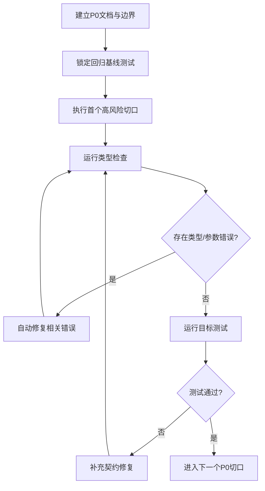

# P0 架构加固执行方案

## 1. 目标

当前项目的大体分层已经建立完成，但仍存在少量 **高风险断点**：它们不会立刻让架构失效，却会在重构推进时持续制造回归，包括：

| P0 项 | 现状问题 | 风险 | ROI |
|---|---|---|---|
| 契约基线与类型检查闭环缺失 | 修改后容易只修局部，不知道是否破坏调用口径 | 高 | 最高 |
| 详情链路口径不稳定 | 诗文正文、古籍 manifest、URI 推断依赖多个 fallback | 高 | 高 |
| 流式问答回调契约脆弱 | callback 参数、降级分支、事件顺序容易漂移 | 高 | 高 |
| 装配层职责仍偏重 | `app.js` 仍同时承担装配、依赖拼接、路由专属依赖整理 | 中 | 中 |

本轮 P0 不追求“大拆大建”，而是优先做 **架构加固**：先把最容易引发隐性回归的链路稳定住，再继续后续模块优化。

## 2. 本轮范围

### 2.1 纳入范围

- 后端 `search / detail / fusion-stream` 三条主链路的契约稳定性
- 类型检查、参数解析、fallback 行为的一致性
- 每一步改动后的自动检查与自动修复闭环

### 2.2 不纳入范围

- 前端视觉层改造
- 大规模目录重命名
- 全量 TypeScript 化
- 搜索排序算法本身的策略升级

## 3. P0 执行原则

1. **先文档，后实施**
2. **先测试暴露风险，再修改实现**
3. **每一小步都做类型检查**
4. **发现参数/契约错误立即补修，不把错误留到下一步**
5. **优先修复主链路完整性，不顺手扩大改造面**

## 4. 执行总图

## 5. P0 拆分步骤

### 步骤 P0-1：建立检查闭环

| 项目 | 内容 |
|---|---|
| 目标 | 固定每次改动后的检查顺序 |
| 输入 | 当前 `tests/server/api/*`、`npm run typescript` |
| 输出 | 稳定的“改动 -> 类型检查 -> 目标测试 -> 修复”流程 |

**执行动作**

1. 先运行与当前切口直接相关的集成测试
2. 记录失败点是否属于参数、类型、回填、降级逻辑
3. 修改实现后先跑 `npm run typescript`
4. 如有类型或调用错误，立即修复
5. 最后回跑目标测试

### 步骤 P0-2：加固详情链路

| 子项 | 目标 |
|---|---|
| 诗文正文回填 | 保证 `poem set -> text docs -> fullText` 稳定拼装 |
| URI 推断 | 保证 `set/txt` 与 `member_of`、检索 fallback 一致 |
| 参数保护 | 保证缺失 ID、非法 URI 返回正确错误码 |

**重点风险**

- `member_of` 与 `setId` 的归一化不一致
- 文本检索 query 过窄，导致明明有文档却搜不到
- 文本文档列表排序或首条 `textUri` 选择漂移

### 步骤 P0-3：加固流式 Fusion 契约

| 子项 | 目标 |
|---|---|
| callback 安全默认值 | 避免空回调、异常回调导致执行中断 |
| 降级语义一致性 | 上游失败时固定输出 `degraded` 响应 |
| 事件顺序稳定 | `status -> evidence -> done/error` 保持一致 |

### 步骤 P0-4：收敛装配层

| 子项 | 目标 |
|---|---|
| 路由依赖整理 | 把可复用依赖收敛到 bootstrap/装配函数 |
| app 装配瘦身 | 让 `app.js` 更聚焦于 middleware + wiring |

> 说明：这一步仍属于 P0，但要在前两个高风险功能链路稳定之后再做。

## 6. 本轮优先执行顺序

| 优先级 | 切口 | 原因 |
|---|---|---|
| 1 | 详情链路正文回填 | 已有明确失败用例，直接影响用户主功能 |
| 2 | 流式 Fusion 契约稳定 | 属于高风险链路，但当前已有一定防护 |
| 3 | 装配层收敛 | 架构收益高，但改动面更大，需要在功能基线稳定后推进 |

## 7. 本轮首个执行切口

### 切口名称

**诗文详情正文回填加固**

### 直接目标

- 修复 `poem details 应能回填 json-ld 文本正文` 的失败用例
- 确保 `fullText`、`textUri`、`set/txt` 推断逻辑稳定
- 不破坏现有 `person / book / place / ancient_book` 详情链路

### 涉及模块

| 文件 | 角色 |
|---|---|
| `server/src/domain/detail/poemExtractor.js` | 主修复点 |
| `tests/server/api/v1DetailScopeAlignment.integration.test.ts` | 基线测试 |

## 8. 每一步的检查清单

### 修改前

- 跑目标测试，确认失败真实存在

### 修改后

- 跑 `npm run typescript`
- 如有类型错误，先修复类型与调用错误
- 回跑目标测试
- 如目标测试通过，再回跑同组相关测试

## 9. 验收标准

| 维度 | 标准 |
|---|---|
| 功能 | 诗文详情可稳定返回正文与首条文本 URI |
| 契约 | 错误码、字段名、参数口径不回退 |
| 类型 | 本轮相关改动通过 `npm run typescript` |
| 回归 | 目标集成测试全部通过 |

## 10. 结论

本轮 P0 不从“大重构”入手，而从 **最容易破坏现有功能完整性** 的主链路切入。执行顺序为：

1. 固定检查闭环
2. 修复诗文详情正文回填
3. 稳定流式 Fusion 契约
4. 再推进装配层收敛

这样能以最小风险换取最大的稳定性收益。
