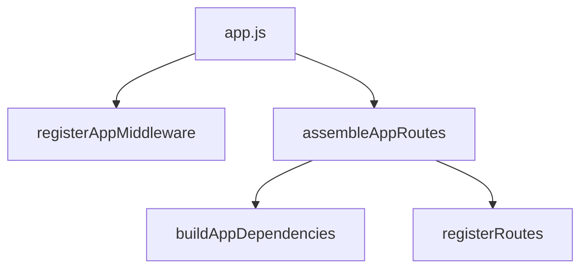

# P1 app/bootstrap 装配层瘦身方案

## 1. 背景

上一轮 P1 已经把 `Fusion` 的共用底盘抽出来了，但后端入口层还有一个典型的 P1 问题：

- `server/src/app.js` 仍然同时承担
  - 中间件挂载
  - URL 重写逻辑
  - 依赖装配触发
  - 路由注册触发

这说明它虽然已经不是“业务巨石”，但还不是一个真正轻量的入口文件。

## 2. 问题描述

| 问题 | 现象 | 风险 |
|---|---|---|
| 入口文件职责偏多 | `app.js` 同时做 middleware、rewrite、wiring | 后续改入口逻辑容易互相影响 |
| 装配逻辑分散 | 一部分在 `app.js`，一部分在 `dependencies.js` | 阅读成本高 |
| 测试定位不直观 | 想看“应用是怎么装起来的”，要跨文件来回跳 | 维护效率下降 |

## 3. 目标

把“应用装配”再明确拆成两类职责：

1. `app.js`
   - 创建 Express 实例
   - 调用装配函数
   - 保留对外导出

2. `bootstrap/appAssembly.js`
   - 中间件注册
   - URL 重写逻辑
   - 依赖装配并注册路由

## 4. 不做的事

- 不改任何 API 路径
- 不改响应结构
- 不改测试入口
- 不改现有导出名称

## 5. 目标结构

## 6. 执行步骤

1. 新增 `server/src/bootstrap/appAssembly.js`
2. 把 `app.js` 中的 URL 重写和挂载流程迁过去
3. `app.js` 改成只保留实例创建与调用
4. 运行 `npm run typescript`
5. 运行 `search / fusion / detail / env` 回归测试
6. 如有回归，立即修复

## 7. 风险与应对

| 风险 | 应对 |
|---|---|
| 中间件顺序变化 | 保持原调用顺序不变 |
| URL 重写行为漂移 | 原样搬迁，不改算法 |
| 路由未注册完整 | 用现有集成测试回归验证 |

## 8. 验收标准

| 维度 | 标准 |
|---|---|
| 结构 | `app.js` 只保留入口职责 |
| 功能 | 主链路测试通过 |
| 类型 | `npm run typescript` 通过 |
| 回归 | 不引入新的接口错误 |

## 9. 大白话总结

这一步不是改功能，而是把“应用怎么装起来”的线路图整理清楚。

整理完之后：

- 想看入口，就看 `app.js`
- 想看中间件和路由怎么挂，就看 `appAssembly.js`

这样后面继续改后端启动逻辑时，更不容易误伤别的部分。
