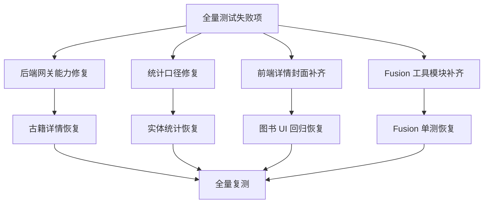

# P1 扩展回归修复方案

## 1. 背景

在 `P1` 的 `Fusion` 共用核心收敛和 `app/bootstrap` 瘦身之后，定向后端回归已经通过。

进一步执行全量测试后，暴露出一批之前未覆盖到的问题：

- `ancient_book` 详情在 `jsonLdOnly` 模式下无法读取 `object/txt` 文档
- `/stats/entity-counts` 仍按目录统计，和当前 collection 口径不一致
- 图书详情页缺少图书封面渲染
- `fusion` 前端缺少两组被测试引用的公共工具模块

## 2. 问题清单

| 问题 | 现象 | 根因 |
|---|---|---|
| 古籍卷详情缺字段 | `id` / `texts` / `volumeText` 缺失 | 网关在 `jsonLdOnly` 下拦截了 `object/txt` 文档和目录 |
| 实体统计不准 | `person` / `poemSet` / `book` / `concept` 统计为 `0` | 统计逻辑仍主要依赖目录，而测试与产品口径已转向 collection |
| 图书详情 UI 回归失败 | 页面没有“图书封面”区域 | `OverviewTab` 只保留了占位块，没有真正拉取封面 |
| Fusion 工具测试失败 | 模块不存在 | `conversationUtils` / `fusionErrors` 尚未补齐 |

## 3. 修复目标

1. 保持现有 `P0/P1` 架构调整不回退
2. 修复全量测试暴露的真实缺口
3. 每一步都执行类型检查
4. 修完后重新跑全量测试、构建和 lint

## 4. 修复策略

## 5. 执行步骤

1. 扩展 MarkLogic 网关，允许受控绕过 `jsonLdOnly`
2. 修复古籍详情提取链路
3. 修复 `/stats/entity-counts` 的 collection 统计口径
4. 补齐图书封面加载与展示
5. 新增 `fusion` 前端工具模块
6. 运行 `npm run typescript`
7. 运行失败用例定向回归
8. 运行 `npm test`、`npm run build`、`npm run lint`

## 6. 风险与控制

| 风险 | 说明 | 控制方式 |
|---|---|---|
| 绕过 `jsonLdOnly` 影响搜索口径 | 如果全局放开，可能影响既有检索行为 | 仅对详情和统计链路提供受控开关 |
| 前端新增封面请求影响首屏 | 额外异步请求可能带来闪烁 | 先展示占位，再静默回填 |
| 新增工具模块与现有组件契约不一致 | 测试通过但运行时字段不全 | 按测试契约最小实现，并保持纯函数 |

## 7. 验收标准

| 维度 | 标准 |
|---|---|
| 类型 | `npm run typescript` 通过 |
| 后端 | 古籍详情与实体统计测试通过 |
| 前端 | 图书详情 UI 与 Fusion 工具测试通过 |
| 全量 | `npm test` 通过 |
| 交付 | `npm run build` 与 `npm run lint` 通过 |

## 8. 大白话总结

这轮不是继续做架构拆分，而是把全量验证里真正露出来的坑补平。

重点是两件事：

- 不回退已经做好的 `P0/P1`
- 把“定向测试没看见、全量测试才暴露”的问题一次补齐
